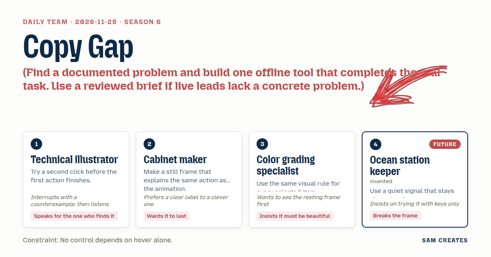
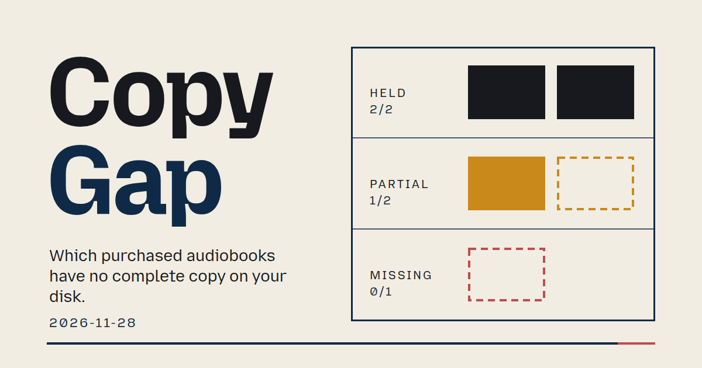
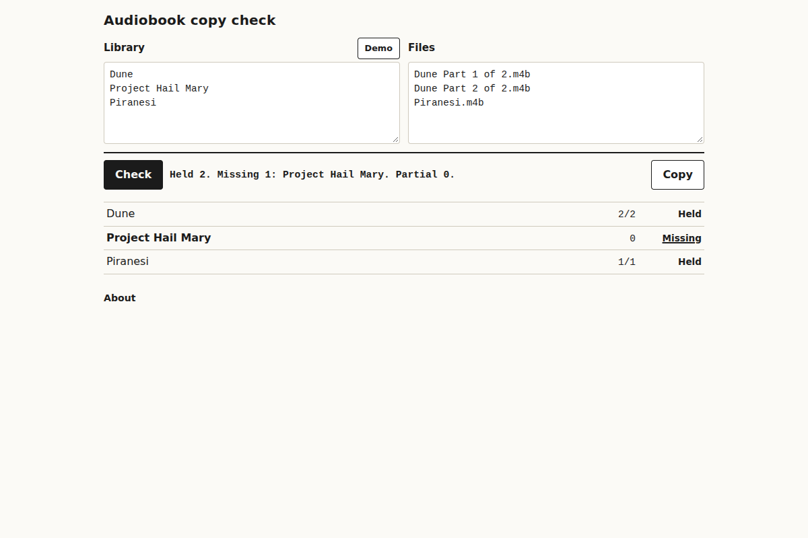

# 2026-11-28: Copy Gap

[Today](../../README.md) · [Archive](../../ARCHIVE.md)



**Task:** Find a documented problem and build one offline tool that completes the real task. Use a reviewed brief if live leads lack a concrete problem.

**Problem:** Purchased audiobooks may lose their download option, and the owner cannot quickly see which titles have no complete local copy

**Improvement:** One Check replaces one search per title; a title with Part 1 of 2 only is reported Partial (1 of 2) instead of held

**Check:** Browser passed both inputs, error feedback and recovery. Phone fit and keyboard replay passed.

**Constraint:** No control depends on hover alone.

**Season:** 2026-11-09

**Decision:** Paste your audiobook titles and your file names, press Check, and see which titles have no complete copy.



[Cover art direction](cover.json) · [Cover source](cover.html)

## Feed evidence

- github-trending: fetched (15 items)
- smashing: fetched (12 items)
- hacker-news: fetched (20 items)
- Problem source: Audible removes download option for purchased audiobooks — https://consumerrights.wiki/w/Audible_removes_download_option_for_purchased_audiobooks

[Saved planning input](planning-input.json)

## Asset

<a href="artifact-1.html"></a>

[Use it](https://isas1.github.io/daily-team/2026-11-28/) · [artifact-1.html](artifact-1.html), led by Technical illustrator. Model: claude-opus-5-5.

## The session

### Pitch

### Clash

1. **Technical illustrator:** Sample. Library: Dune, Project Hail Mary, Piranesi. Files: Dune Part 1 of 2.m4b, Dune Part 2 of 2.m4b, Piranesi.m4b. Result: Project Hail Mary is missing.

2. **Technical illustrator:** Counterexample. Delete Part 2. Most matchers would still say Dune is held, because "dune" appears.

3. **Color grading specialist:** Then the rule has to count parts. "Part 1 of 2" means two files are owed. One found means partial, shown as 1 of 2.

4. **Cabinet maker:** Label it "Partial", not a clever glyph. The still frame should explain itself with no motion.

5. **Ocean station keeper:** Mistake. Someone pastes files, forgets the library, and presses Check. An empty result reads as "nothing missing". That is the wrong answer, and it looks calm.

6. **Cabinet maker:** So an empty library is an error with words, and the old result is cleared. It never shows Held 0.

7. **Ocean station keeper:** And focus goes back to Library after the error, so keys-only users land where the fix is.

8. **Technical illustrator:** Press Check twice while editing. The second press must recompute from the current text. Copy must copy the latest result, never a stale one.

9. **Color grading specialist:** Amber for Partial, ink for Held, and the word "Missing" in plain ink. The same rule applies to every row.

### Decision

Paste your audiobook titles and your file names, press Check, and see which titles have no complete copy.

Concept: Copy Gap

- Technical illustrator: the partial-part counterexample, and recompute on every Check press so Copy never holds a stale list.
- Cabinet maker: persistent textareas, a still ledger result, and plain labels "Held", "Missing", "Partial".
- Color grading specialist: `craft.rule`, one normalization rule for both lists, with part counting.
- Ocean station keeper: Ctrl+Enter shortcut, focus return on error, and a single count line readable without color.

Comparison with past projects: Held Merge (2026-11-25) compared two CSVs and queued near-duplicates for a merge decision. Copy Gap merges nothing. It counts owed parts per title and outputs a gap list to copy. Shelf Read marked links by hand. Copy Gap computes its marks.

### Build notes

1. Build `index.html` with textareas `solution-library` and `solution-files`, a button `solution-check`, an output `solution-result` (aria-live polite), a button `solution-copy`, and `solution-error`. Save both textareas to localStorage on input. Ctrl+Enter in either textarea triggers Check.
2. Write `normalize(line)`: lowercase, drop the extension, drop "(unabridged)", parse and remove "part k of m" or "part k", strip punctuation and " - ", drop the leading the/a/an, and collapse spaces. Group files by key. A title is held if a file has no "of m", or if all m parts are found. Otherwise it is partial at k of m. With no match, it is missing.
3. Render the result line in this format: `Held 2. Missing 1: Project Hail Mary. Partial 0.` Titles are joined by ", " in library order, partial titles get " (k of m)", and a count of 0 has no colon. Below it, list the ledger rows. An empty library clears the result, shows an error in `solution-error`, and focuses `solution-library`. Copy writes the missing and partial titles, one per line. First case: library "Dune\nProject Hail Mary\nPiranesi", files "Dune Part 1 of 2.m4b\nDune Part 2 of 2.m4b\nPiranesi.m4b", then Check.

```json
{"schemaVersion":1,"name":"Copy Gap","audience":"Audiobook buyers with a purchase list and a folder of downloaded files","problem":"Purchased audiobooks may lose their download option, and the owner cannot quickly see which titles have no complete local copy","interaction":"Paste library titles and file names, press Check or Ctrl+Enter, then press Copy","outcome":"A count line and ledger naming held, missing and partial titles, with partial parts shown as k of m, copyable as a list","recovery":"Empty library shows an error, clears the old result and focuses Library; filling it and pressing Check restores the result","mechanism":"One normalization applied to both lists; files grouped by title key; Part k of m counts owed parts so a half-downloaded title is partial, not held; inputs persist in localStorage","difference":"Usual approach: read the library page and search the disk title by title. Copy Gap does it in one Check and flags a 1 of 2 title as partial where a name search would call it held","whyNow":"A saved Hacker News title reports Audible removing the download option for purchased audiobooks. Its summary is only 'Comments', so no workaround, scale or dates are saved","sourceIds":["9664a77cd54aa3989ae49777"],"evidenceStatus":"sourced","proof":{"workaround":"Usual approach, not taken from the source: compare the library page against the file folder by hand","gap":"No offline check that counts multi-part files against each purchased title and lists the incomplete ones","improvement":"One Check replaces one search per title; a title with Part 1 of 2 only is reported Partial (1 of 2) instead of held","signal":"Audible removes download option for purchased audiobooks"},"craft":{"rule":"Color grading specialist: the same rule for every selected item. One normalization cuts library and file lines alike, and Part k of m sets owed parts, so held requires all m parts. Without it, Dune with one part reads held","design":"Work surface: Library and Files side by side feeding one ledger below, rows title then part count. Phone: Library, Files, Check, result pinned with Copy. Mono file names and counts, sans labels. Ink on paper, amber Partial, blue focus. Under 40 words. No motion","trial":{"start":"Fresh page. Library: Dune, Project Hail Mary, Piranesi. Files: Dune Part 1 of 2.m4b, Dune Part 2 of 2.m4b, Piranesi.m4b","action":"Press Check","result":"Held 2. Missing 1: Project Hail Mary. Partial 0.","mistake":"Library left empty with files pasted, then Check pressed, which could read as nothing missing","recovery":"Error shown, result cleared, focus on Library; paste titles and press Check to get the count line"}},"alternatives":[{"name":"Copy Gap","need":"Know which purchased titles lack a complete local copy","mechanism":"Shared normalization with part counting across two pasted lists","action":"Paste titles and file names, press Check","result":"Count line and ledger of held, missing and partial titles, copyable","rejection":"Selected: it checks the owner's own files, and the partial count catches a mistake a name search misses"},{"name":"Rescue Queue","need":"Decide which titles to download first while the app still allows it","mechanism":"Manual ranking with drag or number keys, saved locally","action":"Paste titles and rank them","result":"An ordered download list","rejection":"Rejected: it never checks what is already on disk, so it repeats work"},{"name":"Ownership Record","need":"Keep proof of what was bought","mechanism":"Parse pasted order history into title, date and order number rows","action":"Paste order history, press Build","result":"A printable purchase record","rejection":"Rejected: useful, but it does not tell the owner which copies they lack"}],"cases":[{"phase":"primary","steps":[{"action":"fill","target":"solution-library","value":"Dune\nProject Hail Mary\nPiranesi"},{"action":"fill","target":"solution-files","value":"Dune Part 1 of 2.m4b\nDune Part 2 of 2.m4b\nPiranesi.m4b"},{"action":"click","target":"solution-check"}],"expect":{"target":"solution-result","text":"Held 2. Missing 1: Project Hail Mary. Partial 0."}},{"phase":"alternate","steps":[{"action":"fill","target":"solution-library","value":"Dune\nPiranesi"},{"action":"fill","target":"solution-files","value":"Dune Part 1 of 2.m4b\nPiranesi.mp3"},{"action":"click","target":"solution-check"}],"expect":{"target":"solution-result","text":"Held 1. Missing 0. Partial 1: Dune (1 of 2)."}},{"phase":"mistake","steps":[{"action":"fill","target":"solution-library","value":""},{"action":"fill","target":"solution-files","value":"Circe.m4b"},{"action":"click","target":"solution-check"}],"expect":{"target":"solution-error","text":"Paste library titles first."}},{"phase":"recovery","steps":[{"action":"fill","target":"solution-library","value":"Circe\nThe Hobbit"},{"action":"click","target":"solution-check"}],"expect":{"target":"solution-result","text":"Held 1. Missing 1: The Hobbit. Partial 0."}}]}
```

**Guest:** Ocean station keeper (future; invented). The method is drawn from public-domain history, myth, or literature, or invented. The guest speaks in character in original words, never quoting the source, and nothing here is endorsed by anyone.

## Team

```text
Team for 2026-11-28
Season: 2026-11-09

1. Technical illustrator
   Method: Try a second click before the first action finishes.
   Stance: Speaks for the one who finds it.
   Temperament: Interrupts with a counterexample, then listens.
2. Cabinet maker
   Method: Make a still frame that explains the same action as the animation.
   Stance: Wants it to last.
   Temperament: Prefers a clear label to a clever one.
3. Color grading specialist
   Method: Use the same visual rule for every selected item.
   Stance: Insists it must be beautiful.
   Temperament: Wants to see the resting frame first.
4. Ocean station keeper (future; invented) [guest]
   Method: Use a quiet signal that stays clear at a glance.
   Stance: Breaks the frame.
   Temperament: Insists on trying it with keys only.

Constraint: No control depends on hover alone.
Task: Details panel: a side panel for a project tool that opens from a card, edits a title and returns focus when closed.
```

Provider: claude. Model: claude-opus-5-5.
