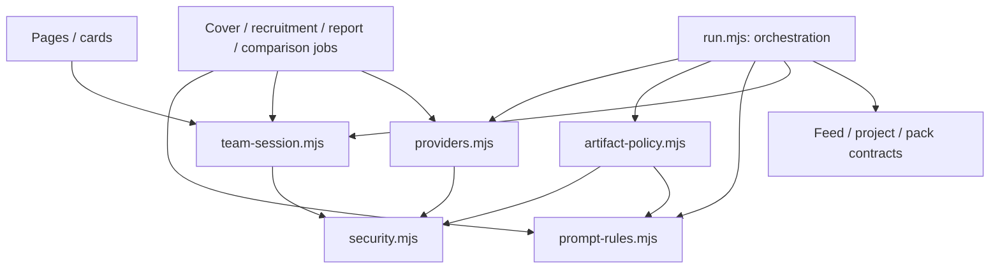

# Code structure

Reviewed 17 November 2026.

Plain Node ESM, shell team picker, file records. No framework or new package needed.

## Review and fixes

| Priority | Finding | Change |
|---|---|---|
| P2 | Pages, cards, covers, reports, recruitment, comparisons and studio tools loaded the generation CLI for shared helpers. | Move shared code into four modules; route production imports straight to owners. |
| P2 | `prepareProvider()` called `process.exit()`. Library callers could not catch bad config. Unknown providers fell through to Claude. | Throw config errors with `exitCode: 2`; CLI handles exit. Reject unknown providers. |
| P2 | OpenRouter endpoint and model list froze at import time. Later config changes could send calls to old endpoint/model. | Resolve config at each call. Mock tests cover two calls with changed config. |
| P3 | No check kept shared code below orchestration. | Add dependency graph guard, cycle check, export compatibility check, and provider regression tests to CI. |
| P1 | Interrupted builds could leave partial JSON; saved `building` days were skipped. Force deleted old assets before new output existed. | Add atomic file writes, one day lock, staged builds, resume from valid saved plan/assets, and guarded final swap. |

`run.mjs` retains its earlier named exports. Production code imports shared helpers from their owning modules.

## Module map

| Module | Owns | Boundary |
|---|---|---|
| `run.mjs` | CLI args, mode choice, discovery, plan/build sequence, day records | Coordinates modules; no production module imports it |
| `run-state.mjs` | Day lock, atomic writes, backup recovery, staged swap | File operations only; no model calls |
| `team-session.mjs` | Date/team helpers, transcript parsing, titles, session checks, referee fallback | Referee receives `complete`; no provider import |
| `prompt-rules.mjs` | `prompt.md` sections and banned-word checks | File read only when called |
| `artifact-policy.mjs` | HTML checks, size limits, CSP, verified vendor embedding | No model calls or record writes |
| `providers.mjs` | Claude/OpenRouter adapters, credentials, model fallback, validation retry | Returns text/model or throws; never exits host |
| `security.mjs` | Plain-text extraction, Markdown escaping, credential redaction | Shared leaf helpers |
| `feed-planning.mjs` | Bounded discovery, cache, saved planning input | Source data enters as untrusted reference text |
| `project-planning.mjs`, `component-pack.mjs` | Plan contracts, evidence/hash checks, export gates | Preserve historical record formats |
| `publish.mjs`, `card.mjs`, `cover.mjs` | Record pages, team cards, cover commission | Consume shared rules directly |
| `recruit.mjs`, `report.mjs`, `compare.mjs` | Separate jobs with own CLI boundaries | Share model adapters and domain helpers |
| `sim/` | Optional studio simulation and live replay | The live viewer follows the staged log through publication |



Diagram shows shared-code direction, not every import. Publishing still imports season readers from `recruit.mjs` and cover state from `cover.mjs`; those files retain guarded CLI entry points. Shared extraction does not make publishing fully independent from job modules.

## Preserved contracts

- New artifacts record a SHA-256 hash so interrupted runs can verify saved assets. Earlier records still export under their original contract.
- `complete(messages, maxTokens)` returns text and model. Claude also returns `costUsd` for studio metering and takes an optional third model argument.
- Credential failures retain CLI exit code 2. Other uncaught run/recruit failures get redacted diagnostics and exit code 1.
- OpenRouter model fallback and two attempts for rate limits stay bounded. Content validation retries once.
- CLI flags, default models, sandbox rules, and vendor checks stay unchanged. Runs now write `.<date>.pending` and publish only after completion.

## Remaining work, ranked

1. **P2 — bounded provider output.** Claude stdout/stderr accumulate without byte caps. Timeout bounds elapsed time, not memory. Add output limits and deterministic stream/process cleanup with oversized-output and early-exit fixtures.
2. **P2 — isolate publication reads.** Move season reading and cover receipt checks into small data modules when touching those jobs next. Keep rendering separate from record writes; preserve export hash gates.
3. **P3 — uniform test discovery.** CI runs all suites, while some job workflows still list narrower checks. Keep one documented test command and align other workflows when changing their job scopes.

Interrupted local run: rerun same date and settings. Saved plan and hashed artifacts resume; missing last asset rebuilds. A completed stage swaps with no model call. Studio runs reuse saved plans and logs. The optional draft review runs when the studio session is still in memory. Use `--force` to start a new plan. A failed forced run leaves old published day intact and keeps staged evidence. Dead writer lock clears on next run if its PID is gone; ambiguous lock ownership needs manual review. Crash during final directory swap leaves a backup restored on next run. This gives recoverable local runs, not a transaction across publication readers; an abrupt stop between the two renames can briefly hide the day. GitHub Actions does not persist the hidden staging directory across fresh jobs.

No concurrent callers should mutate process-wide provider env during an active call. Per-call config removes import-order coupling; fully isolated parallel providers would need explicit config objects.

## Checks

```sh
node --test test.mjs *.test.mjs
git diff --check
```

Tests cover mocked provider calls, saved records, export hash gates, credential redaction, source checks, and publication output. Architecture guard covers static relative ESM imports. Tests do not prove live provider availability or browser quality.
