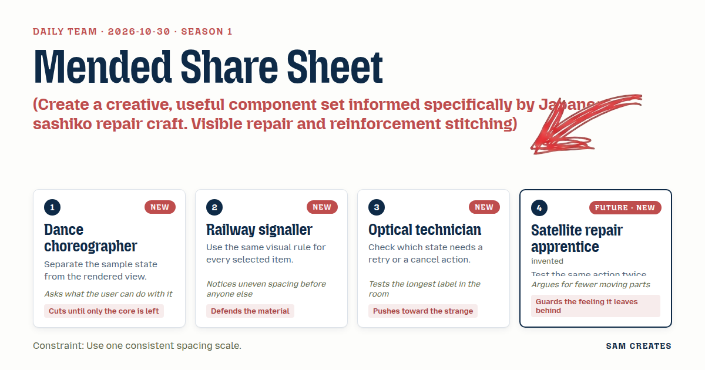
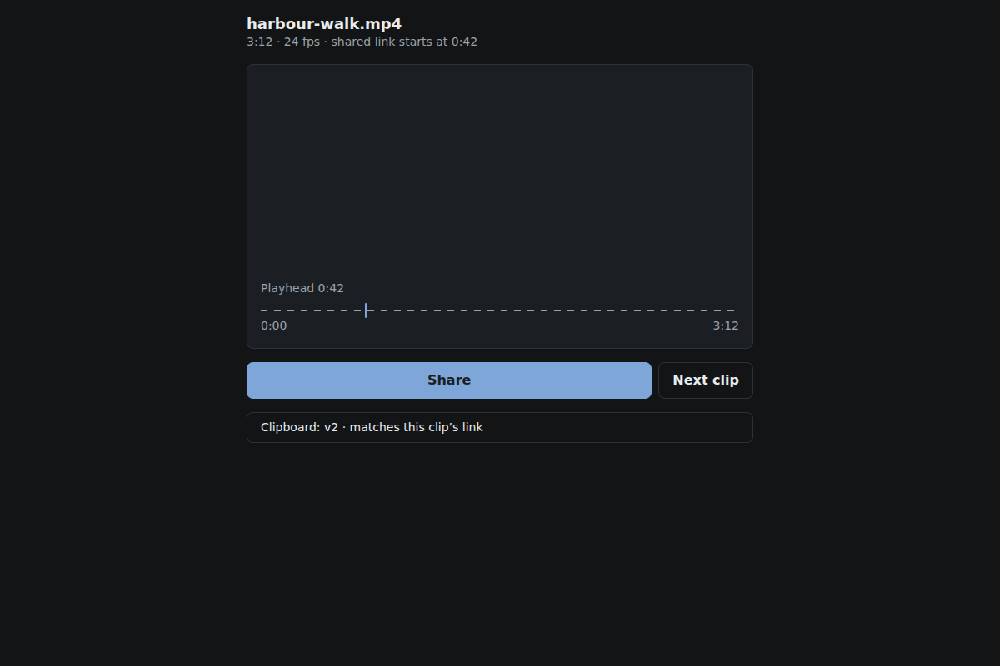
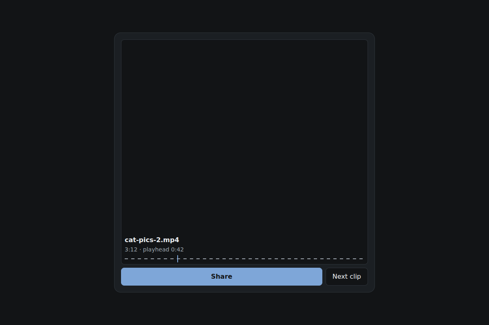
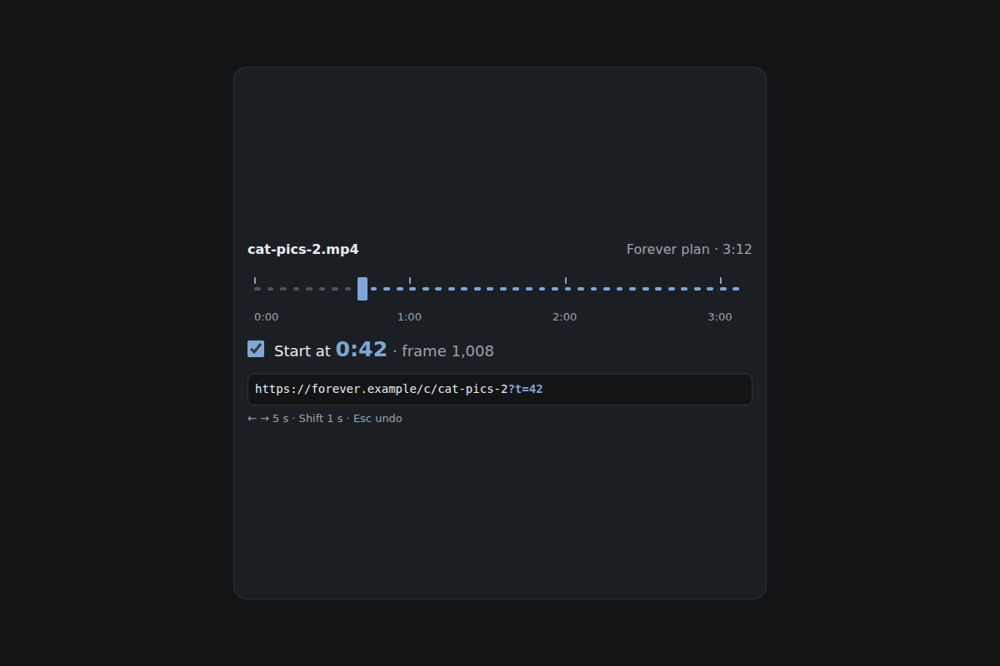
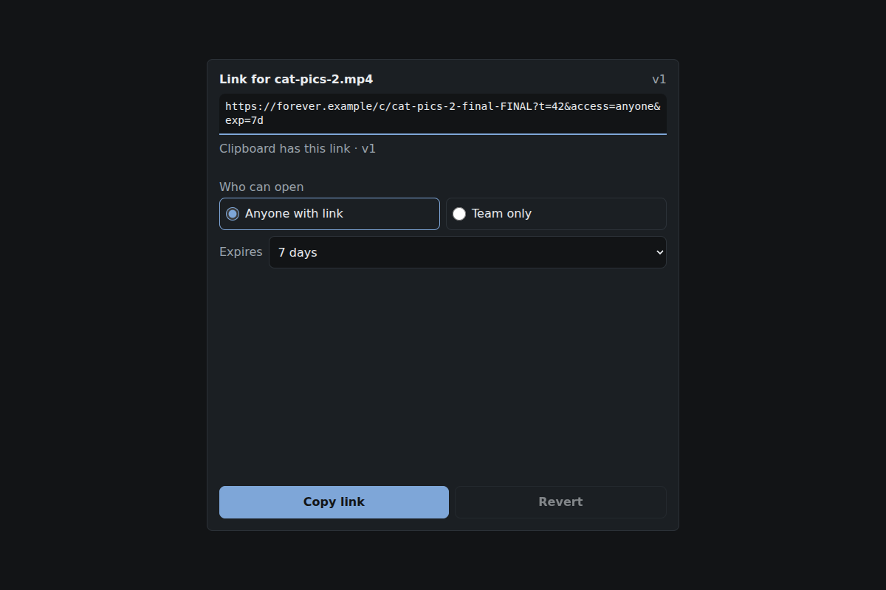
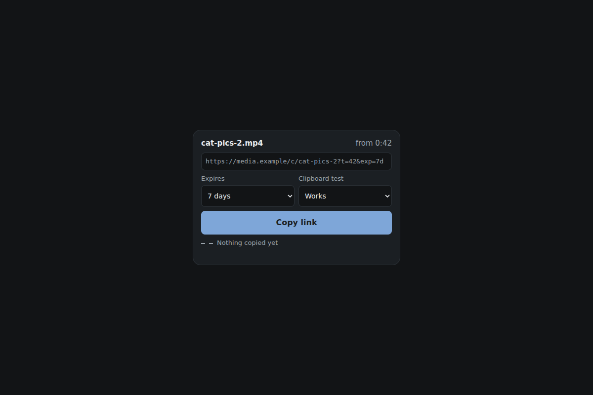
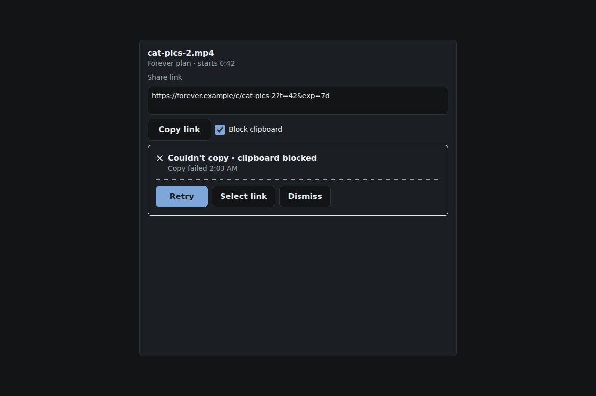
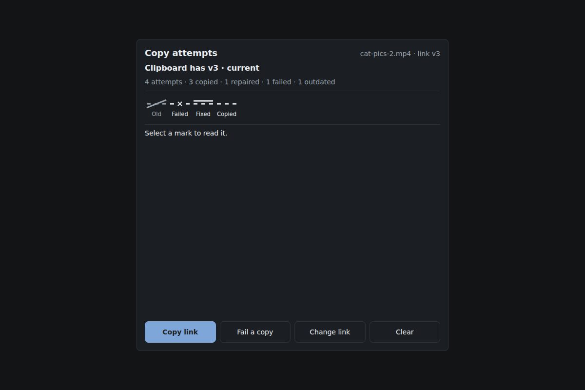

# 2026-10-30: Mended Share Sheet

[Today](../../README.md) · [Archive](../../ARCHIVE.md)



**Task:** Create a creative, useful component set informed specifically by Japanese sashiko repair craft. Visible repair and reinforcement stitching: repairable workflows, measured repeated marks and honest progress. Translate craft principles into distinct interactions, not decorative stereotypes. Use original work, avoid sacred imagery and claims of cultural authenticity. Cite https://www.vam.ac.uk/dundee/whatson/events/stitch-style-sashiko.

**Constraint:** Use one consistent spacing scale.

**Season:** 2026-10-26

**Decision:** The team builds a share sheet for a clip editor where a visitor sets a start point and access, copies the link, and sees any clipboard failure stay visible until it is repaired by retry or manual selection.


[Cover art direction](cover.json) · [Cover source](cover.html)

## Feed evidence

- all: culture-brief
- No feed article recorded as used; fetched items may have been considered without selection.
- Chosen opportunity: daily-task. The explicit brief supplies the sashiko culture lane, and the team task supplies the share sheet. Visible repair maps directly onto clipboard failure, which share panels usually hide.

[Saved planning input](planning-input.json)

## Asset

[Pack manifest](pack.json) · [Shared tokens](tokens.json) · [Planning input](planning-input.json)

Generated candidates require human review. Library acceptance: unreviewed.

<a href="piece.html"></a>

[Use it](https://isas1.github.io/daily-team/editions/culture/2026-10-30/) · [piece.html](piece.html), led by Dance choreographer. Model: claude-opus-5-5.

<a href="artifact-1.html"></a>

[Use it](https://isas1.github.io/daily-team/editions/culture/2026-10-30/) · [artifact-1.html](artifact-1.html), led by Dance choreographer. Model: claude-opus-5-5.

<a href="artifact-2.html"></a>

[Use it](https://isas1.github.io/daily-team/editions/culture/2026-10-30/) · [artifact-2.html](artifact-2.html), led by Railway signaller. Model: claude-opus-5-5.

<a href="artifact-3.html"></a>

[Use it](https://isas1.github.io/daily-team/editions/culture/2026-10-30/) · [artifact-3.html](artifact-3.html), led by Optical technician. Model: claude-opus-5-5.

<a href="artifact-4.html"></a>

[Use it](https://isas1.github.io/daily-team/editions/culture/2026-10-30/) · [artifact-4.html](artifact-4.html), led by Satellite repair apprentice. Model: claude-opus-5-5.

<a href="artifact-5.html"></a>

[Use it](https://isas1.github.io/daily-team/editions/culture/2026-10-30/) · [artifact-5.html](artifact-5.html), led by Dance choreographer. Model: claude-opus-5-5.

<a href="artifact-6.html"></a>

[Use it](https://isas1.github.io/daily-team/editions/culture/2026-10-30/) · [artifact-6.html](artifact-6.html), led by Railway signaller. Model: claude-opus-5-5.

## The session

### Pitch

### Clash

**3 · Optical technician:** The tear is the point. Failure should look like damage.

**4 · Satellite repair apprentice:** A tearing sheet moves the whole frame on every failure. That's three animations for one blocked clipboard. The feeling it leaves is alarm.

**1 · Dance choreographer:** Agreed. And the ledger. Does a user need history for a copy button?

**2 · Railway signaller:** Yes. Change the expiry after copying and the link on your clipboard is stale. The ledger shows that mark struck through. That is the material. Don't cut it.

**3 · Optical technician:** Then the notice and the ledger overlap. Both say "failed".

**1 · Dance choreographer:** Split them. The notice holds the current attempt and offers Retry or Select link. The ledger holds the past and offers nothing but reading.

**4 · Satellite repair apprentice:** Then the second copy of the same link should say "Copied again · same link". Two presses, one honest answer.

**2 · Railway signaller:** And the start picker uses the same dash unit as the ledger, 5 seconds per tick. One rule for every mark.

### Decision

The team builds a share sheet for a clip editor where a visitor sets a start point and access, copies the link, and sees any clipboard failure stay visible until it is repaired by retry or manual selection.

Concept: Mended Share Sheet

The choreographer set the boundary: one sample state object (`clip`, `startSec`, `access`, `expiry`, `attempts[]`) and six views that render from it. The signaller brought the sashiko reference as a rule of measured, repeated, visible marks. That rule became a single 8px dash unit shared by the start ticks and the ledger, with no decorative patterns. The optical technician supplied the state audit: every failing state names its Retry or Cancel path, and the link field is tested with a 140-character URL. The apprentice supplied the double-press check and the manual-select fallback, and argued the tearing frame out.

Rejected direction: the torn-and-stitched sheet. It moved the frame on every failure and turned a clipboard error into spectacle. Its useful core survived as the repair notice's overstitched rule.

Reference: V&A Dundee, Stitch Style: Sashiko (https://www.vam.ac.uk/dundee/whatson/events/stitch-style-sashiko). The pack is informed by sashiko repair as a visible, repeated mark. It claims no cultural authenticity and uses no sacred imagery or traditional pattern motifs. No component_source was supplied. The bottom-sheet idea bank entry informed row 1 as an idea only. No code was copied.

Why six: each row answers a separate question. Where does the panel sit (1)? Where does playback start (2)? Who can open the link, and for how long (3)? Did the copy run (4)? What happened when it failed (5)? What has been copied so far (6)? Removing any row drops one of those answers. Adding a seventh, such as share targets, would duplicate row 4.

```json
{
  "schemaVersion": 1,
  "categoryVersion": 1,
  "id": "mended-share-sheet",
  "name": "Mended Share Sheet",
  "description": "A bottom share panel for a clip editor that sets a start point and access, copies a link, keeps clipboard failures visible until repaired and records each attempt as a measured mark.",
  "project": "Share sheet for a media tool, informed by sashiko repair as visible, measured, repeated marks.",
  "sizeRationale": "Six rows cover panel placement, start time, link options, the copy action, failure repair and attempt history. Each answers one visitor question, and none renames another.",
  "opportunities": [
    {
      "id": "daily-task",
      "need": "A share panel that copies a media link, reports clipboard failure honestly and closes by swipe, button or Escape.",
      "use": "An editor shares a clip at 0:42 with a reviewer and knows whether the link on the clipboard is current.",
      "interaction": "Visible repair: a failed copy stays on screen until retry or manual selection succeeds. Each attempt leaves one even mark.",
      "similarity": "Near 2026-10-27 pipeline retry and 2026-10-29 cancel import. Those retried or rolled back jobs. This records a repaired user action and flags stale copies after option changes."
    }
  ],
  "selection": {
    "id": "daily-task",
    "rationale": "The explicit brief supplies the sashiko culture lane, and the team task supplies the share sheet. Visible repair maps directly onto clipboard failure, which share panels usually hide."
  },
  "tokens": {
    "colors": {
      "dark": { "bg": "#121416", "surface": "#1b1f23", "text": "#e9ecef", "muted": "#9aa3ab", "accent": "#7ea6d8", "border": "#2c3238" },
      "light": { "bg": "#f6f7f8", "surface": "#ffffff", "text": "#16191c", "muted": "#5b6570", "accent": "#2f5f9e", "border": "#d6dbe0" }
    },
    "typography": { "family": "system-ui, -apple-system, \"Segoe UI\", Roboto, sans-serif", "size": "16px" },
    "spacing": { "gap": "8px", "padding": "16px" },
    "radii": { "control": "8px" },
    "motion": { "duration": "200ms", "easing": "ease-out" }
  },
  "components": [
    {
      "row": 1,
      "id": "share-sheet-frame",
      "file": "artifact-1.html",
      "name": "Share sheet frame",
      "description": "Bottom panel with half and full snap points that closes by swipe, Close button or Escape and returns focus to its trigger.",
      "category": "Layout",
      "tags": ["bottom-sheet", "dialog", "swipe", "snap-points", "focus-return", "escape-key"],
      "purpose": "Hold the share controls at thumb height without leaving the editor.",
      "use": "An editor taps Share under harbour-walk.mp4, expands the sheet to full, then swipes it down.",
      "input": "Tap Share to open. Drag the handle or swipe down to close. Keyboard: the handle is a button where Enter or Space toggles half and full. Escape or the Close button closes.",
      "outcome": "The sheet settles at 50% or 92% height, or closes. On close, focus returns to the Share trigger.",
      "recovery": "A drag released under 30% travel at under 0.5 px/ms springs back to its snap point. Closing keeps the chosen options until the clip changes.",
      "mechanism": "A native dialog opened with showModal. Pointer events with setPointerCapture translate the panel on Y only. Snap uses travel plus release velocity. The panel renders from the shared state object and owns no copy logic.",
      "nearestAnalogue": "None in recent dates. The bottom-sheet idea bank entry is the ancestor; only its snap idea is kept.",
      "usefulness": "Share is a short task inside editing, and a bottom panel keeps the timeline visible behind it.",
      "creativeDifference": "Every drag path has a button or key twin, so no snap point is drag-only.",
      "states": [
        "closed: not rendered, reached on load and after close",
        "half: 50% height, reached on open",
        "full: 92% height, reached by dragging up or Enter on the handle",
        "dragging: follows the pointer with no transition",
        "closing: 200ms ease-out slide, reached by swipe, Close or Escape",
        "narrow: at 320px width, controls stack in one column with 16px padding",
        "reduced-motion: snaps without sliding",
        "focus: 2px ring on the handle and Close"
      ],
      "sources": [{ "title": "ARIA Authoring Practices: Dialog (Modal)", "url": "https://www.w3.org/WAI/ARIA/apg/patterns/" }]
    },
    {
      "row": 2,
      "id": "start-point-ticks",
      "file": "artifact-2.html",
      "name": "Start point ticks",
      "description": "Clip-length strip of 5-second ticks that sets where the shared link starts playing.",
      "category": "Media",
      "tags": ["media", "start-time", "slider", "ticks", "timestamp"],
      "purpose": "Choose the moment the recipient sees first.",
      "use": "An editor sets 0:42 so the reviewer lands on the harbour crossing.",
      "input": "Click, tap or drag along the strip. Keyboard: Tab to the slider. Left and Right step 5 s, Shift with an arrow steps 1 s, Home and End jump to 0:00 and 3:10. A checkbox labelled Start at 0:42 includes or omits the time.",
      "outcome": "The link gains t=42 and the label reads 'Start at 0:42 · frame 1,008'.",
      "recovery": "Unchecking removes t from the link but keeps the chosen time, so checking again restores it.",
      "mechanism": "A native input type=range with step=1 and a 5 s keyboard step. Ticks are drawn from one dash unit of 8px dash and 8px gap, one per 5 s, matching row 6.",
      "nearestAnalogue": "2026-10-28 cursor chart snaps to measured samples. This snaps to fixed time units and writes the result into a URL.",
      "usefulness": "Sending a 3:12 clip without a start point makes the reviewer hunt for the moment.",
      "creativeDifference": "The ticks are the measured repeated mark, so the scale is readable without numbers.",
      "states": [
        "default: 0:00, checkbox off, reached on load",
        "set: thumb on a tick with time label",
        "included: checkbox on, link shows t",
        "focus: 2px ring on the thumb",
        "end-clamped: 3:10 maximum, reached by End"
      ],
      "sources": [
        { "title": "ARIA Authoring Practices: Slider", "url": "https://www.w3.org/WAI/ARIA/apg/patterns/" },
        { "title": "V&A Dundee: Stitch Style: Sashiko", "url": "https://www.vam.ac.uk/dundee/whatson/events/stitch-style-sashiko" }
      ]
    },
    {
      "row": 3,
      "id": "link-options-field",
      "file": "artifact-3.html",
      "name": "Link options field",
      "description": "Read-only link with access and expiry options that flags when the copied link no longer matches.",
      "category": "Inputs",
      "tags": ["link", "access", "expiry", "radio-group", "read-only", "stale-state"],
      "purpose": "Set who can open the link and for how long.",
      "use": "An editor switches from Anyone with link to Team only after copying and sees the note 'Link changed since last copy'.",
      "input": "Tap a radio for Anyone with link or Team only, and choose an expiry of 1 day, 7 days or Never from a native select. Keyboard: arrows inside the radio group, Tab to the select. Focusing the link selects all text.",
      "outcome": "The link regenerates from state, for example https://media.example/c/hw-31k?t=42&exp=7d.",
      "recovery": "Reverting an option restores the earlier link and clears the stale note. The field never truncates. Long URLs wrap at a wbr after each slash, question mark and ampersand.",
      "mechanism": "The link is derived from state, never edited directly. A linkVersion counter increments on each change and is compared with the version of the last successful copy.",
      "nearestAnalogue": "2026-10-28 range selector reverts on cancel. This field tracks drift between the current value and what the clipboard holds.",
      "usefulness": "A stale copied link is a common silent share error.",
      "creativeDifference": "The field shows whether the clipboard still agrees with the screen.",
      "states": [
        "default: Anyone with link, 7 days",
        "changed: new link version, reached by any option change",
        "stale: 'Link changed since last copy', reached by a change after a copy",
        "long: 140-character link wraps to three lines at 320px",
        "focus: 2px ring and text selected"
      ],
      "sources": [{ "title": "ARIA Authoring Practices: Radio Group", "url": "https://www.w3.org/WAI/ARIA/apg/patterns/" }]
    },
    {
      "row": 4,
      "id": "copy-link-button",
      "file": "artifact-4.html",
      "name": "Copy link button",
      "description": "Native button that copies the current link with a reserved-width label and an honest second-press result.",
      "category": "Actions",
      "tags": ["button", "clipboard", "copy", "pending", "dedupe", "timeout"],
      "purpose": "Put the current link on the clipboard and say whether it worked.",
      "use": "An editor copies, then copies again before pasting, and reads 'Copied again · same link'.",
      "input": "Click or tap Copy link. Keyboard: Tab to it, Enter or Space.",
      "outcome": "Success reads 'Copied'. A repeat with the same link version reads 'Copied again · same link'. A repeat after a change reads 'Copied · new link'.",
      "recovery": "Presses while pending are ignored. A copy pending over 3000 ms counts as failed and hands off to row 5.",
      "mechanism": "navigator.clipboard.writeText raced against a 3000 ms timeout. A demo toggle forces rejection. Labels swap inside a width reserved for the longest label, 'Copied again · same link'.",
      "nearestAnalogue": "2026-10-28 pin pair swaps labels in a reserved width. This adds pending, timeout and version-aware repeat results.",
      "usefulness": "This button is the core task of the sheet.",
      "creativeDifference": "A second press reports whether the link changed, so pressing twice is a check rather than noise.",
      "states": [
        "idle: 'Copy link'",
        "pressed: 1px sink, reached on pointer or key down",
        "copying: disabled, 'Copying'",
        "copied: 'Copied'",
        "repeat: 'Copied again · same link' or 'Copied · new link'",
        "failed: label returns to 'Copy link' and row 5 shows",
        "focus: 2px ring"
      ],
      "sources": [{ "title": "ARIA Authoring Practices: Button", "url": "https://www.w3.org/WAI/ARIA/apg/patterns/" }]
    },
    {
      "row": 5,
      "id": "copy-repair-notice",
      "file": "artifact-5.html",
      "name": "Copy repair notice",
      "description": "Failure notice that stays until repaired by retry or manual selection, then remains as a one-line repair record.",
      "category": "Feedback",
      "tags": ["error", "retry", "fallback", "live-region", "repair", "clipboard"],
      "purpose": "Report a clipboard failure and keep it visible until it is fixed.",
      "use": "Clipboard access is blocked in an embedded browser. The editor taps Select link, presses Ctrl+C, and reads 'Copy failed 14:02 · repaired by hand 14:03'.",
      "input": "Tap Retry, Select link or Dismiss. Keyboard: Tab to each, Enter or Space. After Select link, Ctrl+C or Cmd+C in the field completes the repair.",
      "outcome": "Failure shows 'Couldn't copy · clipboard blocked'. A repair replaces it with one line over a dashed rule, which gains an overstitched solid segment.",
      "recovery": "Retry disables while pending. A second failure promotes Select link to the first button. Dismiss hides the notice and logs the attempt as failed in row 6.",
      "mechanism": "role=alert on failure and a polite live region on repair. A copy event listener on the link field detects manual copies. The rule is two stacked SVG dash lines using the shared 8px unit.",
      "nearestAnalogue": "2026-10-27 pipeline panel retry and 2026-10-28 load stages failure. Those retry jobs. This offers a manual path and keeps the repair visible.",
      "usefulness": "Silent clipboard failure leads to pasting an old link.",
      "creativeDifference": "The failure is mended in place. The repair stays as a record and is never erased.",
      "states": [
        "hidden: no failure this session",
        "failed: message with Retry, Select link and Dismiss",
        "retrying: Retry disabled, 'Retrying'",
        "failed-again: '2nd attempt failed', Select link first",
        "repaired-retry: 'repaired by retry' line",
        "repaired-manual: 'repaired by hand' line",
        "dismissed: hidden, attempt logged as failed",
        "reduced-motion: overstitch appears without drawing"
      ],
      "sources": [
        { "title": "ARIA Authoring Practices: Alert", "url": "https://www.w3.org/WAI/ARIA/apg/patterns/" },
        { "title": "V&A Dundee: Stitch Style: Sashiko", "url": "https://www.vam.ac.uk/dundee/whatson/events/stitch-style-sashiko" }
      ]
    },
    {
      "row": 6,
      "id": "share-attempt-ledger",
      "file": "artifact-6.html",
      "name": "Share attempt ledger",
      "description": "Row of even marks, one per copy attempt, with a readable list of time, link version and result.",
      "category": "Data",
      "tags": ["ledger", "history", "attempts", "listbox", "non-color-state", "stale-state"],
      "purpose": "Show what has been copied this session and whether it is still current.",
      "use": "An editor reads '4 attempts · 3 copied · 1 repaired · 1 outdated' before pasting into chat.",
      "input": "Click or tap a mark to show its detail. Keyboard: Tab into the list, Left and Right or Up and Down move, Home and End jump, Enter shows detail.",
      "outcome": "Detail reads '14:03 · v3 · Team only, 7 days, t=42 · repaired by retry'.",
      "recovery": "Clear ledger empties it and shows Undo for 5 s. Earlier marks beyond 12 collapse into '+n earlier'.",
      "mechanism": "An append-only attempts array in shared state. Each mark uses one shape rule: solid dash for copied, gap with a cross for failed, dash with overstitch for repaired, and strike for outdated. Each mark pairs with a word. Roving tabindex listbox.",
      "nearestAnalogue": "2026-10-26 log viewer event list. That list filters many event types. This one records one action's attempts against link versions.",
      "usefulness": "It answers whether the clipboard still matches the screen, after the notice is gone.",
      "creativeDifference": "Progress is counted as real attempts in one even rule. Nothing is estimated.",
      "states": [
        "empty: 'No copies yet'",
        "copied: solid dash",
        "failed: gap with cross",
        "repaired: dash with overstitch",
        "outdated: struck mark, reached by an option change after copy",
        "selected: detail line shown",
        "overflow: '+n earlier' after 12 marks",
        "cleared: Undo available for 5 s",
        "focus: 2px ring on the mark"
      ],
      "sources": [
        { "title": "ARIA Authoring Practices: Listbox", "url": "https://www.w3.org/WAI/ARIA/apg/patterns/" },
        { "title": "V&A Dundee: Stitch Style: Sashiko", "url": "https://www.vam.ac.uk/dundee/whatson/events/stitch-style-sashiko" }
      ]
    }
  ],
  "demo": {
    "file": "piece.html",
    "rows": [1, 2, 3, 4, 5, 6],
    "sharedState": "One state object for harbour-walk.mp4 (3:12): startSec 42, includeStart, access, expiry, linkVersion and attempts[]. Row 1 renders the panel. Rows 2 and 3 write link fields and bump linkVersion. Row 4 reads the link and appends an attempt. Row 5 resolves failed attempts to repaired. Row 6 renders attempts and marks any copied version below the current linkVersion as outdated. A demo toggle forces clipboard rejection."
  }
}
```

### Build notes

1. Use one spacing scale of 4, 8, 16, 24 and 32px. The 8px dash unit in rows 2, 5 and 6 comes from the same `--space-2` variable as the gap token.
2. Put state in `state.js` with a `subscribe` function. Each artifact file mounts its own view against a local copy of the sample state, so it works alone, and `piece.html` passes one shared instance to all six.
3. Test each action twice: copy, copy, change expiry, copy, force failure, retry, force failure twice, then Select link and Ctrl+C. Check labels at 320px using the 140-character URL and the label 'Copied again · same link'.

**Guest:** Satellite repair apprentice (future; invented). The method is drawn from public-domain history, myth, or literature, or invented. The guest speaks in character in original words, never quoting the source, and nothing here is endorsed by anyone.

## Team

```text
Team for 2026-10-30
Season: 2026-10-26

1. Dance choreographer [new]
   Method: Separate the sample state from the rendered view. [new]
   Stance: Cuts until only the core is left.
   Temperament: Asks what the user can do with it.
2. Railway signaller [new]
   Method: Use the same visual rule for every selected item. [new]
   Stance: Defends the material.
   Temperament: Notices uneven spacing before anyone else.
3. Optical technician [new]
   Method: Check which state needs a retry or a cancel action. [new]
   Stance: Pushes toward the strange.
   Temperament: Tests the longest label in the room.
4. Satellite repair apprentice (future; invented) [guest] [new]
   Method: Test the same action twice before trusting it.
   Stance: Guards the feeling it leaves behind.
   Temperament: Argues for fewer moving parts.

Constraint: Use one consistent spacing scale.
Task: Share sheet: a bottom panel for a media tool that copies a link, reports failure and closes with a swipe, button or key.
```

Provider: claude. Model: claude-opus-5-5.
