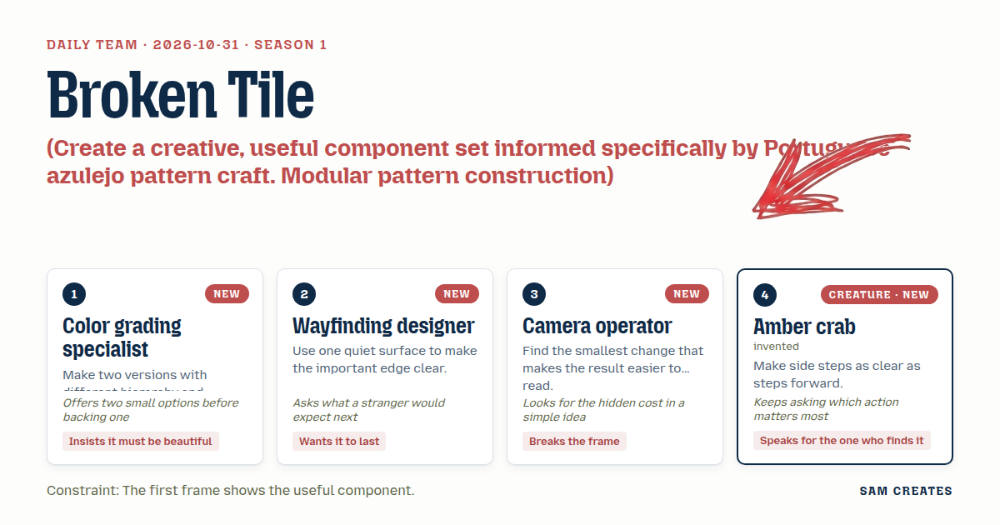
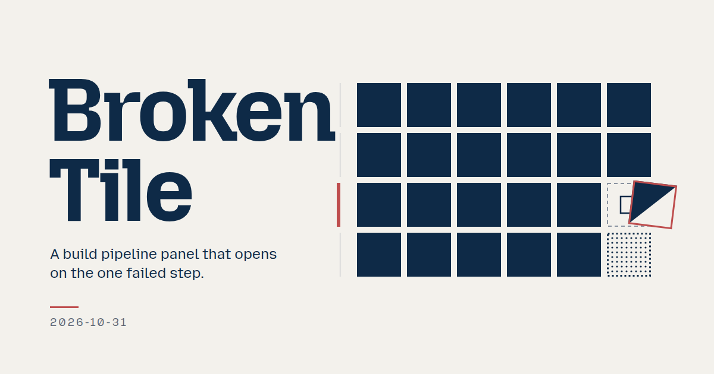
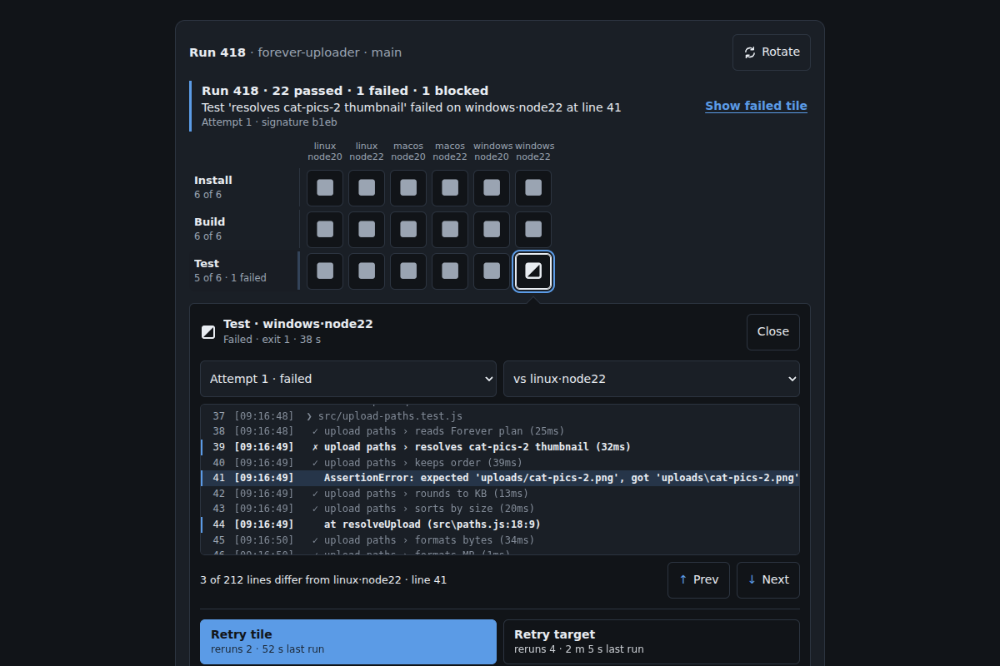
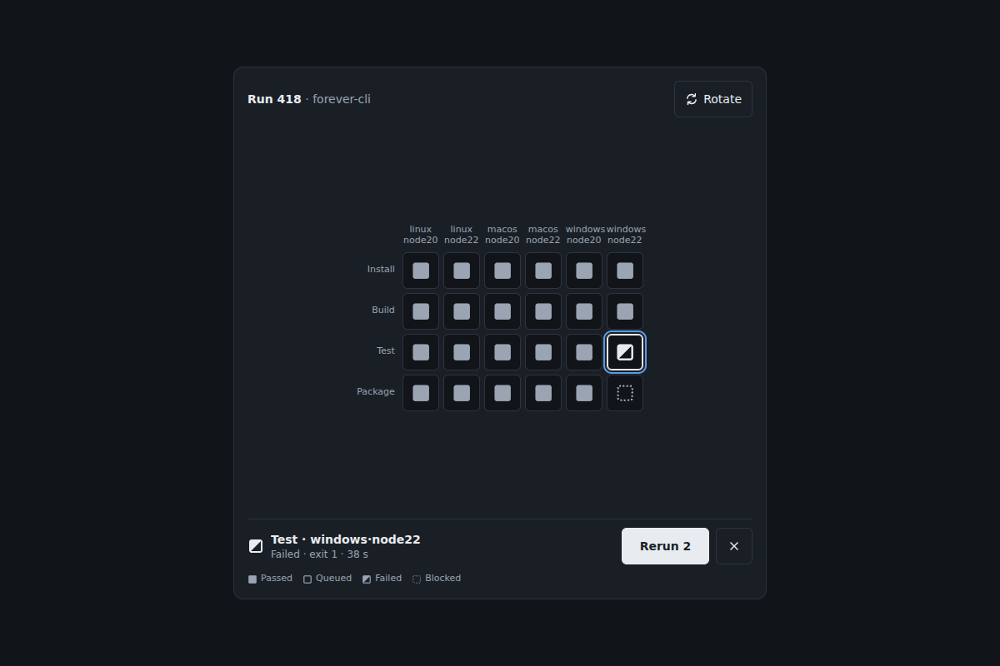
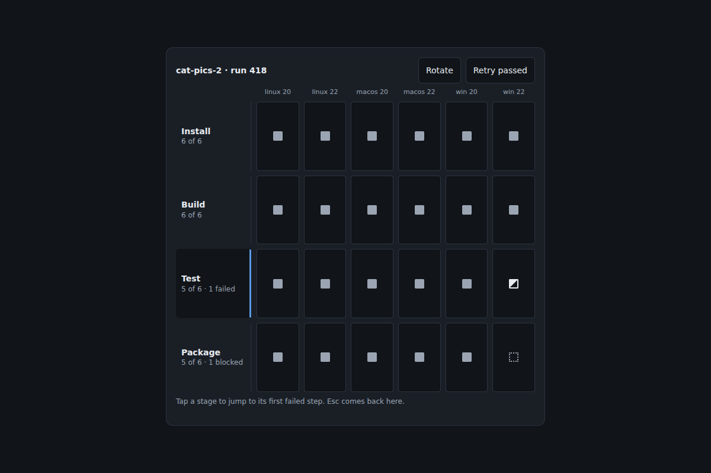
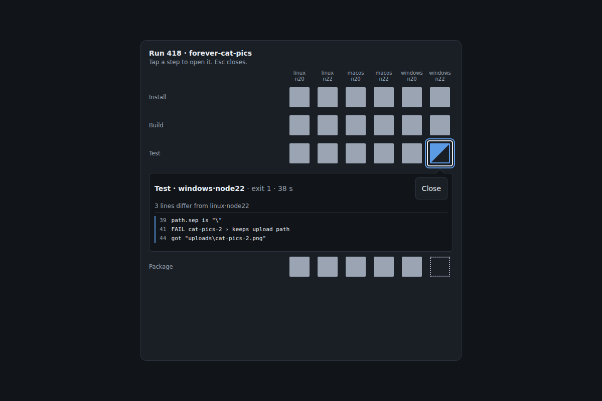
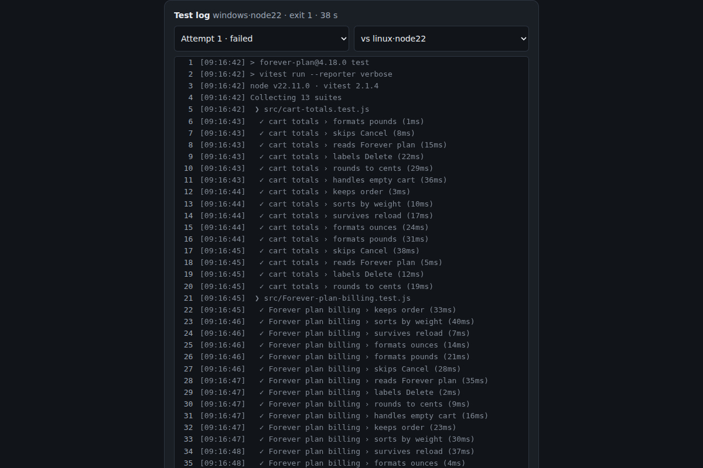
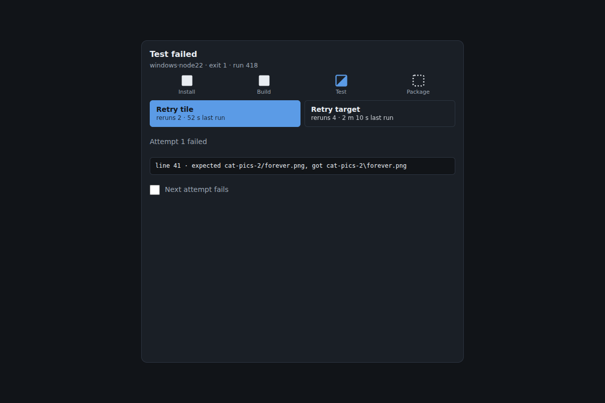
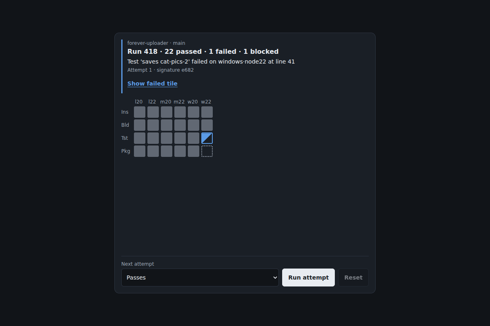

# 2026-10-31: Broken Tile

[Today](../../README.md) · [Archive](../../ARCHIVE.md)



**Task:** Create a creative, useful component set informed specifically by Portuguese azulejo pattern craft. Modular pattern construction: repetition, rotation, borders and local changes forming one coherent whole. Translate craft principles into distinct interactions, not decorative stereotypes. Use original work, avoid sacred imagery and claims of cultural authenticity. Cite https://estudoautonomo.dge.mec.pt/recurso/padroes-e-uma-visita-ao-museu-nacional-do-azulejo.

**Constraint:** The first frame shows the useful component.

**Season:** 2026-10-26

**Decision:** The team builds a pipeline panel where a developer opens on the one failed step already expanded, reads only the log lines that differ from a passing sibling, and retries the failed step at a scope whose cost is shown before the press.



[Cover art direction](cover.json) · [Cover source](cover.html)

## Feed evidence

- all: culture-brief
- No feed article recorded as used; fetched items may have been considered without selection.
- Chosen opportunity: daily-task. This is the only candidate and the required edition task. The team's pipeline need gives it a concrete use, and the craft principles map to pipeline structure without decorative imagery.

[Saved planning input](planning-input.json)

## Asset

[Pack manifest](pack.json) · [Shared tokens](tokens.json) · [Planning input](planning-input.json)

Generated candidates require human review. Library acceptance: unreviewed.

<a href="piece.html"></a>

[Use it](https://isas1.github.io/daily-team/editions/culture/2026-10-31/) · [piece.html](piece.html), led by Color grading specialist. Model: claude-opus-5-5.

<a href="artifact-1.html"></a>

[Use it](https://isas1.github.io/daily-team/editions/culture/2026-10-31/) · [artifact-1.html](artifact-1.html), led by Color grading specialist. Model: claude-opus-5-5.

<a href="artifact-2.html"></a>

[Use it](https://isas1.github.io/daily-team/editions/culture/2026-10-31/) · [artifact-2.html](artifact-2.html), led by Wayfinding designer. Model: claude-opus-5-5.

<a href="artifact-3.html"></a>

[Use it](https://isas1.github.io/daily-team/editions/culture/2026-10-31/) · [artifact-3.html](artifact-3.html), led by Camera operator. Model: claude-opus-5-5.

<a href="artifact-4.html"></a>

[Use it](https://isas1.github.io/daily-team/editions/culture/2026-10-31/) · [artifact-4.html](artifact-4.html), led by Amber crab. Model: claude-opus-5-5.

<a href="artifact-5.html"></a>

[Use it](https://isas1.github.io/daily-team/editions/culture/2026-10-31/) · [artifact-5.html](artifact-5.html), led by Color grading specialist. Model: claude-opus-5-5.

<a href="artifact-6.html"></a>

[Use it](https://isas1.github.io/daily-team/editions/culture/2026-10-31/) · [artifact-6.html](artifact-6.html), led by Wayfinding designer. Model: claude-opus-5-5.

## The session

### Pitch

### Clash

**1 · Color grading specialist:** Option one, glaze depth for status. Option two, glyph shape with a word. I'd take glaze. It's prettier.

**2 · Wayfinding designer:** Glaze fails in greyscale and on a cheap projector. A stranger reading depth has to guess which blue means blocked.

**1 · Color grading specialist:** Then shape carries status, and the one accent goes only on the focused tile and the broken edge. It's still beautiful, and it's quieter.

**3 · Camera operator:** The crab's diff is the real addition. The 10-26 log viewer filtered by severity. Nobody has compared a failure against its own passing twin.

**4 · Amber crab:** And the rotate button. Some people look by target and some by step. Both should be a single side step away.

**3 · Camera operator:** Rotate costs focus. Transpose 24 cells and the keyboard user is lost. Keep focus on the same cell id after the swap, or cut it.

**2 · Wayfinding designer:** Rotate lives inside the matrix and moves the border to the top edge. That doesn't need a seventh component.

**4 · Amber crab:** Retry. The 10-30 retry guard already handles double presses. What is new here?

**3 · Camera operator:** Scope. Retry tile reruns 2. Retry target reruns 4. The label shows the count, and Cancel puts the old pattern back.

### Decision

The team builds a pipeline panel where a developer opens on the one failed step already expanded, reads only the log lines that differ from a passing sibling, and retries the failed step at a scope whose cost is shown before the press.

Concept: Broken Tile

The color grading specialist made two hierarchy versions, and the tile field won over the list. She then gave up glaze tints so that state is carried by shape. The wayfinding designer added the stage border, a quiet frame with one weighted edge, which moves when the grid rotates. The camera operator set the first frame to the open failure and put the downstream rerun count on the retry label. The amber crab brought sibling comparison and side-step navigation, which turns repetition across targets into the diagnostic tool.

The rejected direction is glaze depth as status. It failed greyscale reading and added a palette that the shared tokens forbid.

No component_source was supplied. The ci-oscilloscope entry in the idea bank set the job: stage selection, failure detail and retry. None of its code or housing is used. The azulejo brief maps onto the panel like this. Repetition is the same step across targets. Rotation is the matrix transpose. Borders are stage frames. Local change is the one tile and the three log lines that break the pattern. No ornament motifs are drawn. The work is original and makes no claim of cultural authenticity.

Six components, each answering one question:
- Where did it fail: the matrix.
- Which stage: the border.
- What happened: the inset.
- Why: the sibling log.
- What now: the retry scope.
- Is it fixed, or is it flaky: the verdict.

A loader was left out, because 10-28, 10-29 and 10-30 already cover pending states.

```json
{
  "schemaVersion": 1,
  "categoryVersion": 1,
  "id": "broken-tile-pipeline-panel",
  "name": "Broken Tile",
  "description": "A build pipeline panel laid out as a matrix of step tiles across targets. It opens on the failed tile, compares its log with a passing sibling and retries at a stated scope.",
  "project": "Local demo of build run 418 for a JavaScript package: 4 stages (Install, Build, Test, Package) across 6 targets (linux, macos, windows × node 20, node 22). Test fails on windows·node22 at line 41, and Package on that target is blocked.",
  "sizeRationale": "Six components each answer one question in the failure path: where, which stage, what, why, what now and whether it held. A seventh rotate component was folded into the matrix, and a loader was dropped because 2026-10-28 to 2026-10-30 already cover pending states.",
  "opportunities": [
    {
      "id": "daily-task",
      "need": "Apply azulejo modular pattern principles (repetition, rotation, borders, local change) as interactions on a practical pipeline status panel.",
      "use": "A developer finds the one failed step among 24, sees how its log differs from the same step on a passing target, and retries only what is needed.",
      "interaction": "A tile matrix with arrow-key side steps, a stage border with one weighted edge, an in-grid failure inset, a sibling-diff log, a scoped retry and a pattern verdict.",
      "similarity": "Overlaps 2026-10-26 log viewer (event list) and 2026-10-30 retry guard (dedupe). Differs by diffing against a passing sibling and by stating retry scope and downstream count. 2026-10-27 shares the task but recorded no components."
    }
  ],
  "selection": {
    "id": "daily-task",
    "rationale": "This is the only candidate and the required edition task. The team's pipeline need gives it a concrete use, and the craft principles map to pipeline structure without decorative imagery."
  },
  "tokens": {
    "colors": {
      "dark": { "bg": "#111418", "surface": "#1a1f26", "text": "#e8ecf1", "muted": "#9aa4b2", "accent": "#5b9be6", "border": "#2c3440" },
      "light": { "bg": "#f6f7f9", "surface": "#ffffff", "text": "#14181f", "muted": "#5b6573", "accent": "#1f5fbf", "border": "#d5dae1" }
    },
    "typography": { "family": "system-ui, -apple-system, \"Segoe UI\", Roboto, sans-serif", "size": "14px" },
    "spacing": { "gap": "8px", "padding": "16px" },
    "radii": { "control": "6px" },
    "motion": { "duration": "180ms", "easing": "ease-out" }
  },
  "components": [
    {
      "row": 1,
      "id": "run-tile-matrix",
      "file": "artifact-1.html",
      "name": "Run tile matrix",
      "description": "Grid of 24 square step tiles, with stages as rows and targets as columns, plus a Rotate control that transposes the axes.",
      "category": "Data",
      "tags": ["pipeline", "matrix", "grid", "status-glyph", "transpose", "non-color-state"],
      "purpose": "Show every step of the run as one pattern so the failed tile stands out by shape.",
      "use": "A developer sees one split tile at Test × windows·node22 and a dotted tile below it.",
      "input": "Click or tap a tile to open it. Click or tap Rotate to swap the axes. Keyboard: Tab into the grid. Left and Right move to the same stage on another target, Up and Down move between stages, Home and End jump to row ends, and Ctrl+Home and Ctrl+End jump to the corners. Enter opens the tile. Tab to Rotate, then Enter or Space.",
      "outcome": "The opened tile shows the row 3 inset. Rotate swaps the grid and keeps focus on the same cell id.",
      "recovery": "Rotating again restores the original layout. Opening another tile closes the current inset, and nothing is lost.",
      "mechanism": "ARIA grid with roving tabindex. Each tile is a 40px module with one glyph: filled square for passed, hollow square for queued, diagonal split for failed, dotted square for blocked. Each glyph is paired with its word in the accessible name. Transpose swaps grid-template-rows and grid-template-columns and recomputes positions from a stage-target id map.",
      "nearestAnalogue": "2026-10-30 source tabs used status glyphs in a fixed slot for 3 sources. This places 24 glyphs in a two-axis grid with transpose.",
      "usefulness": "A run with many targets is hard to scan as a list. The grid shows which step and which target at the same time.",
      "creativeDifference": "Repetition makes the pattern, and the failure reads as a broken tile. Rotation is a real view change that keeps focus.",
      "states": [
        "default: stages as rows, failed tile focused and open, reached on load",
        "rotated: targets as rows, reached by Rotate",
        "focus: 2px accent ring on the tile, reached by Tab or arrows",
        "queued: hollow glyphs, reached on retry",
        "narrow: under 480px container width, tiles shrink to 32px and the target labels abbreviate to w22 and similar"
      ],
      "sources": [
        { "title": "ARIA Authoring Practices: Grid", "url": "https://www.w3.org/WAI/ARIA/apg/patterns/" },
        { "title": "Padrões e uma visita ao Museu Nacional do Azulejo", "url": "https://estudoautonomo.dge.mec.pt/recurso/padroes-e-uma-visita-ao-museu-nacional-do-azulejo" }
      ]
    },
    {
      "row": 2,
      "id": "stage-border",
      "file": "artifact-2.html",
      "name": "Stage border",
      "description": "A narrow frame along the matrix edge with one segment per stage and its counts. Only the failing stage's edge is weighted.",
      "category": "Navigation",
      "tags": ["stage", "border", "jump", "wayfinding", "aria-current"],
      "purpose": "Name each stage's result and jump to that stage.",
      "use": "A developer reads 'Test · 5 of 6 · 1 failed' on the border and jumps there.",
      "input": "Click or tap a segment. Keyboard: Tab to the border, Up and Down (Left and Right when rotated) move between segments, Enter or Space jumps.",
      "outcome": "Focus moves to the first failed tile in that stage, or to its first tile if none failed.",
      "recovery": "Jumping never changes run state. Escape in the grid returns focus to the border segment last used.",
      "mechanism": "A nav element containing four buttons. The segment holding the focused tile gets aria-current. The failing segment has a 3px solid edge and all others a 1px hairline. The border moves from the left edge to the top edge when row 1 rotates.",
      "nearestAnalogue": "2026-10-28 breach stepper jumped between computed events. This frames fixed groups and stays visible as a summary.",
      "usefulness": "With 40 targets the grid scrolls, and the border keeps stage results in view.",
      "creativeDifference": "One quiet surface carries one weighted edge, so the break is found without a legend.",
      "states": [
        "default: Test edge weighted, reached on load",
        "current: aria-current on the stage of the focused tile",
        "repaired: Test edge returns to hairline, reached when the retry passes",
        "rotated: border on the top edge",
        "focus: 2px ring on the segment"
      ],
      "sources": [
        { "title": "ARIA Authoring Practices: Landmarks", "url": "https://www.w3.org/WAI/ARIA/apg/patterns/" },
        { "title": "Padrões e uma visita ao Museu Nacional do Azulejo", "url": "https://estudoautonomo.dge.mec.pt/recurso/padroes-e-uma-visita-ao-museu-nacional-do-azulejo" }
      ]
    },
    {
      "row": 3,
      "id": "failure-inset",
      "file": "artifact-3.html",
      "name": "Failure inset",
      "description": "Full-width detail row inserted under the opened tile's row, with a notch pointing at its column.",
      "category": "Layout",
      "tags": ["disclosure", "inset", "grid-row", "focus-return", "expand"],
      "purpose": "Expand the failed step in place without moving any tile out of order.",
      "use": "A developer reads 'Test · windows·node22 · exit 1 · 38 s' directly under the broken tile.",
      "input": "Click or tap the tile or Close. Keyboard: Enter on the tile toggles the inset, and Escape closes it.",
      "outcome": "The inset holds the step header plus rows 4 and 5. Tiles keep their order.",
      "recovery": "On close, focus returns to the tile. Only one inset is open at a time.",
      "mechanism": "An element with grid-column 1 / -1 is inserted after the last cell of the opened tile's row. The notch is offset by column index. Height transitions over 180ms ease-out and is instant under reduced motion. Under 480px container width the inset renders below the grid with a Back to grid button.",
      "nearestAnalogue": "2026-10-28 percentile tiles expanded a tile while its neighbours yielded space. This inserts a row and leaves tile sizes untouched.",
      "usefulness": "The first frame shows the useful content: the failure is already open on load.",
      "creativeDifference": "The detail breaks out of the grid frame once and stays anchored to its tile.",
      "states": [
        "open-on-load: failed tile expanded, reached on load",
        "closed: grid only, reached by Close or Escape",
        "passed-tile: header with duration and no log diff, reached by opening a passed tile",
        "narrow: inset below the grid with Back to grid",
        "reduced-motion: no height transition"
      ],
      "sources": [
        { "title": "ARIA Authoring Practices: Disclosure", "url": "https://www.w3.org/WAI/ARIA/apg/patterns/" }
      ]
    },
    {
      "row": 4,
      "id": "sibling-log",
      "file": "artifact-4.html",
      "name": "Sibling log",
      "description": "Step log with line numbers in which lines shared with a passing sibling target are muted and lines that differ are marked.",
      "category": "Content",
      "tags": ["log", "diff", "line-numbers", "compare", "horizontal-scroll"],
      "purpose": "Show why the step failed by isolating what differs from the same step on a passing target.",
      "use": "A developer reads '3 of 212 lines differ from linux·node22' and finds a backslash path in the assertion at line 41.",
      "input": "Choose a sibling from a native select. Click or tap Next difference or Previous difference. Keyboard: Tab to each control, Enter or Space. The log is a focusable region that scrolls with arrows.",
      "outcome": "Differing lines show at full text with a 2px left bar. Shared lines show in muted text. The count line updates.",
      "recovery": "Choosing None shows the plain log. Text stays selectable for copying.",
      "mechanism": "Lines are normalized by stripping timestamps and millisecond durations, then diffed with LCS against the sibling's normalized lines. The sample logs are bundled locally. Line numbers sit in a sticky 4ch gutter. A pre element scrolls horizontally with no wrapping.",
      "nearestAnalogue": "2026-10-26 log viewer filtered events by severity. This filters by difference from a passing twin.",
      "usefulness": "Failed logs are long, and a passing sibling separates the real change from setup noise.",
      "creativeDifference": "Repetition across targets becomes the diagnostic, and the local change is what is left.",
      "states": [
        "compared: linux·node22 selected by default, reached on load",
        "plain: no sibling, reached by choosing None",
        "no-difference: 'Same lines as sibling', reached when logs match",
        "attempt-2: log of the retried run, reached after row 5",
        "focus: 2px ring on the log region and controls"
      ],
      "sources": [
        { "title": "ARIA Authoring Practices: Landmarks", "url": "https://www.w3.org/WAI/ARIA/apg/patterns/" },
        { "title": "Padrões e uma visita ao Museu Nacional do Azulejo", "url": "https://estudoautonomo.dge.mec.pt/recurso/padroes-e-uma-visita-ao-museu-nacional-do-azulejo" }
      ]
    },
    {
      "row": 5,
      "id": "retry-scope",
      "file": "artifact-5.html",
      "name": "Retry scope",
      "description": "Two retry buttons, one for the tile and one for the target column, each labelled with how many steps rerun and their last recorded duration.",
      "category": "Actions",
      "tags": ["retry", "scope", "downstream", "cancel", "label-swap", "button"],
      "purpose": "Rerun the smallest set of steps that can repair the run, and state the cost first.",
      "use": "A developer presses 'Retry tile · reruns 2 · 52 s last run' instead of rerunning the whole target.",
      "input": "Click or tap Retry tile or Retry target. Cancel appears while the retry runs. Keyboard: Tab to each button, Enter or Space.",
      "outcome": "The affected tiles turn to queued glyphs and run in order. The button reads 'Retrying' and is disabled.",
      "recovery": "Cancel restores the previous tile states and logs. Presses during a retry are ignored. A second failure keeps the attempt 1 log in an attempt selector.",
      "mechanism": "The downstream set is computed from a stage dependency list. The label count and the duration come from recorded sample durations, and no progress percentage is shown. A snapshot of cell states is taken before the run and restored on cancel. Label width is reserved for the longest label.",
      "nearestAnalogue": "2026-10-30 retry guard deduped a single content request. This adds scope choice, downstream count and snapshot restore.",
      "usefulness": "Rerunning a whole pipeline for one flaky test wastes minutes, and rerunning too little leaves blocked steps.",
      "creativeDifference": "Retry replaces one tile and keeps the pattern. The cost is read before the press.",
      "states": [
        "ready: both buttons enabled, reached on a failed tile",
        "retrying: disabled 'Retrying' with Cancel, reached on press",
        "cancelled: previous states restored with note 'Retry cancelled', reached by Cancel",
        "failed-again: 'Retry tile' with 'Attempt 2 failed', reached by the demo toggle",
        "hidden: not rendered when the run has no failure",
        "focus: 2px ring"
      ],
      "sources": [
        { "title": "ARIA Authoring Practices: Button", "url": "https://www.w3.org/WAI/ARIA/apg/patterns/" }
      ]
    },
    {
      "row": 6,
      "id": "run-verdict",
      "file": "artifact-6.html",
      "name": "Run verdict",
      "description": "Status line stating the run's counts and, after a retry, whether the pattern was repaired or failed the same way again.",
      "category": "Feedback",
      "tags": ["status", "live-region", "verdict", "flaky", "summary"],
      "purpose": "Say whether the run is whole, and whether a repeat failure looks flaky or real.",
      "use": "A developer reads 'Failed again at line 41 · same 3 lines · not flaky' and stops retrying.",
      "input": "Display only. Click or tap Show failed tile to focus it. Keyboard: Tab to that link, then Enter.",
      "outcome": "The line reads 'Run 418 · 22 passed · 1 failed · 1 blocked'. After a passing retry it reads 'Run 418 · 24 passed · repaired by attempt 2'.",
      "recovery": "The verdict is derived from the current state, so cancelling a retry restores the earlier line.",
      "mechanism": "role=status with polite announcements on settled states only. The counts come from the cell map. Flakiness compares a hash of the differing lines between attempts: the same hash reads as not flaky, and a different hash reads as changed failure.",
      "nearestAnalogue": "2026-10-29 import summary grouped outcome counts. This also compares failure signatures across attempts.",
      "usefulness": "Repeating retries on a real bug costs time, and the verdict ends that loop.",
      "creativeDifference": "Coherence of the whole pattern is the measure. The run is done only when every tile matches.",
      "states": [
        "failed: counts with Show failed tile, reached on load",
        "running: 'Retrying 2 steps', reached by row 5",
        "repaired: all passed with attempt number",
        "same-failure: 'not flaky' line",
        "changed-failure: 'different lines than attempt 1'"
      ],
      "sources": [
        { "title": "ARIA Authoring Practices: Alert and status", "url": "https://www.w3.org/WAI/ARIA/apg/patterns/" }
      ]
    }
  ],
  "demo": {
    "file": "piece.html",
    "rows": [1, 2, 3, 4, 5, 6],
    "sharedState": "One run object holds 24 cells keyed by stage-target, each with status, attempts and normalized log lines. Before any input, Test × windows·node22 is focused and its inset is open. The matrix and the border read and focus cells from the run object. The inset hosts the sibling log and retry scope for the opened cell. Retry writes queued, then passed or failed into the cells. A demo toggle 'Next attempt fails' forces attempt 2 to fail. The verdict and the border counts recompute from the cell map after each settle."
  }
}
```

### Build notes

1. Keep focus by cell id, never by grid index. Rotate, retry and inset close all call `focusCell(id)`. A test steps through all 24 ids before and after a transpose and asserts that `document.activeElement` keeps the same id.
2. Bundle six local sample logs of about 210 lines each. Strip `^\[\d{2}:\d{2}:\d{2}\]` and `\d+ms` before the LCS. The windows·node22 log must differ from linux·node22 on exactly lines 39, 41 and 44.
3. Take the retry snapshot with `structuredClone(run.cells)` before writing any queued state. Cancel assigns the snapshot back and re-renders the matrix, border and verdict from that one object.

**Guest:** Amber crab (creature; invented). The method is drawn from public-domain history, myth, or literature, or invented. The guest speaks in character in original words, never quoting the source, and nothing here is endorsed by anyone.

## Team

```text
Team for 2026-10-31
Season: 2026-10-26

1. Color grading specialist [new]
   Method: Make two versions with different hierarchy and compare them. [new]
   Stance: Insists it must be beautiful.
   Temperament: Offers two small options before backing one.
2. Wayfinding designer [new]
   Method: Use one quiet surface to make the important edge clear. [new]
   Stance: Wants it to last.
   Temperament: Asks what a stranger would expect next.
3. Camera operator [new]
   Method: Find the smallest change that makes the result easier to read. [new]
   Stance: Breaks the frame.
   Temperament: Looks for the hidden cost in a simple idea.
4. Amber crab (creature; invented) [guest] [new]
   Method: Make side steps as clear as steps forward.
   Stance: Speaks for the one who finds it.
   Temperament: Keeps asking which action matters most.

Constraint: The first frame shows the useful component.
Task: Pipeline panel: a status panel for a build tool that expands a failed step, shows its log and retries it in a local demo.
```

Provider: claude. Model: claude-opus-5-5.
