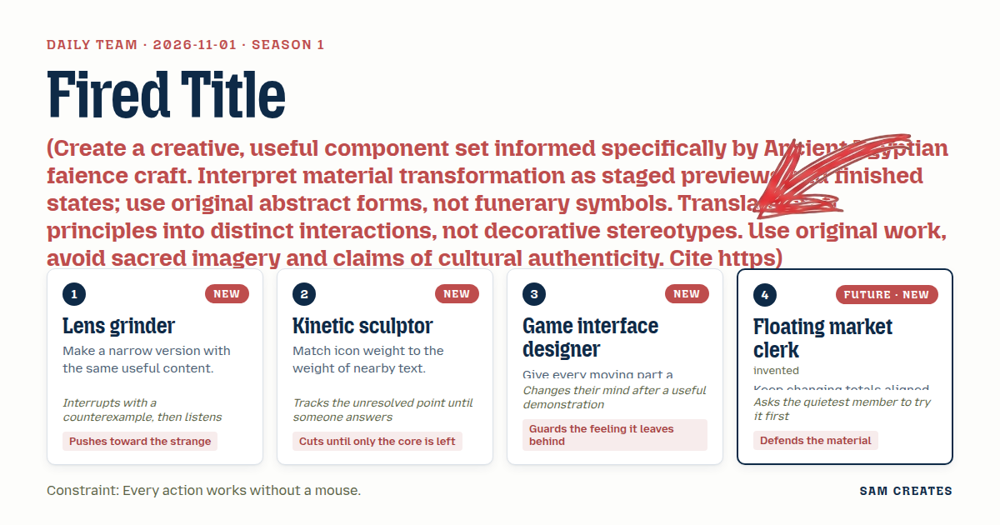
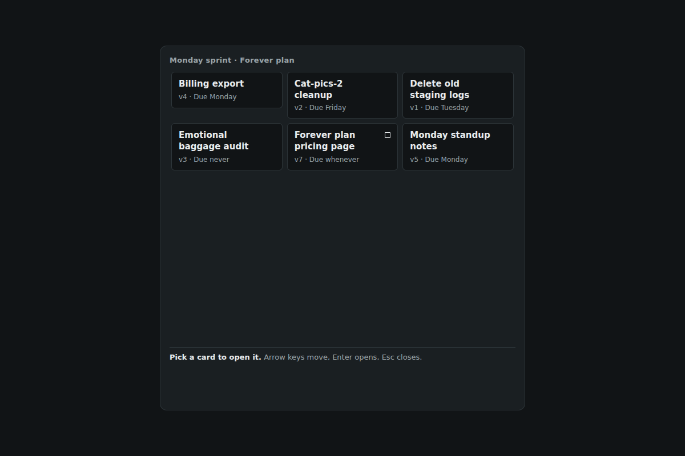
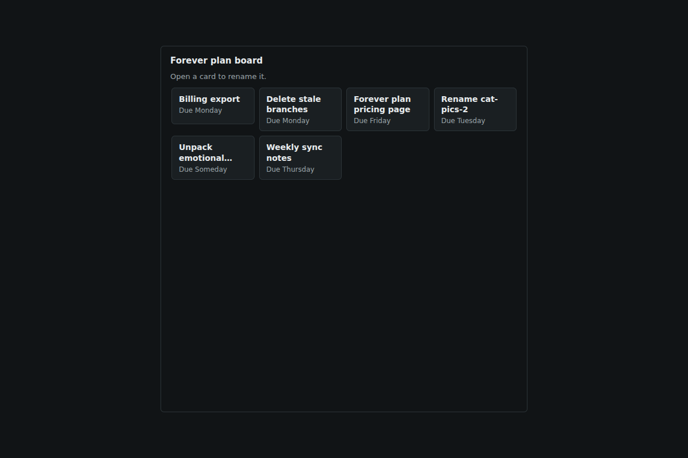
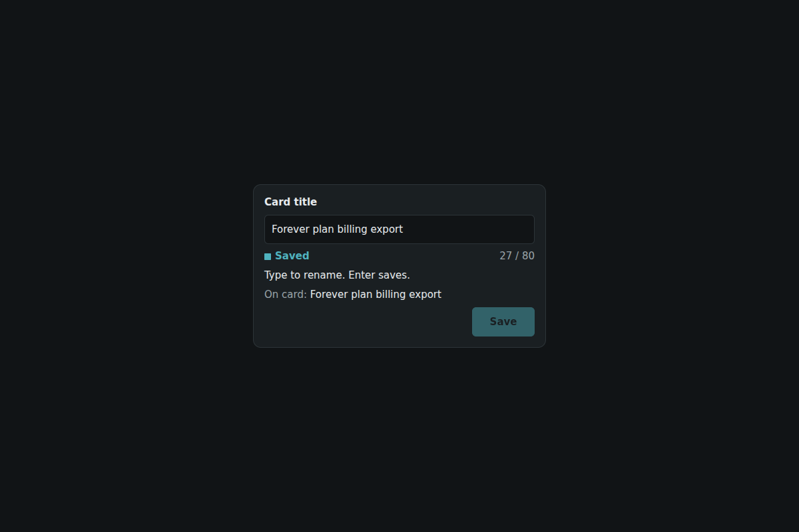
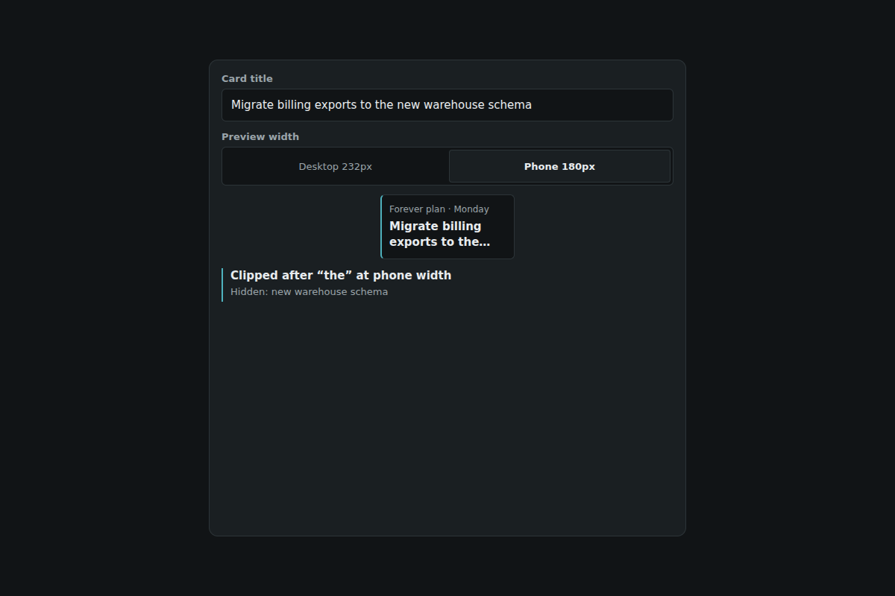
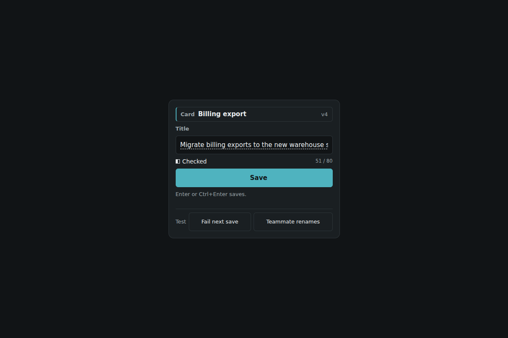
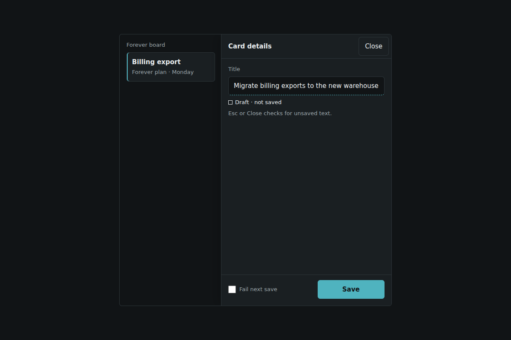

# 2026-11-01: Fired Title

[Today](../../README.md) · [Archive](../../ARCHIVE.md)



**Task:** Create a creative, useful component set informed specifically by Ancient Egyptian faience craft. Interpret material transformation as staged previews and finished states; use original abstract forms, not funerary symbols. Translate craft principles into distinct interactions, not decorative stereotypes. Use original work, avoid sacred imagery and claims of cultural authenticity. Cite https://australian.museum/learn/cultures/international-collection/ancient-egyptian/egyptian-faience/.

**Constraint:** Every action works without a mouse.

**Season:** 2026-10-26

**Decision:** The team selects a project-tool details panel in which a visitor opens a card by keyboard, edits its title against a live card-width preview, saves it with honest pending, failure and conflict states, and closes without losing a draft wh...

## Feed evidence

- all: culture-brief
- No feed article recorded as used; fetched items may have been considered without selection.
- Chosen opportunity: daily-task. The only candidate is the explicit brief. The details panel gives the faience edition a practical home: staged previews map to draft and checked states, and the finished state maps to a saved title.

[Saved planning input](planning-input.json)

## Asset

[Pack manifest](pack.json) · [Shared tokens](tokens.json) · [Planning input](planning-input.json)

Generated candidates require human review. Library acceptance: unreviewed.

piece.html: no asset. only 5 components worked; the piece needs 6

<a href="artifact-1.html"></a>

[Use it](https://isas1.github.io/daily-team/editions/culture/2026-11-01/) · [artifact-1.html](artifact-1.html), led by Lens grinder. Model: claude-opus-5-5.

<a href="artifact-2.html"></a>

[Use it](https://isas1.github.io/daily-team/editions/culture/2026-11-01/) · [artifact-2.html](artifact-2.html), led by Kinetic sculptor. Model: claude-opus-5-5.

<a href="artifact-3.html"></a>

[Use it](https://isas1.github.io/daily-team/editions/culture/2026-11-01/) · [artifact-3.html](artifact-3.html), led by Game interface designer. Model: claude-opus-5-5.

<a href="artifact-4.html"></a>

[Use it](https://isas1.github.io/daily-team/editions/culture/2026-11-01/) · [artifact-4.html](artifact-4.html), led by Floating market clerk. Model: claude-opus-5-5.

<a href="artifact-5.html"></a>

[Use it](https://isas1.github.io/daily-team/editions/culture/2026-11-01/) · [artifact-5.html](artifact-5.html), led by Lens grinder. Model: claude-opus-5-5.

<a href="artifact-6.html"></a>

[Use it](https://isas1.github.io/daily-team/editions/culture/2026-11-01/) · [artifact-6.html](artifact-6.html), led by Kinetic sculptor. Model: claude-opus-5-5. Needs review: class and id names do not share one short prefix such as "ab1-".

## The session

### Pitch

### Clash

**1 · Lens grinder:** Counterexample. "Migrate billing exports to the new warehouse schema" saves fine and then gets clipped to "Migrate billing exports to the new…" on the card. A glyph that says Saved is wrong about what the teammate will see.

**2 · Kinetic sculptor:** Then the fit preview earns a row. The keyboard hint strip does not. Every shortcut belongs in a control's accessible name and visible label.

**3 · Game interface designer:** Fine. The sheen still has a reason. It marks the moment the title becomes fired.

**4 · Floating market clerk:** Before we vote on motion, Kinetic sculptor, you have said least about the panel. Try closing it with Escape mid-edit and tell us what happens.

**2 · Kinetic sculptor:** In the current sketch my draft is gone and focus lands on the page body. That is the unresolved point. Who owns the dirty close?

**3 · Game interface designer:** I demoed it with the sheen on and with the sheen off. The filled glyph plus "Saved 14:06" read the same in both, and the sheen pulled my eye off the close guard. I drop the sheen. The guard gets the row.

**4 · Floating market clerk:** Then my revision ledger is a seventh job inside a one-title edit. I'll cut it. Keep the version number, because Save needs it to detect a teammate's rename.

**1 · Lens grinder:** Agreed, but the preview needs a phone width. Otherwise it only tells the truth on desktop.

### Decision

The team selects a project-tool details panel in which a visitor opens a card by keyboard, edits its title against a live card-width preview, saves it with honest pending, failure and conflict states, and closes without losing a draft while focus returns to the same card.

Concept: Fired Title

The craft reading comes from the Australian Museum's account of Egyptian faience (https://australian.museum/learn/cultures/international-collection/ancient-egyptian/egyptian-faience/). In that account, a shaped body only becomes its finished surface after drying and firing. The pack maps this onto text states only: Draft, Checked and Saved. The forms are plain squares. The pack uses no symbols, motifs or claims of cultural authenticity.

Contributions:
- Lens grinder: the card fit preview, plus its 180px phone width.
- Kinetic sculptor: the three-glyph stage rule at text weight. Also the cut of the hint strip, and pressing the open question of who owns a dirty close until the team answered it.
- Game interface designer: the 180ms slide that stops. After the demo, they withdrew the save sheen.
- Floating market clerk: tabular count alignment, and the version check behind conflict detection.

Rejected direction: the clerk's Ledger Panel. A revision list adds a second data job to a single-title edit. Its useful part, the version number, moved into row 5.

No component_source was supplied. Two idea bank entries shaped the mechanisms:
- The riffle label button became row 5. It keeps reserved label width and the swap from action to completion. It adds pending, failure and conflict states, and drops the housing decoration.
- The bottom sheet became row 2. It keeps Escape, a Close button and focus return. It drops drag and snap points, and returns focus by card id.

Six rows earn their place because each owns one failure the task can produce:
1. The card cannot be reached by keyboard.
2. The panel traps focus or loses it.
3. The draft and the saved title drift apart without notice.
4. The saved title clips on the card.
5. A save fails or overwrites a teammate.
6. Closing drops typed text.

A seventh row would duplicate one of these.

```json
{
  "schemaVersion": 1,
  "categoryVersion": 1,
  "id": "fired-title-details-panel",
  "name": "Fired Title",
  "description": "Details side panel for a project tool that opens from a card, edits the title through Draft, Checked and Saved stages, previews the title at card width and returns focus to the card on close.",
  "project": "A project board with six task cards. Any card opens a details panel where the visitor renames it by keyboard or pointer.",
  "sizeRationale": "Six rows, one per failure the task can produce: unreachable card, lost focus, silent draft drift, clipped title, failed or conflicting save, and lost text on close. A revision ledger was cut as a seventh job.",
  "opportunities": [
    {
      "id": "daily-task",
      "need": "Rename a project card in a side panel without a mouse and without losing focus or text.",
      "use": "A lead renames 'Billing export' to 'Migrate billing exports to the new warehouse schema' and checks that it fits the card.",
      "interaction": "Card opens a panel. The title moves Draft to Checked to Saved. A live preview shows the card clip. A close guard catches unsaved drafts.",
      "similarity": "2026-10-30 share sheet frame also returned focus from a dialog, but by drag snap points. This panel has no drag and returns focus by card id after a reorder. 2026-10-30 link options field flagged drift from the clipboard. This flags drift from the saved title. Tradeoff: three stages add one glyph per field, and the team accepted that cost for honest state."
    }
  ],
  "selection": {
    "id": "daily-task",
    "rationale": "The only candidate is the explicit brief. The details panel gives the faience edition a practical home: staged previews map to draft and checked states, and the finished state maps to a saved title."
  },
  "tokens": {
    "colors": {
      "dark": { "bg": "#111416", "surface": "#1a1f22", "text": "#e8ecee", "muted": "#9aa4a9", "accent": "#4fb3bf", "border": "#2c3438" },
      "light": { "bg": "#f6f7f7", "surface": "#ffffff", "text": "#15191b", "muted": "#5a6469", "accent": "#1f7a85", "border": "#d5dadc" }
    },
    "typography": { "family": "system-ui, -apple-system, 'Segoe UI', Roboto, 'Helvetica Neue', Arial, sans-serif", "size": "15px" },
    "spacing": { "gap": "8px", "padding": "16px" },
    "radii": { "control": "6px" },
    "motion": { "duration": "180ms", "easing": "ease-out" }
  },
  "components": [
    {
      "row": 1,
      "id": "project-card-trigger",
      "file": "artifact-1.html",
      "name": "Project card trigger",
      "description": "Grid of task cards. Each card is a button that opens its details and shows a draft glyph when an unsaved title exists.",
      "category": "Navigation",
      "tags": ["card", "grid", "roving-tabindex", "trigger", "aria-expanded", "draft-marker"],
      "purpose": "Reach any card and open its details from the keyboard or by pointer.",
      "use": "A lead arrows to 'Billing export' and presses Enter.",
      "input": "Click or tap a card. Keyboard: Tab into the grid, arrow keys move between cards by row and column, Home and End jump to row ends, Enter or Space opens.",
      "outcome": "The panel opens for that card. The card gets aria-expanded=true and a 2px accent inline-start edge.",
      "recovery": "On panel close, focus returns to this card. The card is found by id, so a rename that re-sorts the grid does not misplace focus.",
      "mechanism": "Native buttons in a list with roving tabindex. Column count comes from a ResizeObserver on the grid. The draft glyph is a hollow 10px square read from the shared draft store, paired with the visually hidden word 'unsaved draft'.",
      "nearestAnalogue": "2026-10-30 loaded list was a listbox with single selection. These cards are triggers in two dimensions and carry draft state for another surface.",
      "usefulness": "Without arrow movement, reaching card 6 takes six Tab presses, and the draft glyph shows unfinished work before the panel opens.",
      "creativeDifference": "The card shows the raw-state glyph from row 3, so a draft is visible from the board.",
      "states": [
        "default: no card expanded, reached on load",
        "focus: 2px ring, reached by Tab or arrows",
        "expanded: accent edge and aria-expanded=true, reached by Enter, Space or click",
        "draft: hollow square glyph, reached when a dirty draft exists for that card",
        "reordered: card moves in alphabetical sort after a save and keeps focus return by id",
        "narrow: one column under 480px, Up and Down only"
      ],
      "sources": [{ "title": "ARIA Authoring Practices: Grid", "url": "https://www.w3.org/WAI/ARIA/apg/patterns/" }]
    },
    {
      "row": 2,
      "id": "details-side-panel",
      "file": "artifact-2.html",
      "name": "Details side panel",
      "description": "Inline-end modal panel, 400px wide, with sticky header and footer. It closes by Escape or Close and returns focus to the opening card.",
      "category": "Layout",
      "tags": ["side-panel", "dialog", "focus-return", "escape-key", "sticky-footer", "responsive"],
      "purpose": "Hold the card's details beside the board and manage focus in and out.",
      "use": "A lead opens the panel, edits, presses Escape and lands back on the card.",
      "input": "Open from row 1. Click or tap Close. Keyboard: Escape or Enter on Close. Tab cycles within the panel.",
      "outcome": "On open, focus moves to the title field. On close, focus returns to the card by id.",
      "recovery": "If the draft is dirty, close is routed to row 6 instead of closing. If the card was deleted while open, focus moves to the grid heading with the note 'Card no longer exists'.",
      "mechanism": "Native dialog opened with showModal, which makes the board inert. The panel uses translateX over 180ms ease-out and stops on transitionend. The body scrolls between the sticky header and footer. A cancel event handler intercepts Escape for the dirty check.",
      "nearestAnalogue": "2026-10-30 share sheet frame. That sheet snapped by drag at the bottom edge. This panel has no drag, sits at the inline end and returns focus by id.",
      "usefulness": "Focus return is the task's explicit requirement and the most common failure in side panels.",
      "creativeDifference": "Every close path passes one dirty-check gate, so no exit silently drops text.",
      "states": [
        "closed: not rendered, reached on load and after close",
        "opening: 180ms slide, then still",
        "open: focus in title field",
        "close-blocked: held open while row 6 shows, reached by Escape or Close with a dirty draft",
        "narrow: full width under 640px with 16px padding",
        "reduced-motion: appears without slide",
        "focus: 2px ring on Close"
      ],
      "sources": [{ "title": "ARIA Authoring Practices: Dialog (Modal)", "url": "https://www.w3.org/WAI/ARIA/apg/patterns/" }]
    },
    {
      "row": 3,
      "id": "title-draft-field",
      "file": "artifact-3.html",
      "name": "Title draft field",
      "description": "Labelled title input with a stage glyph and word for Draft, Checked or Saved, a tabular count and a revert action.",
      "category": "Inputs",
      "tags": ["text-input", "draft", "validation", "stage-glyph", "character-count", "revert"],
      "purpose": "Edit the title and always show whether the text on screen is draft, checked or saved.",
      "use": "A lead types a long title and reads 'Checked · 52 / 80' before saving.",
      "input": "Type in the field by keyboard or on-screen keyboard. Click, tap or press Enter on Revert to saved, which appears when the draft is dirty.",
      "outcome": "The stage moves to Checked 600ms after the last keystroke when the trimmed title is 1 to 80 characters and differs from saved. Row 5 sets Saved.",
      "recovery": "Revert to saved restores the saved title and the Saved stage. Native Ctrl+Z works in the field.",
      "mechanism": "The draft is stored per card id in the shared store. Validation trims whitespace. Glyphs are 10px squares at a 1.5px stroke to match 15px text: hollow for Draft, half-filled for Checked, filled for Saved. Each glyph pairs with its word. The draft has a 1px dashed underline, and the saved title has none. The count uses tabular-nums in a 7ch slot.",
      "nearestAnalogue": "2026-10-30 link options field flagged drift between the screen and the clipboard. This field flags drift between the draft and the saved title.",
      "usefulness": "Visitors often close panels believing a typed title saved itself.",
      "creativeDifference": "Text moves through raw, checked and finished stages, each with its own shape.",
      "states": [
        "saved: filled square, reached on open and after save",
        "draft: hollow square and dashed underline, reached on typing",
        "checked: half square, reached 600ms after a valid edit",
        "empty: 'Title needed', reached when trimmed text is empty",
        "over-limit: count reads '84 / 80' with 'Shorten by 4'",
        "unchanged: 'Same as saved', reached when the draft equals saved",
        "focus: 2px ring"
      ],
      "sources": [
        { "title": "ARIA Authoring Practices patterns", "url": "https://www.w3.org/WAI/ARIA/apg/patterns/" },
        { "title": "Australian Museum: Egyptian faience", "url": "https://australian.museum/learn/cultures/international-collection/ancient-egyptian/egyptian-faience/" }
      ]
    },
    {
      "row": 4,
      "id": "card-fit-preview",
      "file": "artifact-4.html",
      "name": "Card fit preview",
      "description": "Live render of the draft title inside the card's real width and two-line clamp, reporting fit or the last visible word.",
      "category": "Content",
      "tags": ["preview", "truncation", "line-clamp", "measurement", "responsive", "live-region"],
      "purpose": "Show how the title will read on the board before it is saved.",
      "use": "A lead sees 'Clipped after \"new\" at phone width' and shortens the title.",
      "input": "Display follows the field. Choose Desktop 232px or Phone 180px with a two-option radio group. Keyboard: Tab into the group, arrow keys select.",
      "outcome": "The preview reads 'Fits in 2 lines' or 'Clipped after \"new\"' at the chosen width.",
      "recovery": "Editing the field updates the preview on the next frame. Switching width never changes the draft.",
      "mechanism": "A hidden measuring card uses the same CSS class as row 1, at the chosen width. Overflow is detected by comparing scrollHeight with two line-heights. The cut word is found by binary search over the word count. The live region announces only when the fit state changes.",
      "nearestAnalogue": "None in recent dates. 2026-10-30 reserved skeleton matched loaded geometry, but it held layout and did not measure text.",
      "usefulness": "A title that saves fine but clips on the card hides its key word from teammates.",
      "creativeDifference": "The preview is a staged view of the finished card, made from the same rule that renders it.",
      "states": [
        "fits: 'Fits in 2 lines', reached when text fits",
        "clipped: ellipsis with the last visible word named",
        "phone: 180px measurement, reached by the Phone radio",
        "empty: preview shows 'Untitled' in muted text",
        "focus: 2px ring on the radio group"
      ],
      "sources": [
        { "title": "ARIA Authoring Practices: Radio Group", "url": "https://www.w3.org/WAI/ARIA/apg/patterns/" },
        { "title": "Australian Museum: Egyptian faience", "url": "https://australian.museum/learn/cultures/international-collection/ancient-egyptian/egyptian-faience/" }
      ]
    },
    {
      "row": 5,
      "id": "save-title-button",
      "file": "artifact-5.html",
      "name": "Save title button",
      "description": "Native submit button with a reserved-width label covering idle, saving, saved, failed and conflict outcomes.",
      "category": "Actions",
      "tags": ["button", "submit", "pending", "retry", "conflict", "label-swap"],
      "purpose": "Commit a checked title and state exactly what happened.",
      "use": "A lead saves, and a teammate's earlier rename surfaces as 'Renamed by Ana 14:05'.",
      "input": "Click or tap Save. Keyboard: Enter in the field, Ctrl+Enter or Cmd+Enter anywhere in the panel, or Tab to the button and press Space.",
      "outcome": "The label swaps Save, Saving, then 'Saved 14:06'. The card title updates and row 3 shows Saved.",
      "recovery": "On failure, the label reads 'Not saved · Retry' and the draft is kept. On conflict, two buttons appear: Use mine and Keep theirs. Presses while saving are ignored.",
      "mechanism": "The form submit handler compares the stored version with the baseline captured at open. A local store resolves after 700ms. Demo toggles force a failure or a conflict. The label width is reserved for 'Not saved · Retry'. The button is disabled unless the stage is Checked.",
      "nearestAnalogue": "2026-10-30 copy link button and 2026-10-30 retry guard. Those copied or refetched. This save writes user text and detects a teammate's overwrite.",
      "usefulness": "Silent overwrites and lost failures are the two save errors that cost work.",
      "creativeDifference": "The saved state is the finished surface. The button only accepts text that has passed the checked stage.",
      "states": [
        "disabled: stage is Draft or invalid",
        "idle: 'Save', reached at Checked",
        "saving: disabled 'Saving'",
        "saved: 'Saved 14:06'",
        "failed: 'Not saved · Retry', reached by demo toggle",
        "conflict: Use mine and Keep theirs, reached by version mismatch",
        "focus: 2px ring"
      ],
      "sources": [
        { "title": "ARIA Authoring Practices: Button", "url": "https://www.w3.org/WAI/ARIA/apg/patterns/" },
        { "title": "Australian Museum: Egyptian faience", "url": "https://australian.museum/learn/cultures/international-collection/ancient-egyptian/egyptian-faience/" }
      ]
    },
    {
      "row": 6,
      "id": "unsaved-close-guard",
      "file": "artifact-6.html",
      "name": "Unsaved close guard",
      "description": "Inline alert in the panel footer that intercepts a dirty close with three choices, with Keep editing focused first.",
      "category": "Feedback",
      "tags": ["alert", "unsaved-changes", "escape-key", "discard", "restore", "focus-management"],
      "purpose": "Stop a close from dropping typed text, and let the visitor choose.",
      "use": "A lead presses Escape mid-edit and reads 'Unsaved title · \"Migrate billing exports\"'.",
      "input": "Click or tap Save and close, Discard or Keep editing. Keyboard: focus lands on Keep editing. Tab and Shift+Tab move between the three, Enter or Space activates, and Escape again means Keep editing.",
      "outcome": "Save and close runs row 5, then closes. Discard closes and keeps the draft in a one-slot buffer. Keep editing returns focus to the field with the caret at the end.",
      "recovery": "Reopening the same card in the session offers 'Restore discarded draft'. If Save and close fails, the panel stays open with row 5's failure state.",
      "mechanism": "Triggered from the dialog cancel event, the Close button and row 1 opening another card. The alert uses role=alert and is inline, so no second dialog stacks. The discard buffer holds one draft per session.",
      "nearestAnalogue": "None direct. 2026-10-30 copy repair notice kept a failure visible until fixed. This guard prevents the loss before it happens.",
      "usefulness": "An Escape press that silently discards a sentence breaks trust in the panel.",
      "creativeDifference": "The safest choice gets focus first, and Escape can never discard.",
      "states": [
        "hidden: draft clean",
        "shown: three choices with the draft quoted, reached by a dirty close",
        "saving: Save and close disabled while row 5 runs",
        "discarded: panel closed, buffer filled",
        "restorable: 'Restore discarded draft' on reopen",
        "focus: 2px ring on each choice"
      ],
      "sources": [{ "title": "ARIA Authoring Practices: Alert", "url": "https://www.w3.org/WAI/ARIA/apg/patterns/" }]
    }
  ],
  "demo": {
    "file": "piece.html",
    "rows": [1, 2, 3, 4, 5, 6],
    "sharedState": "One store holds six cards (id, title, version), openId, a per-card draft {text, stage}, the baselineVersion captured on open, and a one-slot discard buffer. Row 1 opens row 2 for card c-3 'Billing export' v4. Row 3 writes the draft, and row 4 measures it. Row 5 saves when the stage is Checked and bumps the version. A demo toggle sets c-3 to v5 'Billing exports' by Ana to force a conflict. Row 6 gates every close. On close, row 2 returns focus to row 1 by id after the alphabetical re-sort."
  }
}
```

### Build notes

1. Route Escape, Close, and opening another card through one `requestClose(reason)` function that checks `draft.stage !== 'saved'` before calling `dialog.close()`. Call `preventDefault` on the dialog `cancel` event so Escape cannot bypass the gate.
2. Look up the return target with `document.querySelector('[data-card-id="c-3"]')` after the save re-sort, never with a stored element reference. Test it by saving a title that moves the card from position 1 to position 5.
3. The row 4 measuring card must share the `.card-title` class and token font with row 1. Run the binary search inside `requestAnimationFrame`, and announce in the live region only when the result changes between "fits" and "clipped".

**Guest:** Floating market clerk (future; invented). The method is drawn from public-domain history, myth, or literature, or invented. The guest speaks in character in original words, never quoting the source, and nothing here is endorsed by anyone.

## Team

```text
Team for 2026-11-01
Season: 2026-10-26

1. Lens grinder [new]
   Method: Make a narrow version with the same useful content. [new]
   Stance: Pushes toward the strange.
   Temperament: Interrupts with a counterexample, then listens.
2. Kinetic sculptor [new]
   Method: Match icon weight to the weight of nearby text. [new]
   Stance: Cuts until only the core is left.
   Temperament: Tracks the unresolved point until someone answers.
3. Game interface designer [new]
   Method: Give every moving part a reason to stop. [new]
   Stance: Guards the feeling it leaves behind.
   Temperament: Changes their mind after a useful demonstration.
4. Floating market clerk (future; invented) [guest] [new]
   Method: Keep changing totals aligned and easy to compare.
   Stance: Defends the material.
   Temperament: Asks the quietest member to try it first.

Constraint: Every action works without a mouse.
Task: Details panel: a side panel for a project tool that opens from a card, edits a title and returns focus when closed.
```

Provider: claude. Model: claude-opus-5-5.
