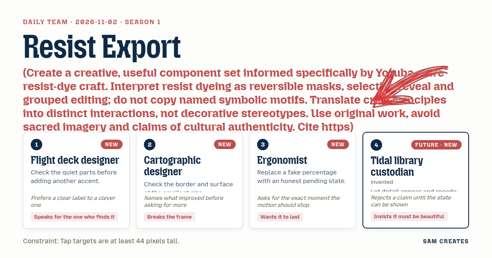
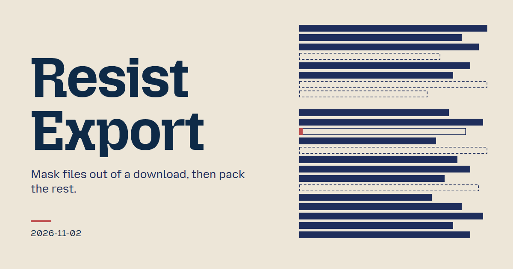
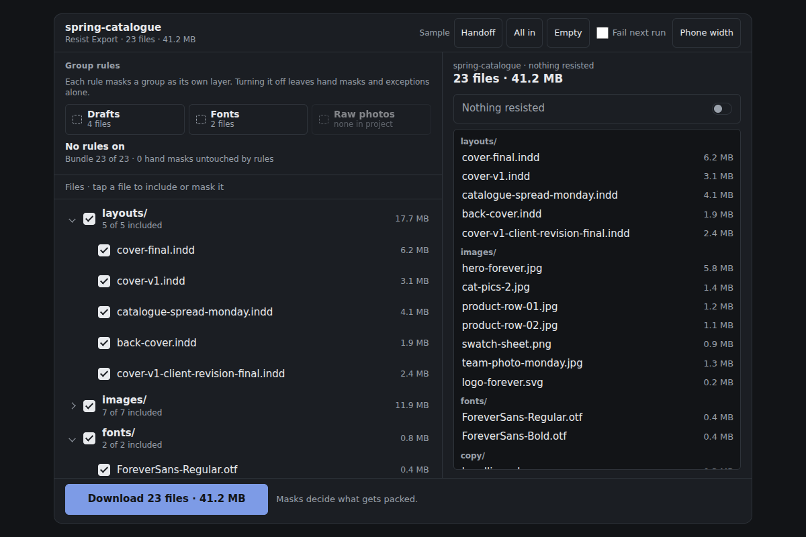
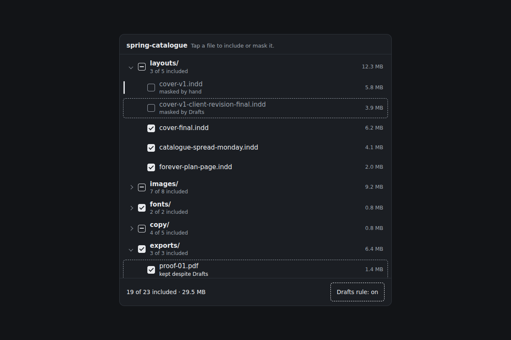
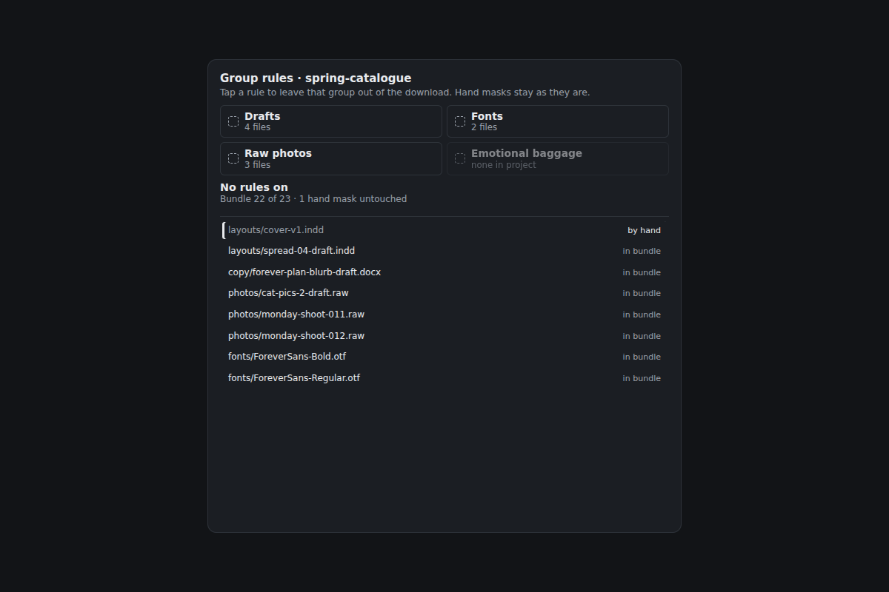
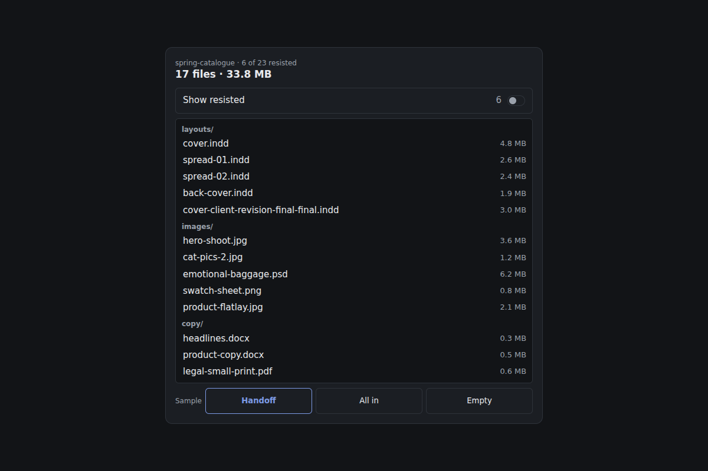
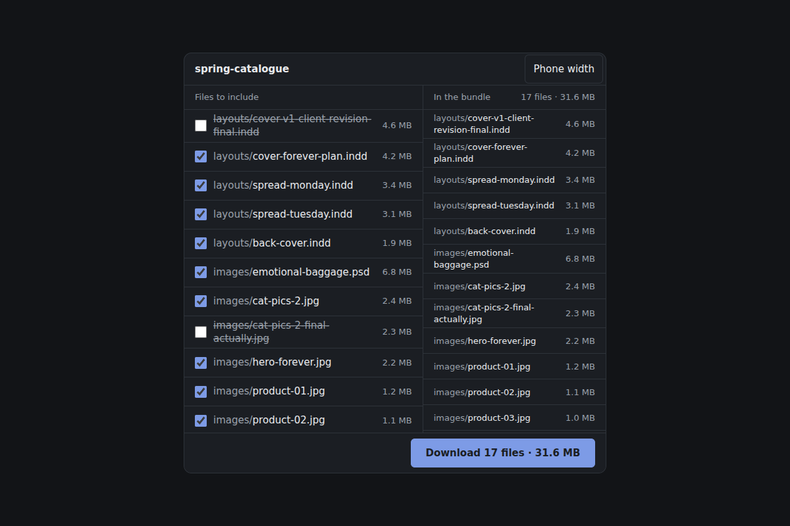
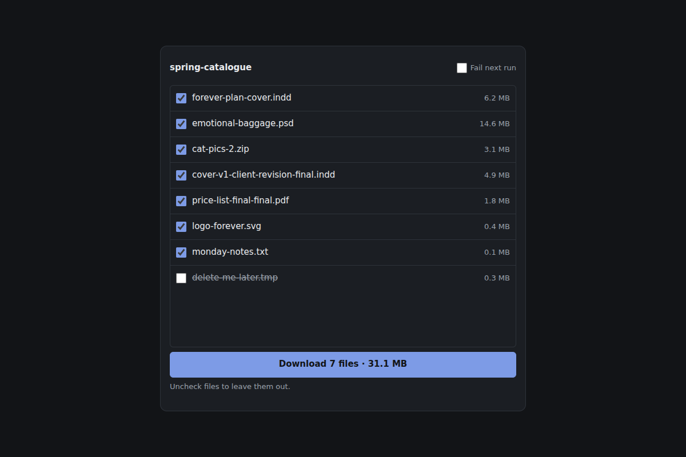
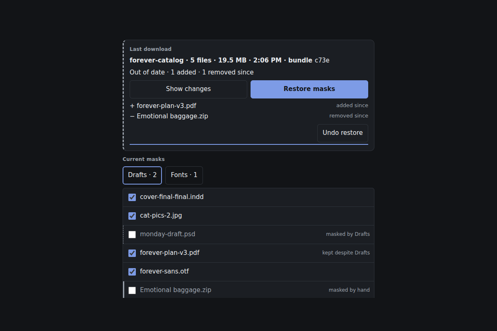

# 2026-11-02: Resist Export

[Today](../../README.md) · [Archive](../../ARCHIVE.md)



**Task:** Create a creative, useful component set informed specifically by Yoruba adire resist-dye craft. Interpret resist dyeing as reversible masks, selective reveal and grouped editing; do not copy named symbolic motifs. Translate craft principles into distinct interactions, not decorative stereotypes. Use original work, avoid sacred imagery and claims of cultural authenticity. Cite https://www.vam.ac.uk/articles/cloth-of-a-continent-africa-fashion.

**Constraint:** Tap targets are at least 44 pixels tall.

**Season:** 2026-10-26

**Decision:** The team builds Resist Export, a file panel where a visitor masks files and groups out of a bundle, downloads it with honest preparation feedback, and repeats or restores it knowing exactly which files the download holds.



[Cover art direction](cover.json) · [Cover source](cover.html)

## Feed evidence

- all: culture-brief
- No feed article recorded as used; fetched items may have been considered without selection.
- Chosen opportunity: daily-task. It is the only candidate and the explicit edition brief. Resist dyeing maps onto masking files from a download, which serves the download-button task directly.

[Saved planning input](planning-input.json)

## Asset

[Pack manifest](pack.json) · [Shared tokens](tokens.json) · [Planning input](planning-input.json)

Generated candidates require human review. Library acceptance: unreviewed.

<a href="piece.html"></a>

[Use it](https://isas1.github.io/daily-team/editions/culture/2026-11-02/) · [piece.html](piece.html), led by Flight deck designer. Model: claude-opus-5-5.

<a href="artifact-1.html"></a>

[Use it](https://isas1.github.io/daily-team/editions/culture/2026-11-02/) · [artifact-1.html](artifact-1.html), led by Flight deck designer. Model: claude-opus-5-5.

<a href="artifact-2.html"></a>

[Use it](https://isas1.github.io/daily-team/editions/culture/2026-11-02/) · [artifact-2.html](artifact-2.html), led by Cartographic designer. Model: claude-opus-5-5.

<a href="artifact-3.html"></a>

[Use it](https://isas1.github.io/daily-team/editions/culture/2026-11-02/) · [artifact-3.html](artifact-3.html), led by Ergonomist. Model: claude-opus-5-5.

<a href="artifact-4.html"></a>

[Use it](https://isas1.github.io/daily-team/editions/culture/2026-11-02/) · [artifact-4.html](artifact-4.html), led by Tidal library custodian. Model: claude-opus-5-5.

<a href="artifact-5.html"></a>

[Use it](https://isas1.github.io/daily-team/editions/culture/2026-11-02/) · [artifact-5.html](artifact-5.html), led by Flight deck designer. Model: claude-opus-5-5.

<a href="artifact-6.html"></a>

[Use it](https://isas1.github.io/daily-team/editions/culture/2026-11-02/) · [artifact-6.html](artifact-6.html), led by Cartographic designer. Model: claude-opus-5-5.

## The session

### Pitch

### Clash

**3 · Ergonomist:** Report Pull is the plainest answer to the brief. Prepare, complete, repeat. Nothing else to argue about.

**1 · Flight deck designer:** It's the third loader in a week. 10-28 had load stages and 10-29 had an import stage track. The repeat action is the only new part. In Resist Export the repeat has to decide: same bundle, or the masks changed.

**4 · Tidal library custodian:** That decision is a claim. Show it. If "Download again" reuses a cached bundle, the label has to say "same bundle" and the receipt has to carry its id.

**2 · Cartographic designer:** Good. Area painting is drag-only, so I'll drop Offline Area. I'll keep the smallest-size check. At 320 px a two-pane file panel collapses, and the button can't end up under the fold.

**3 · Ergonomist:** Then the button's pending state counts files the packing loop has really packed. "Preparing · 7 of 21". And I need the exact moment it stops: the label swaps once on completion and holds. No pulse after that.

**1 · Flight deck designer:** Rule masks and hand masks should look different on the quiet rows. A dashed edge for a rule, a solid bar for a hand mask, with the word beside each. That way the accent stays for the selected row.

**4 · Tidal library custodian:** The preview gets my method. "Show resisted" brings masked rows back into view, dimmed and struck. The count label above stays fixed.

**2 · Cartographic designer:** That's better than the shelf pitch. Making the reveal reversible gives it a job. I'd add one thing: the receipt should restore the downloaded mask set. That makes resist reversible end to end.

### Decision

The team builds Resist Export, a file panel where a visitor masks files and groups out of a bundle, downloads it with honest preparation feedback, and repeats or restores it knowing exactly which files the download holds.

Concept: Resist Export

**Contributions.** The Flight deck designer set the direction and the quiet-row rule: dashed edge for rule masks, solid bar for hand masks, the accent kept for selection. The Cartographic designer set the panel frame and the 320 px check, and proposed restoring masks from the receipt. The Ergonomist set the counted pending state, the dedupe on presses and the single settle point. The Tidal library custodian set the fixed-label reveal and the rule that "same bundle" is shown by an id.

**Rejected direction.** Report Pull. It was clear and useful, but its prepare-and-retry shape repeats 10-28 load stages and 10-29 import stage track. Its repeat action had no decision to make.

**Adire reading.** Resist dyeing appears as interaction only. Masks protect files from the bundle the way resist protects cloth from the dye. Rules mask groups, and removing a rule lifts only its own layer. The preview reveals what was resisted. No motifs, no imagery and no claims of authenticity. Reference: https://www.vam.ac.uk/articles/cloth-of-a-continent-africa-fashion.

**Source.** No component_source was supplied. The idea-bank note for the riffle label button shaped row 4 in three ways: a native button, a reserved label width and no housing decoration. No source code is used.

**Why six.** Each row answers a separate question:
1. Which files are in.
2. Which groups are out.
3. What will arrive.
4. Does the panel hold at 320 px.
5. Do it.
6. Does the download still match.

Dropping any row leaves one of those questions unanswered. A seventh row would be a mask-preset picker, and it would duplicate row 2.

```json
{
  "schemaVersion": 1,
  "categoryVersion": 1,
  "id": "resist-export",
  "name": "Resist Export",
  "description": "A file panel that masks files and groups out of a download bundle, previews what will be packed, prepares it with counted progress and reports whether a repeat download matches the current masks.",
  "project": "Download panel for a 23-file design project, spring-catalogue, 41.2 MB, running as a local demo.",
  "sizeRationale": "Six rows each answer one question: which files are in, which groups are out, what will arrive, whether the frame holds at 320px, the download itself, and whether the download still matches. A preset picker was cut because it duplicated group rules.",
  "opportunities": [
    {
      "id": "daily-task",
      "need": "Download a chosen subset of project files and know afterwards exactly what the bundle holds.",
      "use": "A designer sends a client handoff without drafts or licensed fonts, then repeats the download after one change.",
      "interaction": "Layered reversible masks on files and groups, a fixed-label reveal of masked files, a counted prepare state and a mask-aware repeat.",
      "similarity": "10-28 load stages and 10-29 import stage track counted pending work. 10-30 link options flagged drift. This set adds selective exclusion before the job and restores masks after it. Tradeoff: more input surface than a single download button."
    }
  ],
  "selection": {
    "id": "daily-task",
    "rationale": "It is the only candidate and the explicit edition brief. Resist dyeing maps onto masking files from a download, which serves the download-button task directly."
  },
  "tokens": {
    "colors": {
      "dark": {"bg": "#121417", "surface": "#1b1e23", "text": "#e8eaed", "muted": "#9aa1ab", "accent": "#7d9be6", "border": "#2e333a"},
      "light": {"bg": "#f6f7f8", "surface": "#ffffff", "text": "#1a1d21", "muted": "#5c636d", "accent": "#2f4fa8", "border": "#d9dde2"}
    },
    "typography": {"family": "system-ui, -apple-system, \"Segoe UI\", Roboto, sans-serif", "size": "15px"},
    "spacing": {"gap": "8px", "padding": "16px"},
    "radii": {"control": "6px"},
    "motion": {"duration": "180ms", "easing": "ease-out"}
  },
  "components": [
    {
      "row": 1,
      "id": "mask-file-tree",
      "file": "artifact-1.html",
      "name": "Mask file tree",
      "description": "File tree with an Include checkbox per file, tri-state folders and a mask-source mark per row.",
      "category": "Data",
      "tags": ["tree", "checkbox", "tri-state", "mask", "exclude", "non-color-state"],
      "purpose": "Choose which single files go into the download and see why each excluded file is out.",
      "use": "A designer unchecks layouts/cover-v1.indd and sees it marked 'masked by hand'.",
      "input": "Click or tap a checkbox or a folder disclosure. Keyboard: Tab into the tree, Up and Down move, Right and Left expand and collapse, Space toggles Include, Home and End jump.",
      "outcome": "The file's include state changes, its folder updates to checked, mixed or unchecked, and the bundle count in row 3 updates.",
      "recovery": "Checking a file again lifts its hand mask. Checking a file masked by a rule adds an exception, labelled 'kept despite Drafts'.",
      "mechanism": "APG treeview with roving tabindex. Included is computed as not hand-masked and not (rule-masked without an exception). Rule masks show a 1px dashed edge, and hand masks show a 3px solid bar. Each mark is paired with its word.",
      "nearestAnalogue": "2026-10-29 file manifest listed per-file outcomes after an import. This tree sets inclusion before the job and names the mask layer.",
      "usefulness": "A bundle builder that hides why a file is missing causes resend requests.",
      "creativeDifference": "Each excluded row names its resist layer, so hand and group masks never blur together.",
      "states": [
        "default: all 23 included, reached on load",
        "hand-masked: solid bar and 'masked by hand', reached by unchecking",
        "rule-masked: dashed edge and rule name, reached by row 2",
        "exception: 'kept despite <rule>', reached by checking a rule-masked file",
        "mixed folder: aria-checked=mixed",
        "focus: 2px ring on the row"
      ],
      "sources": [
        {"title": "ARIA Authoring Practices: Tree View", "url": "https://www.w3.org/WAI/ARIA/apg/patterns/"},
        {"title": "V&A: Cloth of a continent, Africa Fashion", "url": "https://www.vam.ac.uk/articles/cloth-of-a-continent-africa-fashion"}
      ]
    },
    {
      "row": 2,
      "id": "group-resist-rules",
      "file": "artifact-2.html",
      "name": "Group resist rules",
      "description": "Three toggle buttons that mask a whole group of files as one layer, each showing how many files it covers.",
      "category": "Inputs",
      "tags": ["toggle-button", "group-edit", "mask", "layer", "aria-pressed"],
      "purpose": "Exclude a group by type in one action, and lift it without touching hand masks.",
      "use": "A designer turns on 'Drafts · 4' and 'Fonts · 2' for a client handoff.",
      "input": "Click or tap a rule. Keyboard: Tab to each button, Enter or Space toggles.",
      "outcome": "The covered files become rule-masked, and the label reads 'Masking 6 files'.",
      "recovery": "Turning a rule off lifts only that layer. Hand masks and exceptions stay as they were.",
      "mechanism": "Native buttons with aria-pressed. Each rule is a predicate over file tags, stored as its own layer. Counts come from the predicate, so overlap between rules is counted once in the total.",
      "nearestAnalogue": "2026-10-26 log viewer severity filter narrowed a view. These rules change the output and stack as separate layers.",
      "usefulness": "Unchecking four drafts across three folders by hand is slow, and it is easy to miss one.",
      "creativeDifference": "Group edits are reversible layers, so lifting one never undoes another.",
      "states": [
        "off: no fill, reached on load",
        "on: aria-pressed=true with an accent edge",
        "overlap: total reads 'Masking 6 files · 1 in two rules'",
        "empty rule: disabled with 'none in project'",
        "focus: 2px ring"
      ],
      "sources": [
        {"title": "ARIA Authoring Practices: Button", "url": "https://www.w3.org/WAI/ARIA/apg/patterns/"},
        {"title": "V&A: Cloth of a continent, Africa Fashion", "url": "https://www.vam.ac.uk/articles/cloth-of-a-continent-africa-fashion"}
      ]
    },
    {
      "row": 3,
      "id": "bundle-reveal-preview",
      "file": "artifact-3.html",
      "name": "Bundle reveal preview",
      "description": "Read-only view of the bundle as packed, with a Show resisted toggle that reveals masked files in place under a fixed count label.",
      "category": "Content",
      "tags": ["preview", "reveal", "manifest", "fixed-label", "disclosure"],
      "purpose": "Show exactly what will arrive, and on request what was left out.",
      "use": "A designer reads '17 files · 33.8 MB · 6 resisted', reveals them and spots a font they meant to keep.",
      "input": "Click or tap Show resisted. Keyboard: Tab to it, Enter or Space toggles.",
      "outcome": "Resisted rows appear at their tree positions, dimmed and struck, each with its mask word.",
      "recovery": "Toggling off hides them again. The preview never edits masks.",
      "mechanism": "Rendered from the computed include set. The count label sits in a fixed-height header with tabular numerals in a reserved width. Revealed rows fade in over 180ms and appear instantly under reduced motion.",
      "nearestAnalogue": "2026-11-01 card fit preview rendered a draft in its finished form. This renders the finished bundle and its gaps.",
      "usefulness": "The visitor sees the result before packing.",
      "creativeDifference": "Detail appears and recedes while the main label holds still.",
      "states": [
        "packed view: included files only, reached on load",
        "revealed: resisted rows shown, aria-pressed=true",
        "nothing resisted: toggle disabled with 'Nothing resisted'",
        "empty bundle: 'No files to download'",
        "focus: 2px ring"
      ],
      "sources": [
        {"title": "ARIA Authoring Practices: Button", "url": "https://www.w3.org/WAI/ARIA/apg/patterns/"},
        {"title": "V&A: Cloth of a continent, Africa Fashion", "url": "https://www.vam.ac.uk/articles/cloth-of-a-continent-africa-fashion"}
      ]
    },
    {
      "row": 4,
      "id": "export-panel-frame",
      "file": "artifact-4.html",
      "name": "Export panel frame",
      "description": "Two-pane file panel with a pinned action foot that collapses to one column with a preview disclosure under 480px.",
      "category": "Layout",
      "tags": ["panel", "container-query", "sticky-footer", "responsive", "disclosure"],
      "purpose": "Keep the tree, the preview and the download button usable at every width.",
      "use": "A designer on a 320px phone keeps the Download button in reach while scrolling 23 files.",
      "input": "Click or tap Preview bundle at narrow widths. Keyboard: Tab to it, Enter or Space toggles.",
      "outcome": "The panel shows two panes at 480px and above. Below that it shows one column with the preview behind a disclosure.",
      "recovery": "Widening the container restores two panes and keeps the disclosure state for the next narrow view.",
      "mechanism": "CSS container query on the panel. The body scrolls between a sticky header and a sticky foot. The foot holds row 5 at a minimum height of 44px and full width when narrow. Long file names wrap and are never truncated.",
      "nearestAnalogue": "2026-11-01 details side panel managed focus in a dialog. This frame manages space and keeps the action reachable without a dialog.",
      "usefulness": "A download button that scrolls away on a phone stops the task.",
      "creativeDifference": "The narrow layout trades the preview pane for a disclosure, and the button stays fixed in the foot.",
      "states": [
        "wide: two panes, reached at container width 480px and above",
        "narrow: one column with a Preview bundle disclosure",
        "preview-open: disclosure expanded, aria-expanded=true",
        "320px: 16px padding and a full-width foot button",
        "focus: 2px ring on the disclosure"
      ],
      "sources": [
        {"title": "ARIA Authoring Practices: Disclosure", "url": "https://www.w3.org/WAI/ARIA/apg/patterns/"}
      ]
    },
    {
      "row": 5,
      "id": "download-bundle-button",
      "file": "artifact-5.html",
      "name": "Download bundle button",
      "description": "Native button that prepares, completes and repeats a download, counting real packed files and reusing a cached bundle when the masks match.",
      "category": "Actions",
      "tags": ["button", "download", "pending", "repeat", "cache", "label-swap"],
      "purpose": "Prepare and save the bundle, and make the repeat action say whether it is the same bundle.",
      "use": "A designer downloads, unmasks one font, and the button reads 'Prepare new bundle · 1 change'.",
      "input": "Click or tap the button, minimum 44px tall. Keyboard: Tab to it, Enter or Space. Escape stops a preparation in progress.",
      "outcome": "The label moves from 'Download 17 files · 33.8 MB' to 'Preparing · 7 of 17' to 'Downloaded'. It then holds at 'Download again · same bundle'.",
      "recovery": "Presses while preparing are ignored. Escape stops the preparation and returns the label to idle with 'Stopped at 7 of 17'. A demo failure reads 'Not prepared · Retry'.",
      "mechanism": "A packing loop over the included files, 60ms per file, increments the shown count. No percentage is shown. The result is a local JSON manifest Blob saved through an object URL and an anchor with a download attribute. The bundle id is a short hash of the sorted included ids. A repeat with a matching id reuses the cached Blob. Label width is reserved for the longest label.",
      "nearestAnalogue": "2026-10-30 copy link button reported version-aware repeats. This adds counted preparation and a cached file for the repeat.",
      "usefulness": "This button is the core task.",
      "creativeDifference": "The repeat label states whether the masks changed before the press.",
      "states": [
        "idle: count and size, reached on load",
        "pressed: 1px sink on pointer or key down",
        "preparing: disabled with 'Preparing · n of N'",
        "complete: 'Downloaded' for 1.2s, then settled",
        "repeat-same: 'Download again · same bundle'",
        "repeat-changed: 'Prepare new bundle · n changes'",
        "stopped: via Escape",
        "failed: 'Not prepared · Retry'",
        "empty: disabled, reached when the bundle is empty",
        "focus: 2px ring",
        "reduced-motion: label swaps without transition"
      ],
      "sources": [
        {"title": "ARIA Authoring Practices: Button", "url": "https://www.w3.org/WAI/ARIA/apg/patterns/"}
      ]
    },
    {
      "row": 6,
      "id": "bundle-drift-receipt",
      "file": "artifact-6.html",
      "name": "Bundle drift receipt",
      "description": "Status receipt naming the downloaded bundle, which flags drift when masks change and can restore the downloaded mask set.",
      "category": "Feedback",
      "tags": ["status", "receipt", "drift", "restore", "live-region", "undo"],
      "purpose": "Record what was downloaded and say when the screen no longer matches it.",
      "use": "A designer reads 'Bundle a3f9 out of date · 1 file added since' and presses Restore masks.",
      "input": "Click or tap Show changes or Restore masks. Keyboard: Tab to each, Enter or Space.",
      "outcome": "The receipt reads 'spring-catalogue · 17 files · 33.8 MB · 14:06 · bundle a3f9'. On drift it lists the added and removed files.",
      "recovery": "Restore masks sets hand masks, rules and exceptions back to the a3f9 snapshot. An Undo restore option is offered for 5s.",
      "mechanism": "role=status, with polite announcements on completion and on the first drift only. The mask snapshot is stored with the bundle id. Drift is a set difference between the snapshot include set and the current include set.",
      "nearestAnalogue": "2026-10-30 link options field flagged clipboard drift. This receipt also restores the earlier masks.",
      "usefulness": "It shows which files the downloaded copy holds after the button has reset.",
      "creativeDifference": "The mask can be reapplied exactly from the record.",
      "states": [
        "hidden: before the first download",
        "current: receipt line",
        "drifted: 'out of date' with change counts",
        "changes-shown: list of added and removed files",
        "restored: 'Masks restored to a3f9' with Undo",
        "focus: 2px ring"
      ],
      "sources": [
        {"title": "ARIA Authoring Practices: Alert and status", "url": "https://www.w3.org/WAI/ARIA/apg/patterns/"},
        {"title": "V&A: Cloth of a continent, Africa Fashion", "url": "https://www.vam.ac.uk/articles/cloth-of-a-continent-africa-fashion"}
      ]
    }
  ],
  "demo": {
    "file": "piece.html",
    "rows": [1, 2, 3, 4, 5, 6],
    "sharedState": "One store holds the 23 spring-catalogue files with tags and sizes, handMasks, active rules, exceptions and the last bundle {id, snapshot, blob, time}. Rows 1 and 2 write masks. Row 3 reads the computed include set. Row 4 frames all rows. Row 5 packs the include set and writes the bundle. Row 6 compares the bundle snapshot with the current set and can write the snapshot back."
  }
}
```

### Build notes

1. Compute `included` in one pure function from handMasks, rules and exceptions. Rows 1, 3, 5 and 6 read only that function. Hash the sorted ids with a 4-character FNV-1a for the bundle id, so "same bundle" is checkable.
2. Reserve the row 5 label width by rendering every label variant in a hidden grid cell stack, so the widest label sets the width. Set `min-height: 44px` on the button, the rule toggles, the tree rows and the disclosure.
3. Test at 320px container width with long names such as `layouts/cover-v1-client-revision-final.indd`. Names must wrap, the foot must stay pinned, and the preview label must not move when Show resisted toggles. Report this as a manual check, not as verified.

**Guest:** Tidal library custodian (future; invented). The method is drawn from public-domain history, myth, or literature, or invented. The guest speaks in character in original words, never quoting the source, and nothing here is endorsed by anyone.

## Team

```text
Team for 2026-11-02
Season: 2026-10-26

1. Flight deck designer [new]
   Method: Check the quiet parts before adding another accent. [new]
   Stance: Speaks for the one who finds it.
   Temperament: Prefers a clear label to a clever one.
2. Cartographic designer [new]
   Method: Check the border and surface at the smallest size. [new]
   Stance: Breaks the frame.
   Temperament: Names what improved before asking for more.
3. Ergonomist [new]
   Method: Replace a fake percentage with an honest pending state. [new]
   Stance: Wants it to last.
   Temperament: Asks for the exact moment the motion should stop.
4. Tidal library custodian (future; invented) [guest] [new]
   Method: Let detail appear and recede without moving the main label.
   Stance: Insists it must be beautiful.
   Temperament: Rejects a claim until the state can be shown.

Constraint: Tap targets are at least 44 pixels tall.
Task: Download button: a button for a file panel that shows preparation, completion and a repeat action in a local demo.
```

Provider: claude. Model: claude-opus-5-5.
