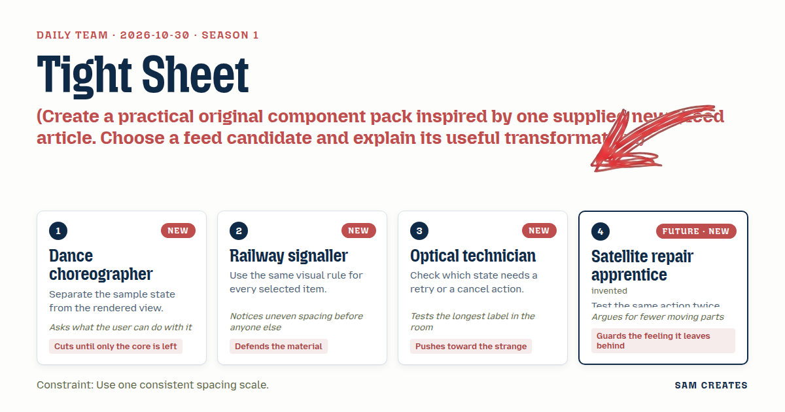
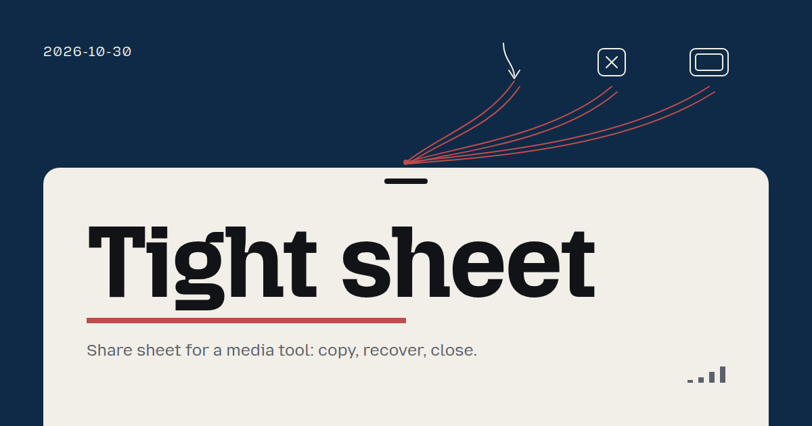
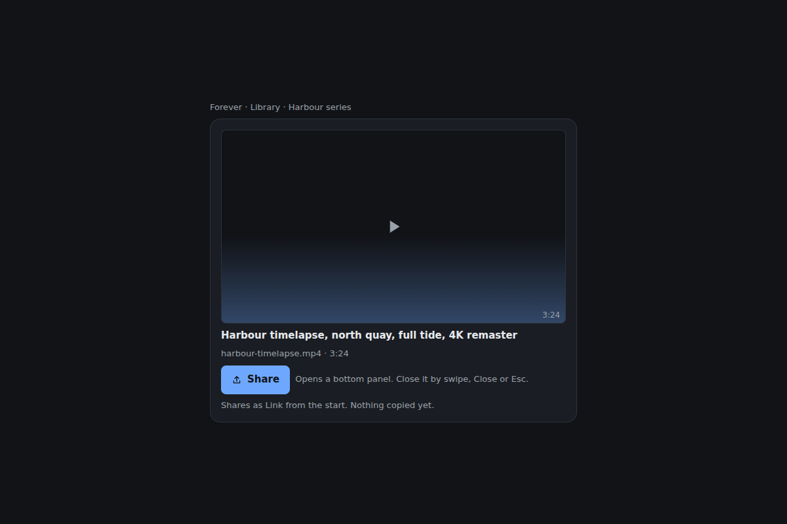
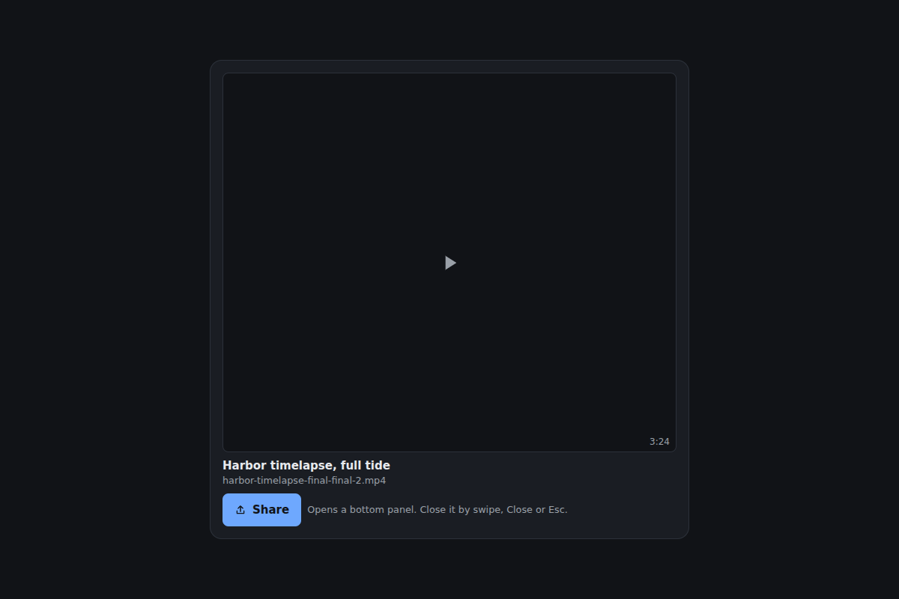
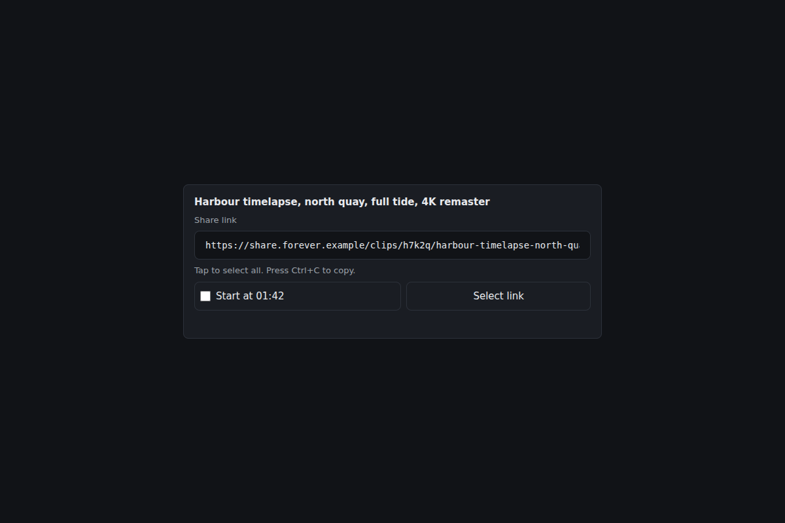
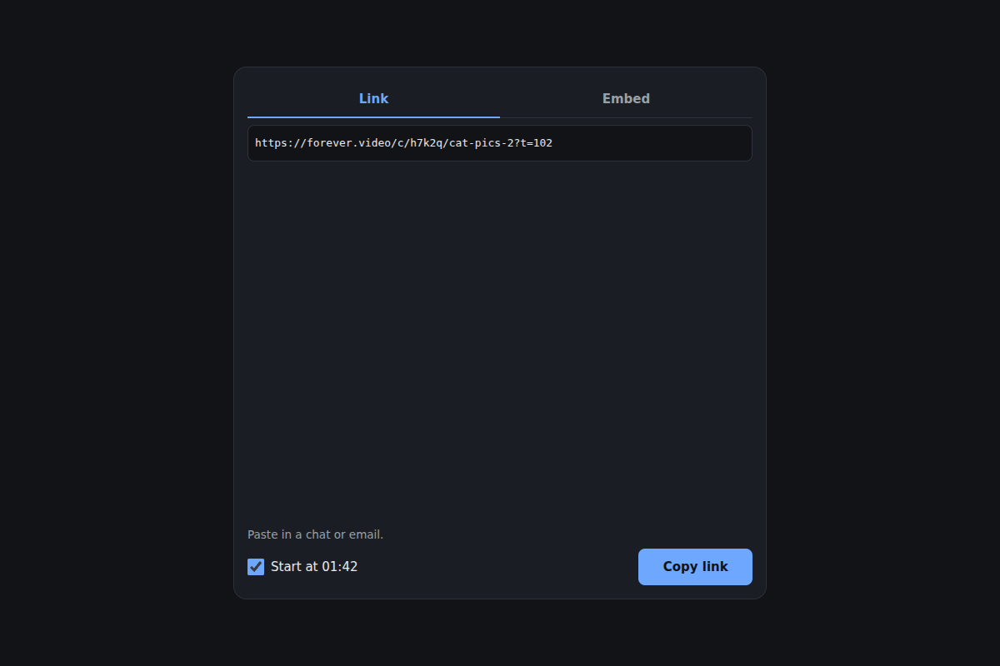
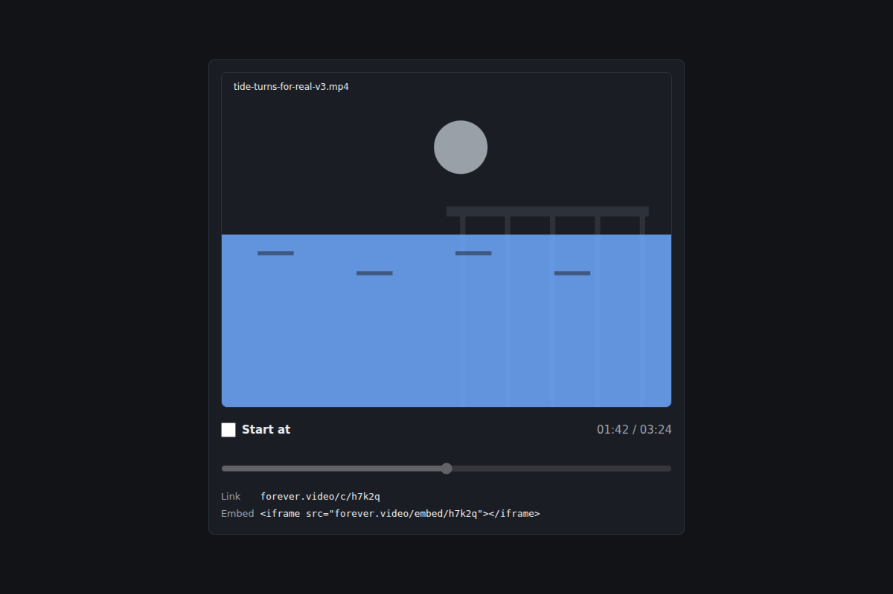
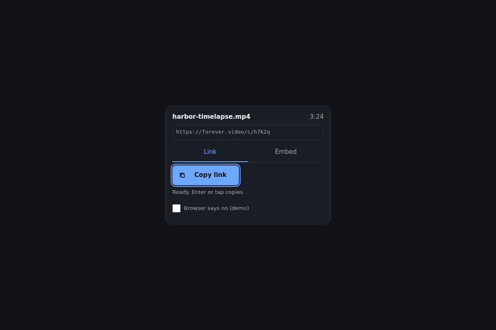
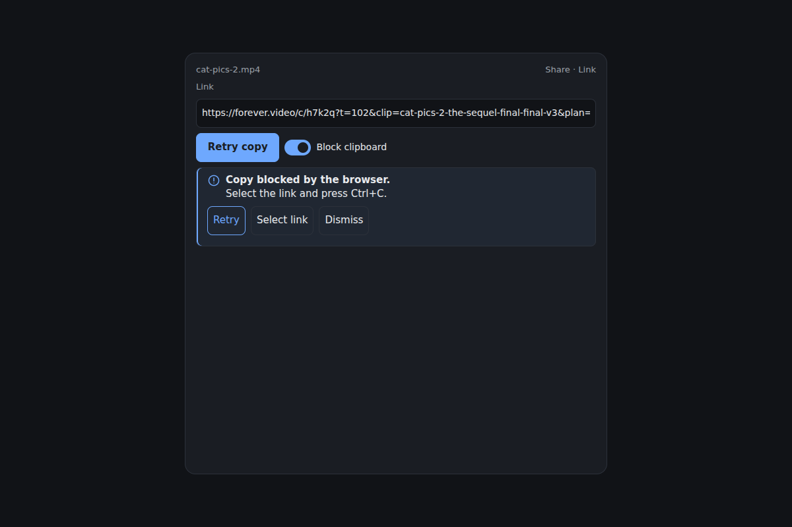

# 2026-10-30: Tight sheet

[Today](../../README.md) · [Archive](../../ARCHIVE.md)



**Task:** Create a practical original component pack inspired by one supplied news/feed article. Choose a feed candidate and explain its useful transformation.

**Constraint:** Use one consistent spacing scale.

**Season:** 2026-10-26

**Decision:** The team builds a share sheet for a media tool where a visitor sets an optional start time, copies a link or embed in one press, sees and recovers from a blocked clipboard, and closes by swipe, button or Escape.



[Cover art direction](cover.json) · [Cover source](cover.html)

## Feed evidence

- smashing: fetched (9 items)
- hacker-news: fetched (20 items)
- codrops: disabled — 2026-10-27: endpoint returns HTTP 410; awaiting verified replacement
- Used feed inspiration: The Death Of The Button: Why The Best Interface Is No Interface — https://smashingmagazine.com/2026/09/death-button-why-best-interface-is-no-interface/
- Chosen opportunity: 8f216ec363408e7c0935b0dd. The article's intent-first argument maps onto the share task's core need of one-step copying. Testing showed the literal no-button version fails on clipboard permission, so the pack keeps its intent and adds visible fallbacks.

[Saved planning input](planning-input.json)

## Asset

[Pack manifest](pack.json) · [Shared tokens](tokens.json) · [Planning input](planning-input.json)

Generated candidates require human review. Library acceptance: unreviewed.

<a href="piece.html"></a>

[Use it](https://isas1.github.io/daily-team/editions/news/2026-10-30/) · [piece.html](piece.html), led by Dance choreographer. Model: claude-opus-5-5.

<a href="artifact-1.html"></a>

[Use it](https://isas1.github.io/daily-team/editions/news/2026-10-30/) · [artifact-1.html](artifact-1.html), led by Dance choreographer. Model: claude-opus-5-5.

<a href="artifact-2.html"></a>

[Use it](https://isas1.github.io/daily-team/editions/news/2026-10-30/) · [artifact-2.html](artifact-2.html), led by Railway signaller. Model: claude-opus-5-5.

<a href="artifact-3.html"></a>

[Use it](https://isas1.github.io/daily-team/editions/news/2026-10-30/) · [artifact-3.html](artifact-3.html), led by Optical technician. Model: claude-opus-5-5.

<a href="artifact-4.html"></a>

[Use it](https://isas1.github.io/daily-team/editions/news/2026-10-30/) · [artifact-4.html](artifact-4.html), led by Satellite repair apprentice. Model: claude-opus-5-5.

<a href="artifact-5.html"></a>

[Use it](https://isas1.github.io/daily-team/editions/news/2026-10-30/) · [artifact-5.html](artifact-5.html), led by Dance choreographer. Model: claude-opus-5-5.

<a href="artifact-6.html"></a>

[Use it](https://isas1.github.io/daily-team/editions/news/2026-10-30/) · [artifact-6.html](artifact-6.html), led by Railway signaller. Model: claude-opus-5-5.

## The session

### Pitch

### Clash

**4 · Satellite repair apprentice:** I tested auto-copy twice. First open, it wrote. Second open from the keyboard shortcut, the browser blocked it with no gesture. Same action, two results. I won't trust it.

**3 · Optical technician:** And it fails without a sound. Someone pastes yesterday's link. That's the state that needs a retry the most, and Tether hides it.

**1 · Dance choreographer:** Then keep the article's real point. Fewer steps. Open the sheet with focus already on Copy. One press, Enter or tap. The button stays.

**2 · Railway signaller:** Fine. But your Copy and Embed have to look like one family. The selected tab, the checked start time and the active snap all use one rule: 2px accent underline, accent text. Three different highlights on a 360px sheet is noise.

**3 · Optical technician:** The lens blur on the link, then. It's strange, I'll give you that. But a blurred URL can't be read or selected, and selecting is the manual fallback when the clipboard fails. I drop it. I keep start time, because it's media.

**1 · Dance choreographer:** Start time earns a row. "Send them to 1:42" is something a person does with a clip every day. The destination list doesn't. The OS share already owns that.

**2 · Railway signaller:** I'll give up the list if the tabs stay. Link and Embed are different material, and copying an iframe into a chat by mistake is a real error.

**4 · Satellite repair apprentice:** Then swipe close has to equal the Close button and Escape exactly. Same focus return, same reset of copy state. I'll press each one twice.

### Decision

The team builds a share sheet for a media tool where a visitor sets an optional start time, copies a link or embed in one press, sees and recovers from a blocked clipboard, and closes by swipe, button or Escape.

Concept: Tight sheet

The Dance choreographer set the frame. One state object renders every view, and the destination grid is cut. The Railway signaller set the single selection rule and the 4/8/16/24 spacing scale, and kept the Link/Embed split. The Optical technician placed retry and select-link fallbacks on the failure state, and supplied the long-URL and long-title stress cases. The Satellite repair apprentice ran the double-press tests that ended auto-copy and made the three close paths equivalent.

Rejected direction: Tether. Auto-copy on open was cut because clipboard writes need a user gesture. A second open failed without any sign. The article's idea survives as focus-on-open, so copying takes one press.

The feed transformation runs against the article's literal claim. It keeps the intent: fewer steps between opening and done. The visible control stays, because the gesture alone gives no feedback and fails without warning.

Source base: https://github.com/isas1/creative-sites-vault/blob/1595af38a69fbb67c674ef4b90b776a2245c270b/00-components/overlays/sam-creates/bottom-sheet/bottom-sheet.html. Retained mechanism: pointer-drag translateY on a handle, with release snapping to a resting position. Improvements: (1) Escape and a visible Close button run the same close routine as swipe, with focus returned to the trigger. (2) Snap positions drop from three to open and closed, and the source's 13px handle gap moves onto the 8px scale. (3) Content scrolls inside the panel at 320px width, and reduced motion sets position without transition. The split-flap button contributes only its reserved-width label swap. Its housing is removed.

Six components earn their place. Each answers one need in the task: container and close, link visibility, what to copy, where in the clip, the copy itself, and failure recovery. The destination list and the QR panel were cut because neither adds a job the OS menu or the link field does not already cover.

```json
{
  "schemaVersion": 1,
  "categoryVersion": 1,
  "id": "media-share-sheet",
  "name": "Media share sheet",
  "description": "A bottom panel for a media tool that copies a link or embed code, sets an optional start time, reports clipboard failure with recovery, and closes by swipe, button or Escape.",
  "project": "Share panel for a clip in a media library: harbour-timelapse.mp4, 3:24 long, shared as a link or an iframe embed.",
  "sizeRationale": "Six rows map to six separate jobs: container and dismissal, link display, format choice, start time, the copy action and failure recovery. A destination grid and a QR panel were cut because they duplicate the OS share menu and the link field.",
  "opportunities": [
    {
      "id": "8f216ec363408e7c0935b0dd",
      "need": "Cut the steps between opening a share panel and having the link on the clipboard.",
      "use": "Sheet opens with focus on Copy, so one Enter or tap copies. Gestures stay as shortcuts with button equivalents.",
      "interaction": "Focus-on-open, one-press copy, swipe or Escape close mirrored by a Close button.",
      "similarity": "The article argues for removing visible interface. This pack keeps the button, because auto-copy without a gesture is blocked by browsers and fails without feedback."
    },
    {
      "id": "906c26c75ab309095d956d6f",
      "need": "Clear action labels in a small panel.",
      "use": "Labels such as Copy link, Copy embed and Retry copy name the result.",
      "interaction": "Label wording only, no new mechanism.",
      "similarity": "Useful as a writing check. Too thin to anchor six components."
    },
    {
      "id": "c15c1be0aad75fb41fbdb15d",
      "need": "Visual variety through CSS random().",
      "use": "Could splay recipient cards.",
      "interaction": "Decorative layout only.",
      "similarity": "Art-led. It conflicts with the one-spacing-scale constraint and adds no user outcome to a share task."
    }
  ],
  "selection": {
    "id": "8f216ec363408e7c0935b0dd",
    "rationale": "The article's intent-first argument maps onto the share task's core need of one-step copying. Testing showed the literal no-button version fails on clipboard permission, so the pack keeps its intent and adds visible fallbacks."
  },
  "tokens": {
    "colors": {
      "dark": { "bg": "#111317", "surface": "#1a1d23", "text": "#e8eaed", "muted": "#9aa0a8", "accent": "#6ea8fe", "border": "#2c313a" },
      "light": { "bg": "#f6f7f9", "surface": "#ffffff", "text": "#16181d", "muted": "#5b616b", "accent": "#2459c7", "border": "#d6d9df" }
    },
    "typography": { "family": "system-ui, -apple-system, 'Segoe UI', Roboto, sans-serif", "size": "15px" },
    "spacing": { "gap": "8px", "padding": "16px" },
    "radii": { "control": "8px" },
    "motion": { "duration": "200ms", "easing": "ease-out" }
  },
  "components": [
    {
      "row": 1,
      "id": "share-sheet-frame",
      "file": "artifact-1.html",
      "name": "Share sheet frame",
      "description": "Modal bottom panel with a drag handle, a Close button and Escape, all running one close routine.",
      "category": "Layout",
      "tags": ["bottom-sheet", "dialog", "swipe-dismiss", "focus-return", "escape-key"],
      "purpose": "Hold the share controls and close them by any of three equal paths.",
      "use": "An editor opens Share on a clip, copies, then swipes the panel down with a thumb.",
      "input": "Tap Share to open. Drag the handle down, or tap Close. Keyboard: Enter on Share opens, Escape or Enter on Close closes, Tab cycles inside the panel.",
      "outcome": "Panel rises to its open height with focus on the copy button. Closing slides it away and returns focus to Share.",
      "recovery": "A drag released above the threshold springs back to open. Reopening restores the last format and start time, and clears copy status.",
      "mechanism": "Native dialog element opened with showModal. Pointer events on the handle set translateY. On release, the panel closes if travel is over 30% of its height or velocity is over 0.5 px/ms. Otherwise it returns to open. Swipe, Close and Escape all call close(), which resets copy state and focuses the trigger.",
      "nearestAnalogue": "2026-10-29 cancel import used Escape and a bottom-edge target to stop a job. This frame uses the same reach for dismissal and adds drag with focus return.",
      "usefulness": "A share panel that only closes by swipe excludes keyboard and switch users. Equal paths remove that gap.",
      "creativeDifference": "Three close paths share one routine, so their side effects cannot drift apart.",
      "states": ["closed: not rendered, reached on load and after any close", "open: resting height with focus on Copy, reached by Share", "dragging: follows pointer, reached by pointer down on the handle", "spring-back: returns to open, reached by release under threshold", "closing: slides out over 200ms, reached by swipe, Close or Escape", "narrow: content scrolls inside the panel at 320px width", "reduced-motion: position set without transition"],
      "sources": [
        { "title": "Bottom sheet (creative-sites-vault)", "url": "https://github.com/isas1/creative-sites-vault/blob/1595af38a69fbb67c674ef4b90b776a2245c270b/00-components/overlays/sam-creates/bottom-sheet/bottom-sheet.html" },
        { "title": "ARIA Authoring Practices: Dialog (Modal)", "url": "https://www.w3.org/WAI/ARIA/apg/patterns/" }
      ]
    },
    {
      "row": 2,
      "id": "link-field",
      "file": "artifact-2.html",
      "name": "Link field",
      "description": "Read-only URL field that selects in full on focus and scrolls long links instead of truncating them.",
      "category": "Inputs",
      "tags": ["read-only-input", "url", "select-all", "overflow", "manual-copy"],
      "purpose": "Show the exact link that will be copied and allow manual selection.",
      "use": "An editor checks that the link ends in ?t=102 before pasting it into a review thread.",
      "input": "Tap or click the field to select all. Keyboard: Tab into the field selects all, arrow keys move the caret, Ctrl+C or Cmd+C copies.",
      "outcome": "Full URL is selected and readable. A 140-character link scrolls horizontally inside the field with a fade at the hidden edge.",
      "recovery": "Clicking elsewhere clears the selection. The field cannot be edited, so the link cannot be broken by a stray key.",
      "mechanism": "input type=text with readonly. A focus listener calls select(). A scroll listener toggles the fade on the clipped side. The value is rendered from shared state and never parsed back.",
      "nearestAnalogue": "2026-10-29 choose files empty state also used a native input behind a clear label. That input took files in. This one exposes a value for reading and selection.",
      "usefulness": "The visitor can verify the link, and the field is the manual fallback when the clipboard is blocked.",
      "creativeDifference": "Long links scroll in place with no middle ellipsis, so every character stays reachable.",
      "states": ["idle: link shown from the start", "focused: full selection with 2px accent ring, reached by Tab or tap", "overflowing: edge fade, reached when the link exceeds field width", "updated: value replaced, reached by a start-time or format change", "selected-by-fallback: full selection, reached by Select link in the failure notice"],
      "sources": [
        { "title": "ARIA Authoring Practices patterns", "url": "https://www.w3.org/WAI/ARIA/apg/patterns/" }
      ]
    },
    {
      "row": 3,
      "id": "format-tabs",
      "file": "artifact-3.html",
      "name": "Format tabs",
      "description": "Two tabs, Link and Embed, that switch what the panel shows and what Copy writes.",
      "category": "Navigation",
      "tags": ["tabs", "embed", "roving-tabindex", "format-switch", "selection-rule"],
      "purpose": "Choose between a shareable link and iframe embed code.",
      "use": "An editor switches to Embed to paste the clip into a blog draft.",
      "input": "Click or tap a tab. Keyboard: Tab into the tablist, Left and Right move and activate, Home and End jump to the ends.",
      "outcome": "The Embed panel shows the iframe snippet in a read-only monospace block. The copy label changes to Copy embed.",
      "recovery": "Switching back to Link restores the link view. Start time carries across both formats.",
      "mechanism": "APG tabs pattern with automatic activation and roving tabindex. The selected tab uses the pack's one selection rule: 2px accent underline and accent text. The embed block scrolls horizontally with wrapping off.",
      "nearestAnalogue": "2026-10-28 range selector, a radio group that replaced a data window. These tabs swap the panel content and the copy target.",
      "usefulness": "Pasting an iframe into a chat, or a bare link into a CMS embed slot, are common mistakes. A named format prevents both.",
      "creativeDifference": "The tab choice also renames the copy action, so the label always states what will land on the clipboard.",
      "states": ["link-selected: default on open", "embed-selected: snippet shown, reached by tab or arrow", "focus: ring on the active tab, reached by Tab", "overflow: snippet scrolls horizontally at 320px width"],
      "sources": [
        { "title": "ARIA Authoring Practices: Tabs", "url": "https://www.w3.org/WAI/ARIA/apg/patterns/" }
      ]
    },
    {
      "row": 4,
      "id": "start-time",
      "file": "artifact-4.html",
      "name": "Start time",
      "description": "Checkbox and slider over a clip preview that add a start offset to the shared link.",
      "category": "Media",
      "tags": ["start-time", "timestamp", "range-input", "media-preview", "deep-link"],
      "purpose": "Send recipients to a chosen moment in the clip.",
      "use": "An editor ticks Start at, drags to 01:42 and shares the moment the tide turns.",
      "input": "Tap the checkbox, then drag the slider. Keyboard: Space toggles the checkbox, Left and Right step 1 second, Page Up and Page Down step 10, Home and End jump to 00:00 and 03:24.",
      "outcome": "The preview poster jumps to the nearest sampled frame and the time label updates. The link gains ?t=102, or the embed gains start=102.",
      "recovery": "Unticking removes the offset and keeps the slider position for next time. Setting 00:00 removes the parameter.",
      "mechanism": "Native checkbox and input type=range, min 0, max 204, step 1. Posters are 12 pre-sampled frames picked by nearest index. The time label has a fixed width set from '00:00 / 03:24'.",
      "nearestAnalogue": "2026-10-19 scroll progress mapped position to a value with no data points. This control writes a value into a URL and previews the frame.",
      "usefulness": "Linking to a moment instead of the start is the main reason to share from a media tool.",
      "creativeDifference": "The preview frame confirms the moment visually before the link leaves the tool.",
      "states": ["off: slider disabled, link has no offset, reached on first open", "on: slider enabled, reached by ticking", "scrubbing: frame and label update live, reached by drag or arrows", "zero: offset dropped at 00:00", "focus: ring on checkbox or slider", "reduced-motion: frame swaps without crossfade"],
      "sources": [
        { "title": "ARIA Authoring Practices: Slider", "url": "https://www.w3.org/WAI/ARIA/apg/patterns/" }
      ]
    },
    {
      "row": 5,
      "id": "copy-button",
      "file": "artifact-5.html",
      "name": "Copy button",
      "description": "Native button that writes the current format to the clipboard and swaps its label within a reserved width.",
      "category": "Actions",
      "tags": ["copy", "clipboard", "label-swap", "pending", "button", "dedupe"],
      "purpose": "Put the link or embed on the clipboard in one press.",
      "use": "An editor opens Share and presses Enter. The label reads Copied.",
      "input": "Click or tap the button. Keyboard: focus lands on it when the sheet opens, and Enter or Space activates it.",
      "outcome": "The clipboard holds the current link or snippet. The label reads Copied for 2000ms, then returns to Copy link or Copy embed.",
      "recovery": "Presses during pending are ignored. Pressing after Copied copies again and restarts the 2000ms timer. A rejection hands off to the failure notice and sets the label to Retry copy.",
      "mechanism": "navigator.clipboard.writeText runs inside the click handler. The pending label shows only if the promise takes more than 150ms. Width is reserved from the longest label, Retry copy. A demo toggle forces rejection.",
      "nearestAnalogue": "2026-10-28 pin pair also swapped labels in a reserved width. That button kept chart pins. This one performs an async browser write with pending and failure.",
      "usefulness": "Copying is the core outcome of the task, and the label states clearly whether it worked.",
      "creativeDifference": "Focus on open plus a gesture-bound write keeps the one-step intent from the article and stays within browser permission rules.",
      "states": ["idle: 'Copy link' or 'Copy embed'", "pressed: 1px sink on pointer down or key down", "pending: 'Copying', disabled, reached after 150ms without resolve", "success: 'Copied' for 2000ms", "retry: 'Retry copy', reached on rejection", "focus: 2px accent ring, reached on sheet open or Tab"],
      "sources": [
        { "title": "Riffle label button (creative-sites-vault)", "url": "https://github.com/isas1/creative-sites-vault/blob/1595af38a69fbb67c674ef4b90b776a2245c270b/00-components/buttons/splitflap/01-riffle-label-button.html" },
        { "title": "The Death Of The Button: Why The Best Interface Is No Interface", "url": "https://smashingmagazine.com/2026/09/death-button-why-best-interface-is-no-interface/" },
        { "title": "ARIA Authoring Practices: Button", "url": "https://www.w3.org/WAI/ARIA/apg/patterns/" }
      ]
    },
    {
      "row": 6,
      "id": "clipboard-failure-notice",
      "file": "artifact-6.html",
      "name": "Clipboard failure notice",
      "description": "Inline notice that names a blocked copy and offers Retry, Select link and Dismiss.",
      "category": "Feedback",
      "tags": ["error", "clipboard", "retry", "fallback", "live-region"],
      "purpose": "Make a failed copy visible and give two ways to finish it.",
      "use": "A browser blocks the clipboard. The editor presses Select link, then Ctrl+C.",
      "input": "Tap or click Retry, Select link or Dismiss. Keyboard: Tab to each button, Enter or Space.",
      "outcome": "Message reads 'Copy blocked by the browser. Select the link and press Ctrl+C.' Select link focuses and selects the link field or embed block.",
      "recovery": "Retry runs the copy again from a fresh gesture. A success clears the notice. Dismiss hides it and returns focus to Copy. Closing the sheet clears it.",
      "mechanism": "Rendered only when copyStatus is 'failed'. Text sits in a polite live region. The shortcut reads Cmd+C on macOS. Retry calls the same handler as the copy button, and the copy button and notice disable together while pending.",
      "nearestAnalogue": "2026-10-27 pipeline panel retried a failed build step. This notice adds a manual fallback that does not depend on the failing API.",
      "usefulness": "A silent clipboard failure leads to pasting a stale link. The notice prevents that.",
      "creativeDifference": "Recovery has two independent paths, one through the API and one through selection, so a permanently blocked clipboard still ends in a copied link.",
      "states": ["hidden: copyStatus not failed", "shown: message with three actions, reached on rejection", "retrying: actions disabled, reached by Retry", "cleared: hidden after a later success", "dismissed: hidden with focus on Copy, reached by Dismiss", "long-message: wraps within 320px width without clipping"],
      "sources": [
        { "title": "ARIA Authoring Practices: Alert", "url": "https://www.w3.org/WAI/ARIA/apg/patterns/" }
      ]
    }
  ],
  "demo": {
    "file": "piece.html",
    "rows": [1, 2, 3, 4, 5, 6],
    "sharedState": "One object { clip: { id: 'h7k2q', title: 'Harbour timelapse, north quay, full tide, 4K remaster', duration: 204 }, open, format: 'link'|'embed', startOn, startSec, copyStatus: 'idle'|'pending'|'copied'|'failed', denyClipboard } drives one render(). Start time and format tabs write startOn, startSec and format. The link field and embed block render the derived string. The copy button writes that string and sets copyStatus. The failure notice reads copyStatus and targets the field. Every frame close path resets copyStatus and returns focus to Share. A demo toggle sets denyClipboard."
  }
}
```

### Build notes

1. Spacing uses only 4, 8, 16 and 24px. The handle sits 8px from the top edge, with 16px panel padding and 8px between rows. Check the source's 13px handle gap and remove it.
2. Test each close path twice in a row: swipe, Close and Escape. After each, focus must be on Share and copyStatus must be idle. Repeat with denyClipboard on, using the 140-character link at 320px width.
3. Bind the clipboard write directly in the click and keydown handlers. Do not route it through setTimeout or a promise chain started elsewhere. The copy button's reserved width must fit "Retry copy" at 15px system-ui.

**Guest:** Satellite repair apprentice (future; invented). The method is drawn from public-domain history, myth, or literature, or invented. The guest speaks in character in original words, never quoting the source, and nothing here is endorsed by anyone.

## Team

```text
Team for 2026-10-30
Season: 2026-10-26

1. Dance choreographer [new]
   Method: Separate the sample state from the rendered view. [new]
   Stance: Cuts until only the core is left.
   Temperament: Asks what the user can do with it.
2. Railway signaller [new]
   Method: Use the same visual rule for every selected item. [new]
   Stance: Defends the material.
   Temperament: Notices uneven spacing before anyone else.
3. Optical technician [new]
   Method: Check which state needs a retry or a cancel action. [new]
   Stance: Pushes toward the strange.
   Temperament: Tests the longest label in the room.
4. Satellite repair apprentice (future; invented) [guest] [new]
   Method: Test the same action twice before trusting it.
   Stance: Guards the feeling it leaves behind.
   Temperament: Argues for fewer moving parts.

Constraint: Use one consistent spacing scale.
Task: Share sheet: a bottom panel for a media tool that copies a link, reports failure and closes with a swipe, button or key.
```

Provider: claude. Model: claude-opus-5-5.
