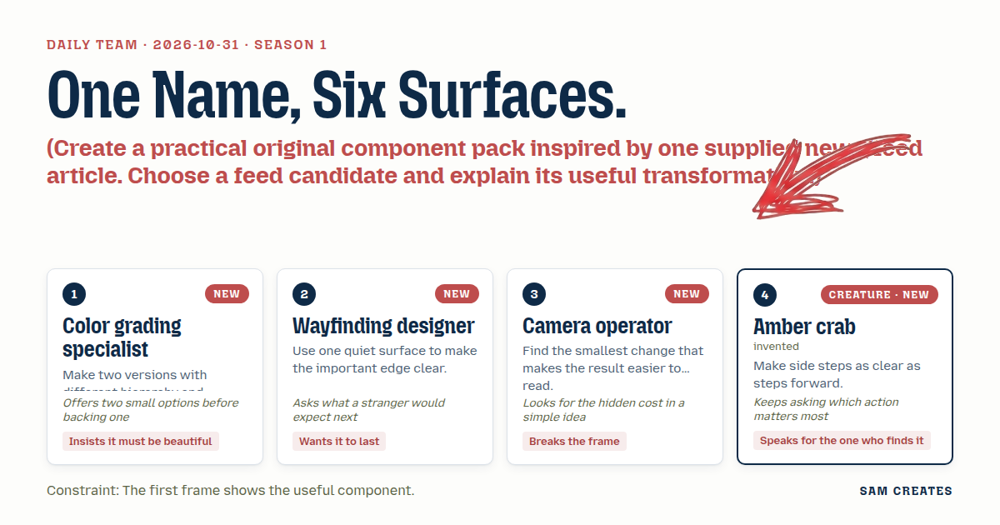
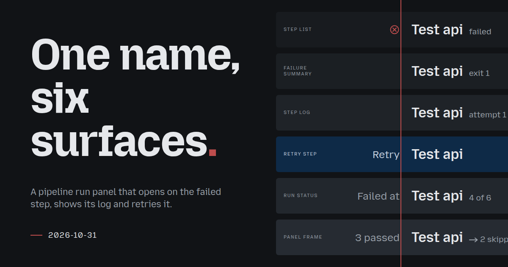
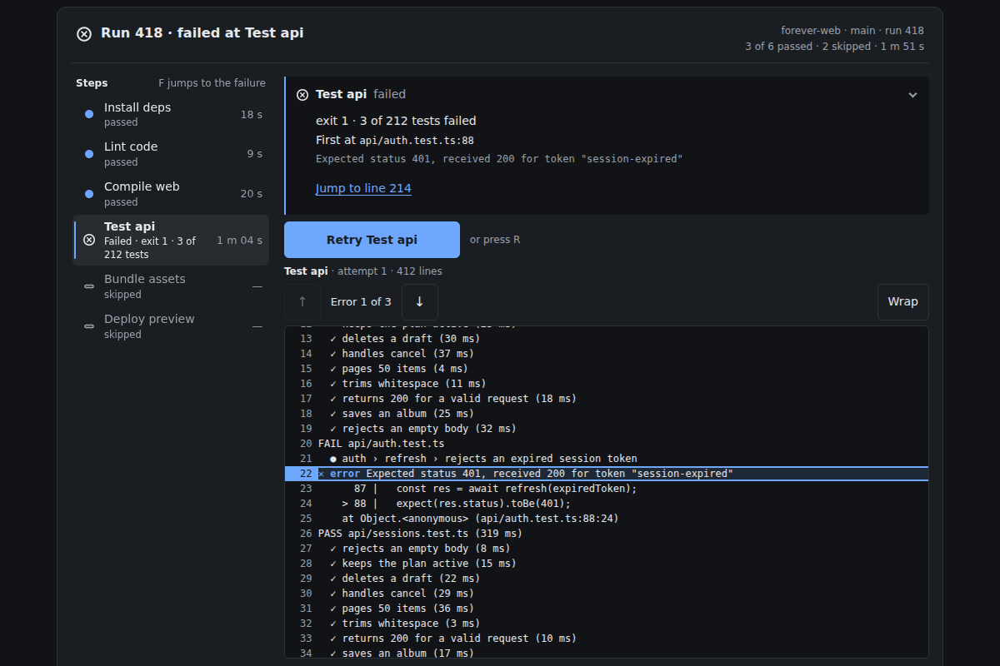
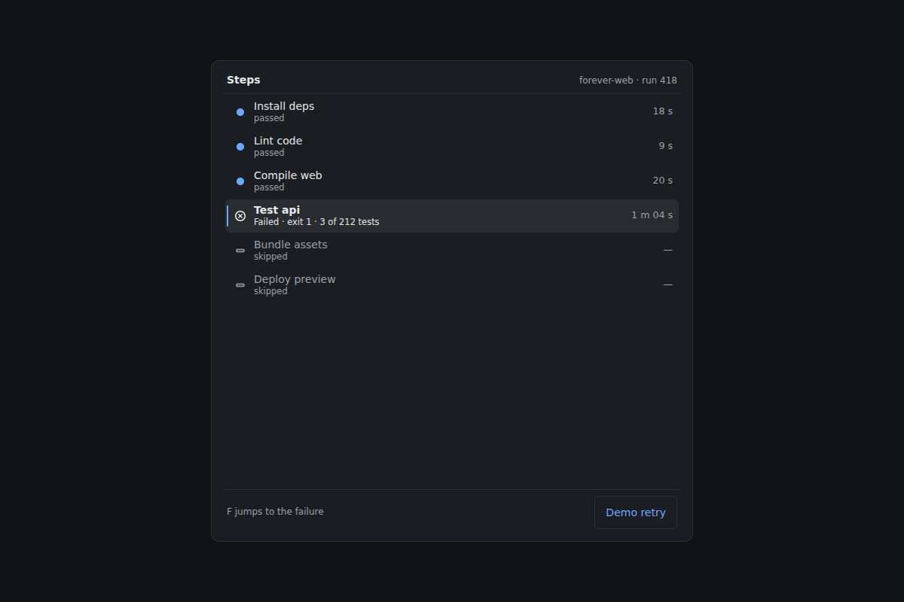
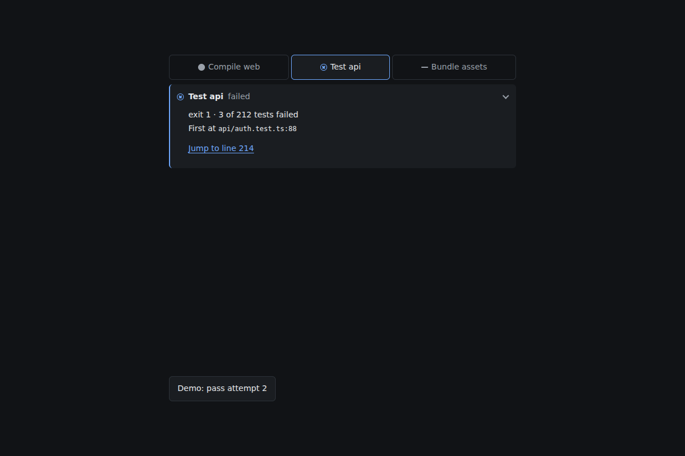
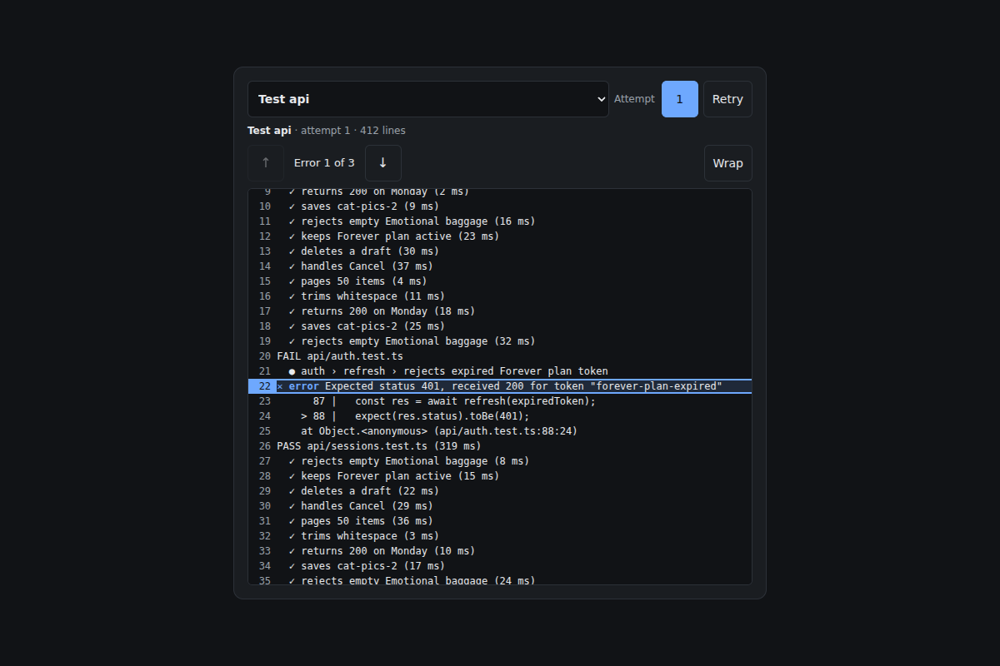
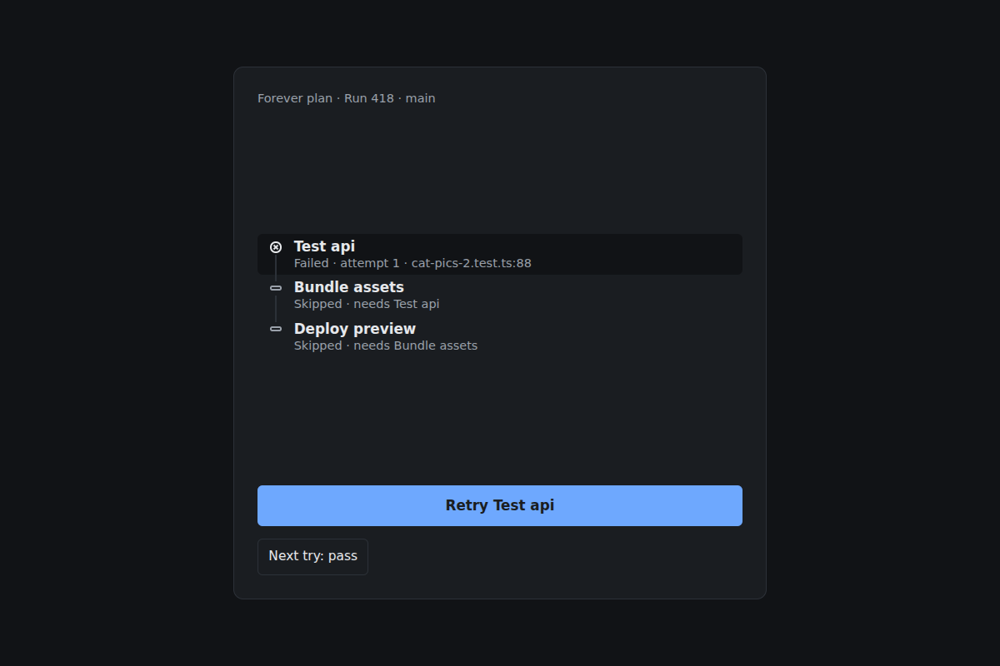
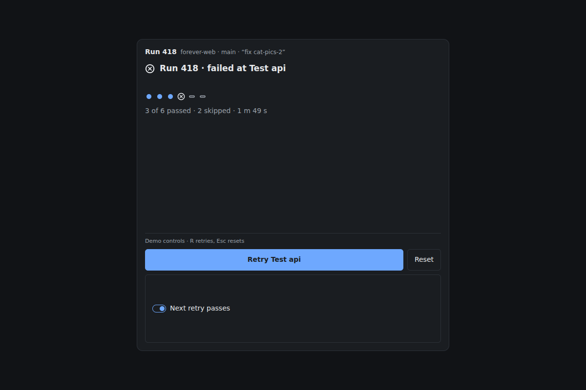
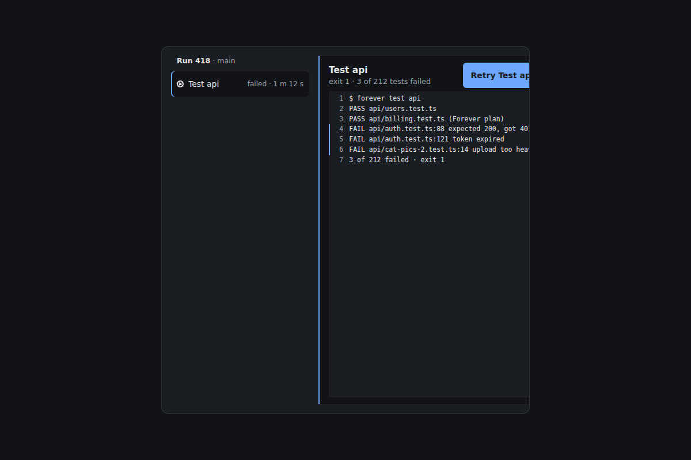

# 2026-10-31: One name, six surfaces.

[Today](../../README.md) · [Archive](../../ARCHIVE.md)



**Task:** Create a practical original component pack inspired by one supplied news/feed article. Choose a feed candidate and explain its useful transformation.

**Constraint:** The first frame shows the useful component.

**Season:** 2026-10-26

**Decision:** The team builds a pipeline run panel where a developer lands on run 418, sees "Test api" failed in the first frame, reads the cause and the error lines, retries that one step, and watches the skipped steps run after it.



[Cover art direction](cover.json) · [Cover source](cover.html)

## Feed evidence

- smashing: fetched (8 items)
- hacker-news: fetched (20 items)
- codrops: disabled — 2026-10-27: endpoint returns HTTP 410; awaiting verified replacement
- Used feed inspiration: A Practical Guide To Naming Things — https://smashingmagazine.com/2026/10/how-name-things/
- Chosen opportunity: 906c26c75ab309095d956d6f. Naming is the practical gap in pipeline panels. Applying verb-object names consistently across six surfaces makes the target of each action unambiguous. The other two candidates add decoration or invented data.

[Saved planning input](planning-input.json)

## Asset

[Pack manifest](pack.json) · [Shared tokens](tokens.json) · [Planning input](planning-input.json)

Generated candidates require human review. Library acceptance: unreviewed.

<a href="piece.html"></a>

[Use it](https://isas1.github.io/daily-team/editions/news/2026-10-31/) · [piece.html](piece.html), led by Color grading specialist. Model: claude-opus-5-5.

<a href="artifact-1.html"></a>

[Use it](https://isas1.github.io/daily-team/editions/news/2026-10-31/) · [artifact-1.html](artifact-1.html), led by Color grading specialist. Model: claude-opus-5-5.

<a href="artifact-2.html"></a>

[Use it](https://isas1.github.io/daily-team/editions/news/2026-10-31/) · [artifact-2.html](artifact-2.html), led by Wayfinding designer. Model: claude-opus-5-5.

<a href="artifact-3.html"></a>

[Use it](https://isas1.github.io/daily-team/editions/news/2026-10-31/) · [artifact-3.html](artifact-3.html), led by Camera operator. Model: claude-opus-5-5.

<a href="artifact-4.html"></a>

[Use it](https://isas1.github.io/daily-team/editions/news/2026-10-31/) · [artifact-4.html](artifact-4.html), led by Amber crab. Model: claude-opus-5-5.

<a href="artifact-5.html"></a>

[Use it](https://isas1.github.io/daily-team/editions/news/2026-10-31/) · [artifact-5.html](artifact-5.html), led by Color grading specialist. Model: claude-opus-5-5.

<a href="artifact-6.html"></a>

[Use it](https://isas1.github.io/daily-team/editions/news/2026-10-31/) · [artifact-6.html](artifact-6.html), led by Wayfinding designer. Model: claude-opus-5-5.

## The session

### Pitch

### Clash

**1 · Color grading specialist:** I ran both hierarchies in my head. Log-first looks better in a screenshot and reads worse. Summary-first wins. I still want the history strip.

**2 · Wayfinding designer:** The strip answers "is this flaky", which is a later question. A stranger's next question is "why did this run fail". The strip costs a row and does not answer it.

**3 · Camera operator:** Agree. Hidden cost in the strip: twenty runs of sample data, and someone will read the colours as real trends.

**4 · Amber crab:** Which action matters most? Retry. The strip has no action. My claws say drop it.

**1 · Color grading specialist:** Fine. Then the beauty goes into the type ramp and one accent. Tabular numerals on durations so the column never shifts.

**3 · Camera operator:** My inline drop has a cost of its own. On a 320px screen, three passed steps above push the failed row down. Smallest fix: fold the passed steps into one row, "3 passed · 47 s", and the skipped ones into "2 skipped". The failed step sits between them in the first frame.

**2 · Wayfinding designer:** That fold is a layout job, separate from the list's navigation job. Keep it as its own component so it lasts when the list changes.

**4 · Amber crab:** And the fold keeps the skipped row tappable. Side step, same weight as the step forward.

### Decision

The team builds a pipeline run panel where a developer lands on run 418, sees "Test api" failed in the first frame, reads the cause and the error lines, retries that one step, and watches the skipped steps run after it.

Concept: One name, six surfaces.

The Wayfinding designer set the first-frame rule and brought the naming transformation: one names table keyed by step id that every component reads. The Color grading specialist compared two hierarchies, chose summary-first and set the tokens. The Camera operator found the hidden cost of the inline log on phones and proposed the fold that became row 6. The Amber crab made skipped steps selectable with a stated reason, and tied retry to re-queuing them.

Rejected: the run history strip. It answers a later question, it needs invented history, and it has no action.

No component_source was supplied. The rows adapt ideas from the inspiration bank: stage selection and failure detail from ci-pipeline-oscilloscope, line reading from rolling-log-band, label swap from the riffle button, and the arc from the arc spinner. No code is copied.

Six components earn their place because each does one job the developer needs in order. Choose a step, learn why it failed, read the raw evidence, act, see the result, and keep all of it on one screen at 320px. A seventh row for history was cut.

```json
{
  "schemaVersion": 1,
  "categoryVersion": 1,
  "id": "pipeline-run-panel",
  "name": "Pipeline run panel",
  "description": "A status panel for a build tool that opens on the failed step, explains it, shows its log, and retries it in a local demo. One step name is used on every surface.",
  "project": "Run 418 on branch main of a sample web repo. Six steps: Install deps, Lint code, Compile web, Test api, Bundle assets, Deploy preview. Test api failed, and the last two steps were skipped.",
  "sizeRationale": "Six rows cover the developer's sequence: choose a step, read the cause, read the log, retry, follow status, and hold the layout on small screens. A history strip was cut because it answers a later question and has no action.",
  "opportunities": [
    {
      "id": "906c26c75ab309095d956d6f",
      "need": "Build steps are often named inconsistently between the step list, the log header and the action buttons, so a developer cannot tell which step a retry targets.",
      "use": "A developer reads 'Retry Test api' and knows it reruns only that step, using the same words shown in the list and the log header.",
      "interaction": "A single names table with verb-object step names feeds the list, summary, log header, retry label and status line.",
      "similarity": "The article covers naming UI components. This pack applies its conventions to runtime labels. 2026-10-27 recorded the same task with no components, so this is the first build of it."
    },
    {
      "id": "c15c1be0aad75fb41fbdb15d",
      "need": "No clear need. Randomness could stagger glyph entry or jitter retry timing.",
      "use": "Decorative variance on status glyphs.",
      "interaction": "CSS random() on delays.",
      "similarity": "Random visual variance conflicts with a status panel, where position and timing must stay stable. Weak fit."
    },
    {
      "id": "b008f772ace718d60f01070e",
      "need": "Showing the time cost of failed runs.",
      "use": "A wasted-minutes counter.",
      "interaction": "Aggregated cost display.",
      "similarity": "This is a reporting concern outside a single run panel. It would need invented data. Weak fit."
    }
  ],
  "selection": {
    "id": "906c26c75ab309095d956d6f",
    "rationale": "Naming is the practical gap in pipeline panels. Applying verb-object names consistently across six surfaces makes the target of each action unambiguous. The other two candidates add decoration or invented data."
  },
  "tokens": {
    "colors": {
      "dark": { "bg": "#111316", "surface": "#1a1d21", "text": "#e6e8eb", "muted": "#9aa1aa", "accent": "#6ea8fe", "border": "#2c3138" },
      "light": { "bg": "#f6f7f9", "surface": "#ffffff", "text": "#16191d", "muted": "#5b636d", "accent": "#1f5fbf", "border": "#d5d9df" }
    },
    "typography": { "family": "system-ui, -apple-system, 'Segoe UI', Roboto, sans-serif", "size": "14px" },
    "spacing": { "gap": "8px", "padding": "16px" },
    "radii": { "control": "6px" },
    "motion": { "duration": "180ms", "easing": "ease-out" }
  },
  "components": [
    {
      "row": 1,
      "id": "step-list",
      "file": "artifact-1.html",
      "name": "Step list",
      "description": "Listbox of pipeline steps with shape glyphs and fixed-width durations. The first failed step is selected on load.",
      "category": "Navigation",
      "tags": ["listbox", "pipeline", "steps", "status-glyph", "roving-tabindex", "first-frame"],
      "purpose": "Choose which step the panel describes, starting on the failure.",
      "use": "A developer opens run 418 and finds Test api already selected. They press Down to read why Bundle assets was skipped.",
      "input": "Click or tap a row. Keyboard: Tab into the list, Up and Down move, Home and End jump, F moves to the next failed step, Enter selects.",
      "outcome": "The selected step drives rows 2 to 4. A skipped step reads 'Skipped because Test api failed'.",
      "recovery": "Selecting another step changes nothing in the run. After a retry, the selection stays on the retried step.",
      "mechanism": "Listbox with roving tabindex. Rows are built from the shared names table and the step-state array. Glyphs: filled dot for passed, ringed cross for failed, hollow dash for skipped, hollow ring for queued, 12px arc for running. Each glyph has a visible word. Durations use tabular-nums in a column reserved from '1 m 59 s'.",
      "nearestAnalogue": "2026-10-30 source tabs showed request state in a fixed glyph slot across three sources. This list orders dependent steps and states why a step did not run.",
      "usefulness": "It puts the failure in the first frame and makes each step one keypress away.",
      "creativeDifference": "Skipped steps are selectable and give their cause, so the side step is as legible as the failure.",
      "states": [
        "loaded: Test api selected, reached on load",
        "selected: 2px accent left edge, reached by click or Enter",
        "focus: 2px ring, reached by Tab or arrows",
        "skipped-selected: reason line shown, reached by selecting Bundle assets or Deploy preview",
        "running: arc glyph on the retried step, reached by row 4",
        "all-passed: F does nothing and the hint reads 'No failed steps'"
      ],
      "sources": [
        { "title": "CI pipeline oscilloscope (creative-sites-vault)", "url": "https://github.com/isas1/creative-sites-vault/blob/1595af38a69fbb67c674ef4b90b776a2245c270b/00-components/devtools-delivery/ci-oscilloscope/ci-pipeline-oscilloscope.html" },
        { "title": "A Practical Guide To Naming Things", "url": "https://smashingmagazine.com/2026/10/how-name-things/" },
        { "title": "ARIA Authoring Practices: Listbox", "url": "https://www.w3.org/WAI/ARIA/apg/patterns/" }
      ]
    },
    {
      "row": 2,
      "id": "failure-summary",
      "file": "artifact-2.html",
      "name": "Failure summary",
      "description": "Disclosure card stating the failed step, exit code, failing count and first error location, with a link into the log.",
      "category": "Content",
      "tags": ["disclosure", "error", "summary", "exit-code", "deep-link"],
      "purpose": "Say why the step failed in two lines before any log reading.",
      "use": "A developer reads 'Test api · exit 1 · 3 of 212 tests failed · first at api/auth.test.ts:88' and jumps to it.",
      "input": "Click or tap the header to collapse or expand, and tap 'Jump to line 214'. Keyboard: Tab to the header, Enter or Space toggles. Tab to the link, Enter jumps.",
      "outcome": "The summary is open by default for failed steps. The jump scrolls row 3 to the line and focuses it.",
      "recovery": "Collapsing keeps a one-line header. Selecting a passed step replaces the card with 'Passed in 31 s'. After a successful retry, the card reads 'Passed on attempt 2' and the earlier failure stays under 'Attempt 1'.",
      "mechanism": "A button with aria-expanded controls a region. Content is derived from the step record: name, exit code, counts and the first error line index. One quiet surface carries a single 2px border edge on the failure side. No other border is used.",
      "nearestAnalogue": "2026-10-30 failure plate laid a cause over stale content. This card summarises a build failure and links to the exact log line.",
      "usefulness": "Most developers need only the first error location to start a fix.",
      "creativeDifference": "Attempts stack as named history inside one card, so a retry never erases the earlier failure.",
      "states": [
        "open: shown for a failed step on load",
        "collapsed: header only, reached by toggle",
        "passed: one-line duration, reached by selecting a passed step",
        "skipped: 'Did not run', reached by selecting a skipped step",
        "recovered: 'Passed on attempt 2' with attempt 1 kept, reached by a successful retry",
        "focus: 2px ring on header or link"
      ],
      "sources": [
        { "title": "CI pipeline oscilloscope (creative-sites-vault)", "url": "https://github.com/isas1/creative-sites-vault/blob/1595af38a69fbb67c674ef4b90b776a2245c270b/00-components/devtools-delivery/ci-oscilloscope/ci-pipeline-oscilloscope.html" },
        { "title": "ARIA Authoring Practices: Disclosure", "url": "https://www.w3.org/WAI/ARIA/apg/patterns/" }
      ]
    },
    {
      "row": 3,
      "id": "step-log",
      "file": "artifact-3.html",
      "name": "Step log",
      "description": "Monospace log for one step with line numbers, horizontal scroll, a wrap toggle and next and previous error jumps.",
      "category": "Data",
      "tags": ["log", "monospace", "line-numbers", "error-jump", "horizontal-scroll", "wrap-toggle"],
      "purpose": "Show the raw output of the selected step and move between its errors.",
      "use": "A developer reads 'Error 2 of 3' at line 301 and copies the stack trace without line numbers.",
      "input": "Scroll or swipe the log, and tap Previous error, Next error or Wrap. Keyboard: Tab into the log region, arrow keys scroll, N and Shift+N jump between errors, W toggles wrap.",
      "outcome": "The current error line is outlined and the counter updates. The header names the step and attempt: 'Test api · attempt 1 · 412 lines'.",
      "recovery": "The buttons disable at the first and last error. A step with no errors reads 'No errors · 96 lines'. Switching attempts keeps each attempt's scroll position.",
      "mechanism": "Lines render from an array in a focusable region. Line numbers come from a CSS counter in a gutter with user-select none, so copied text excludes them. Error lines carry a glyph and the word 'error'. Long lines scroll horizontally unless Wrap is on. Rows use content-visibility to keep 412 lines cheap.",
      "nearestAnalogue": "2026-10-26 log viewer filtered sample events by severity across a stream. This log reads one step's raw output and navigates by error.",
      "usefulness": "The log is the evidence. Error jumps and clean copy save the scrolling a developer would otherwise do.",
      "creativeDifference": "The header carries the shared step name and the attempt number, so a reader never confuses two runs of the same step.",
      "states": [
        "error-focused: line 214 outlined, reached on load or by the row 2 jump",
        "browsing: free scroll, reached by scroll or arrows",
        "wrapped: lines wrap, reached by W or the Wrap toggle",
        "no-errors: counter hidden with 'No errors', reached by selecting a passed step",
        "empty: 'Did not run', reached by selecting a skipped step",
        "streaming: lines append during a retry with auto-follow, paused when the reader scrolls up",
        "focus: 2px ring on the region"
      ],
      "sources": [
        { "title": "Rolling log band (creative-sites-vault)", "url": "https://github.com/isas1/creative-sites-vault/blob/1595af38a69fbb67c674ef4b90b776a2245c270b/00-components/monitors-logs/forever/rolling-log-band/rolling-log-band.html" },
        { "title": "ARIA Authoring Practices patterns", "url": "https://www.w3.org/WAI/ARIA/apg/patterns/" }
      ]
    },
    {
      "row": 4,
      "id": "retry-step",
      "file": "artifact-4.html",
      "name": "Retry step",
      "description": "Native button labelled with the step name that reruns one step and re-queues the steps it blocked.",
      "category": "Actions",
      "tags": ["retry", "button", "label-swap", "re-queue", "dedupe", "attempt-count"],
      "purpose": "Rerun only the failed step and what depended on it.",
      "use": "A developer presses 'Retry Test api'. Attempt 2 passes, and Bundle assets and Deploy preview then run.",
      "input": "Click or tap the button. Keyboard: Tab to it, Enter or Space, or R while the panel has focus.",
      "outcome": "The label reads 'Retrying Test api' and the button disables. On pass, skipped dependants move to queued and run in order. On failure, the label reads 'Retry Test api again'.",
      "recovery": "Presses while running are ignored. A second failure adds attempt 2 to row 2 and keeps the button ready. A demo switch outside the component sets the next outcome to pass or fail.",
      "mechanism": "The label comes from the names table. Width is reserved from the longest label, 'Retry Test api again'. An attempt id increments per press, and results with an older id are dropped. Dependants are found from a needs array on each step.",
      "nearestAnalogue": "2026-10-30 retry guard retried a content request with a double-press guard. This retry targets one named step in a dependency graph and re-queues its dependants.",
      "usefulness": "Rerunning a whole pipeline for one flaky test wastes minutes. A scoped retry does not.",
      "creativeDifference": "The button states its target in words, so the scope of the action is visible before the press.",
      "states": [
        "ready: 'Retry Test api', reached on load",
        "pressed: 1px sink on pointer down or key down",
        "running: disabled 'Retrying Test api', reached on press",
        "passed: hidden, with focus moved to the row 5 status, reached by success",
        "failed-again: 'Retry Test api again', reached by a forced failure",
        "unavailable: hidden when the selected step passed or was skipped",
        "focus: 2px ring"
      ],
      "sources": [
        { "title": "Riffle label button (creative-sites-vault)", "url": "https://github.com/isas1/creative-sites-vault/blob/1595af38a69fbb67c674ef4b90b776a2245c270b/00-components/buttons/splitflap/01-riffle-label-button.html" },
        { "title": "ARIA Authoring Practices: Button", "url": "https://www.w3.org/WAI/ARIA/apg/patterns/" }
      ]
    },
    {
      "row": 5,
      "id": "run-status",
      "file": "artifact-5.html",
      "name": "Run status",
      "description": "Header status line that names the run outcome, the active step and real elapsed time, with no percentage.",
      "category": "Feedback",
      "tags": ["status", "live-region", "elapsed-time", "spinner", "reduced-motion"],
      "purpose": "State what the run is doing now and how it ended.",
      "use": "A developer glances up and reads 'Running Bundle assets · 4 of 6 · 9 s' while scrolling the log.",
      "input": "Display only. Keyboard: skipped in tab order. Screen readers hear it through a polite live region. It receives focus with tabindex=-1 when a retry completes.",
      "outcome": "The line moves from 'Run 418 · failed at Test api' to 'Retrying Test api · 6 s' to 'Passed · 6 of 6 · 2 m 07 s'.",
      "recovery": "A second failure reads 'Failed at Test api · attempt 2'. The elapsed time freezes at the stop point.",
      "mechanism": "Text is derived from the step-state array and a demo clock. The live region announces only state changes, never each second. A 12px arc shows while a step runs. Under reduced motion it becomes a static arc with the word 'running'. The step count is the only progress measure.",
      "nearestAnalogue": "2026-10-28 load stages reported fixed data-load stages. This line follows a dependency run and names the step through the shared table.",
      "usefulness": "The developer keeps the outcome in view while reading a long log.",
      "creativeDifference": "The status speaks the same step names as every other surface, so the announced name matches the label pressed.",
      "states": [
        "failed: 'Run 418 · failed at Test api', reached on load",
        "running: arc, step name and seconds, reached by retry",
        "passed: summary with total time, reached when all steps pass",
        "failed-again: names the attempt, reached by a forced failure",
        "reduced-motion: static arc and the word 'running'"
      ],
      "sources": [
        { "title": "Minimalist arc spinner (creative-sites-vault)", "url": "https://github.com/isas1/creative-sites-vault/blob/1595af38a69fbb67c674ef4b90b776a2245c270b/00-components/loaders/05-dash-orbital-ring/var-1-arc-spinner.html" },
        { "title": "ARIA Authoring Practices patterns", "url": "https://www.w3.org/WAI/ARIA/apg/patterns/" }
      ]
    },
    {
      "row": 6,
      "id": "run-panel-frame",
      "file": "artifact-6.html",
      "name": "Run panel frame",
      "description": "Container-query frame that uses two panes when wide and, when narrow, folds passed and skipped neighbours around the selected step.",
      "category": "Layout",
      "tags": ["container-query", "split-pane", "fold", "first-frame", "reserved-height"],
      "purpose": "Keep the failed step, its summary and the retry inside the first screen at any width.",
      "use": "On a 360px phone, a developer sees '3 passed · 47 s', then Test api with its summary, then '2 skipped', all without scrolling.",
      "input": "Tap a fold row to expand it. Keyboard: Tab to a fold row, Enter or Space toggles.",
      "outcome": "At 640px and wider, the list is a 240px left pane and the detail is on the right. Below 640px, the panel stacks and neighbours fold into counted rows.",
      "recovery": "An expanded fold stays open until toggled. If a resize folds the focused step, focus moves to its fold row. The log keeps a reserved height of 240px to 50vh, so the retry and its result never shift the page.",
      "mechanism": "A container query on the panel switches the grid. A fold groups contiguous steps that share a state and lie on either side of the selection, and gets its count and total time from the step array. A ResizeObserver handles only the focus hand-off.",
      "nearestAnalogue": "2026-10-28 percentile tiles turned into a chip row below 480px. This frame folds content by state around the selection.",
      "usefulness": "On a phone, the failure would otherwise sit below three healthy rows.",
      "creativeDifference": "The fold is computed from run state, so the frame centres the problem rather than the top of the list.",
      "states": [
        "wide: two panes, reached at 640px container width and above",
        "narrow-folded: counted fold rows, reached below 640px",
        "fold-open: grouped steps listed, reached by toggle",
        "refold: folds recompute after a retry changes states",
        "focus-handoff: fold row focused, reached when a resize hides the focused step",
        "focus: 2px ring on fold rows"
      ],
      "sources": [
        { "title": "Stop Treating CSS Container Queries Like Traditional Media Queries", "url": "https://smashingmagazine.com/2026/09/stop-treating-css-container-queries-traditional-media-queries/" },
        { "title": "ARIA Authoring Practices: Disclosure", "url": "https://www.w3.org/WAI/ARIA/apg/patterns/" }
      ]
    }
  ],
  "demo": {
    "file": "piece.html",
    "rows": [1, 2, 3, 4, 5, 6],
    "sharedState": "One run record holds a names table and six steps with id, name, state, duration, needs, attempts[] and log lines. Test api is failed with attempt 1 (exit 1, 3 of 212, first error at line 214). Bundle assets and Deploy preview are skipped. Row 1 selection sets selectedId, which rows 2, 3 and 4 read. Row 4 appends an attempt, sets the step to running and streams lines into row 3. On pass it re-queues the dependants, which row 5 reports and row 6 refolds. A labelled demo switch sets the next outcome to pass or fail."
  }
}
```

### Build notes

1. Create `names.js` with an object keyed by step id, for example `{ test-api: "Test api" }`. Rows 1 to 5 render labels only through `nameOf(id)`. In the demo, renaming a step in that object should change all six surfaces.
2. Set the retry button's min-width with a hidden sizer span that contains 'Retry Test api again'. Use the same technique for the duration column with '1 m 59 s'. Check at 320px that neither wraps.
3. In the demo clock, run each re-queued step for 3 to 6 s on a setTimeout chain. Announce from row 5 only when a step changes state. Under prefers-reduced-motion, swap the arc for the static glyph and skip the 180ms fold transition.

**Guest:** Amber crab (creature; invented). The method is drawn from public-domain history, myth, or literature, or invented. The guest speaks in character in original words, never quoting the source, and nothing here is endorsed by anyone.

## Team

```text
Team for 2026-10-31
Season: 2026-10-26

1. Color grading specialist [new]
   Method: Make two versions with different hierarchy and compare them. [new]
   Stance: Insists it must be beautiful.
   Temperament: Offers two small options before backing one.
2. Wayfinding designer [new]
   Method: Use one quiet surface to make the important edge clear. [new]
   Stance: Wants it to last.
   Temperament: Asks what a stranger would expect next.
3. Camera operator [new]
   Method: Find the smallest change that makes the result easier to read. [new]
   Stance: Breaks the frame.
   Temperament: Looks for the hidden cost in a simple idea.
4. Amber crab (creature; invented) [guest] [new]
   Method: Make side steps as clear as steps forward.
   Stance: Speaks for the one who finds it.
   Temperament: Keeps asking which action matters most.

Constraint: The first frame shows the useful component.
Task: Pipeline panel: a status panel for a build tool that expands a failed step, shows its log and retries it in a local demo.
```

Provider: claude. Model: claude-opus-5-5.
