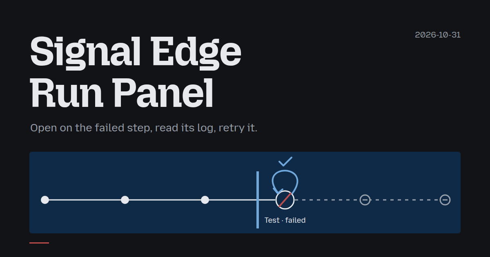
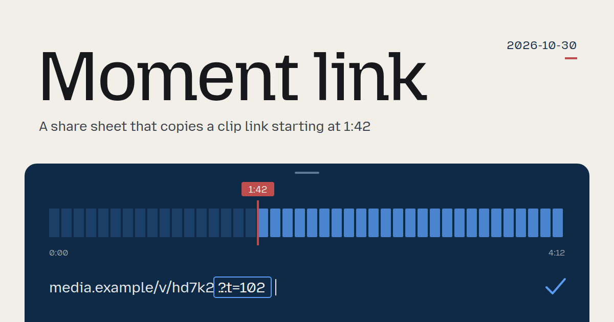

# Archive

Every daily team and the asset it made, newest first. 2 days recorded.

[Today](README.md)

| Date | Task | Team | Constraint | Asset |
|---|---|---|---|---|
| [2026-10-31](days/2026-10-31/) | Signal Edge Run Panel | Color grading specialist · Wayfinding designer · Camera operator · Amber crab | The first frame shows the useful component. |  [asset](days/2026-10-31/piece.html) |
| [2026-10-30](days/2026-10-30/) | Moment link | Dance choreographer · Railway signaller · Optical technician · Satellite repair apprentice | Use one consistent spacing scale. |  [asset](days/2026-10-30/piece.html) |
