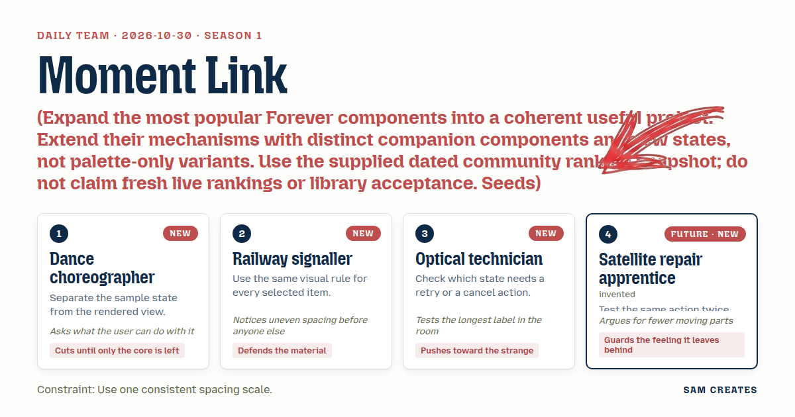
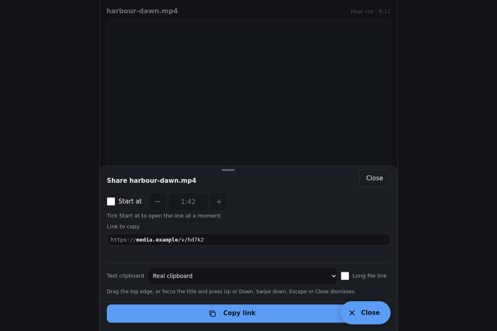
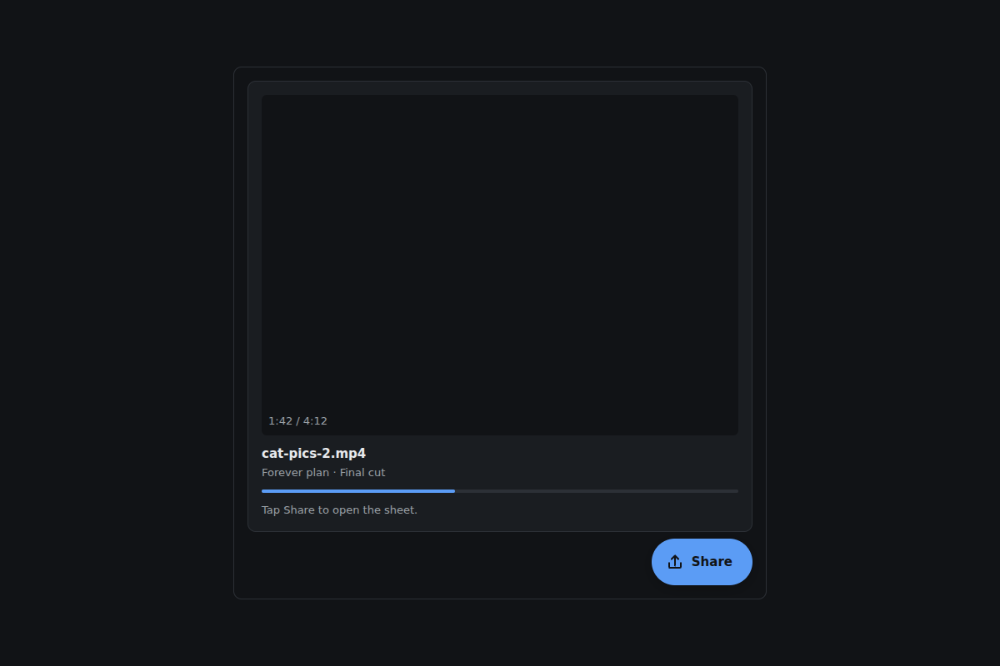
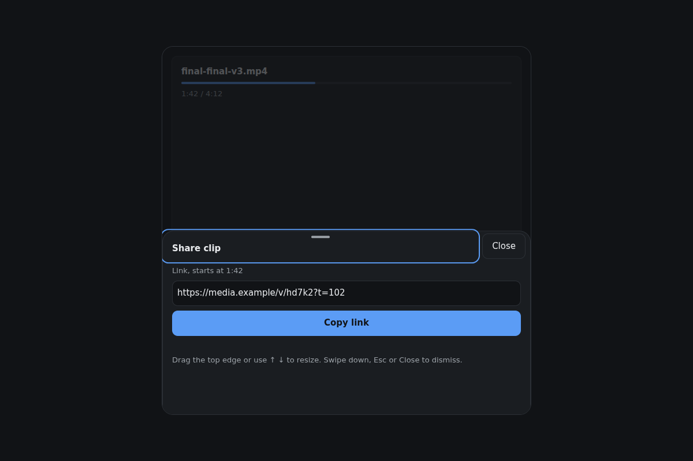
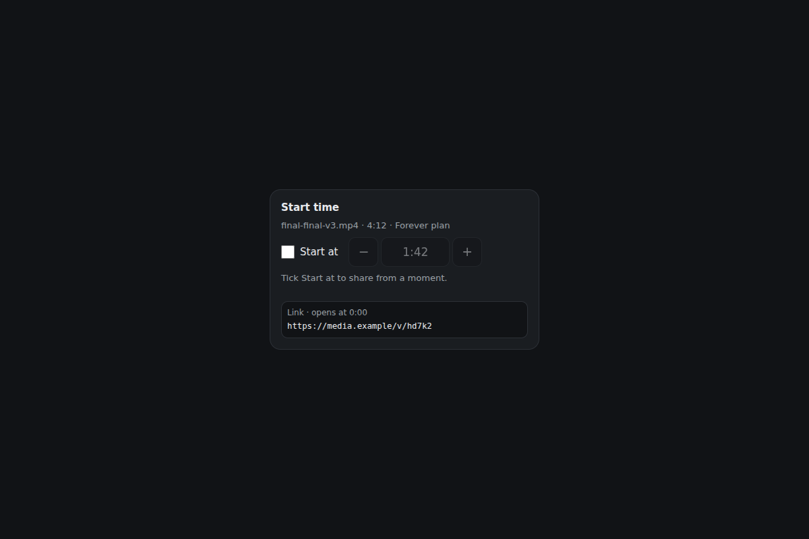
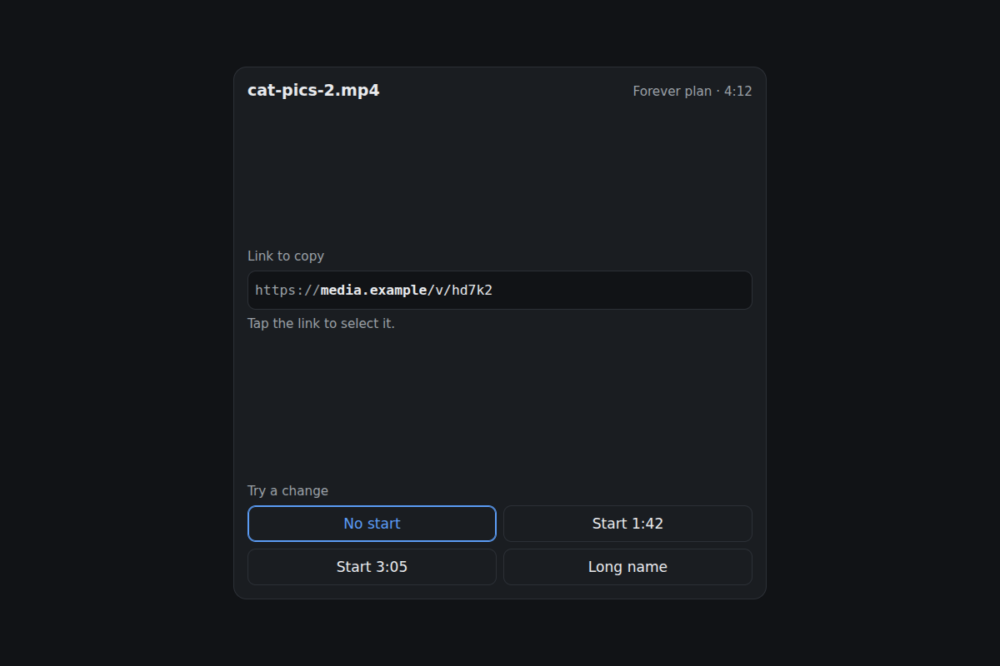
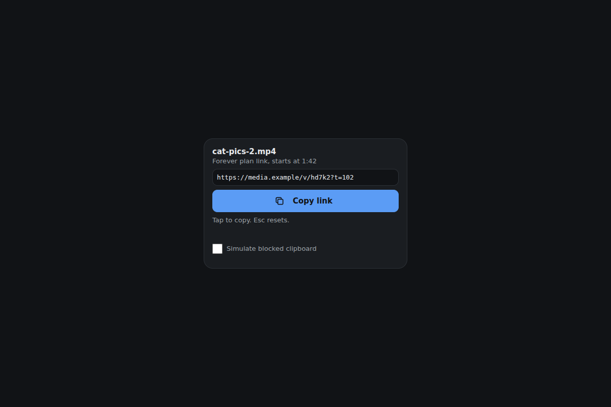
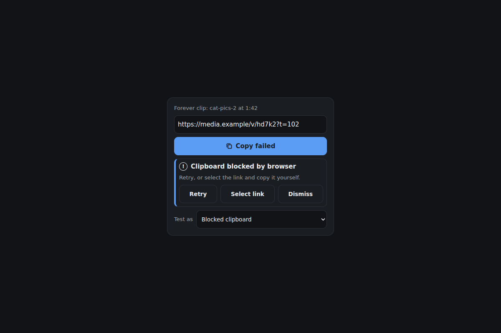

# 2026-10-30: Moment link

[Today](../../README.md) · [Archive](../../ARCHIVE.md)



**Task:** Expand the most popular Forever components into a coherent useful project. Extend their mechanisms with distinct companion components and new states, not palette-only variants. Use the supplied dated community ranking snapshot; do not claim fresh live rankings or library acceptance. Seeds: Morphing Action FAB (rank 1, displayed score 9); Success Check (rank 2, displayed score 7); Typewriter Loop (rank 3, displayed score 6). Source: https://forevercomponents.com/?collection=popular.

**Constraint:** Use one consistent spacing scale.

**Season:** 2026-10-26

**Decision:** The team builds a share sheet for a media tool where a visitor opens the panel, sets an optional start time, copies a working link, sees the result plainly when the clipboard refuses, and closes the panel by swipe, button or Escape.


[Cover art direction](cover.json) · [Cover source](cover.html)

## Feed evidence

- all: popular-brief
- No feed article recorded as used; fetched items may have been considered without selection.
- Chosen opportunity: daily-task. It is the only candidate and the explicit brief. The seeds map to distinct share jobs, not palette variants.

[Saved planning input](planning-input.json)

## Asset

[Pack manifest](pack.json) · [Shared tokens](tokens.json) · [Planning input](planning-input.json)

Generated candidates require human review. Library acceptance: unreviewed.

<a href="piece.html"></a>

[Use it](https://isas1.github.io/daily-team/editions/popular/2026-10-30/) · [piece.html](piece.html), led by Dance choreographer. Model: claude-opus-5-5.

<a href="artifact-1.html"></a>

[Use it](https://isas1.github.io/daily-team/editions/popular/2026-10-30/) · [artifact-1.html](artifact-1.html), led by Dance choreographer. Model: claude-opus-5-5.

<a href="artifact-2.html"></a>

[Use it](https://isas1.github.io/daily-team/editions/popular/2026-10-30/) · [artifact-2.html](artifact-2.html), led by Railway signaller. Model: claude-opus-5-5.

<a href="artifact-3.html"></a>

[Use it](https://isas1.github.io/daily-team/editions/popular/2026-10-30/) · [artifact-3.html](artifact-3.html), led by Optical technician. Model: claude-opus-5-5.

<a href="artifact-4.html"></a>

[Use it](https://isas1.github.io/daily-team/editions/popular/2026-10-30/) · [artifact-4.html](artifact-4.html), led by Satellite repair apprentice. Model: claude-opus-5-5.

<a href="artifact-5.html"></a>

[Use it](https://isas1.github.io/daily-team/editions/popular/2026-10-30/) · [artifact-5.html](artifact-5.html), led by Dance choreographer. Model: claude-opus-5-5.

<a href="artifact-6.html"></a>

[Use it](https://isas1.github.io/daily-team/editions/popular/2026-10-30/) · [artifact-6.html](artifact-6.html), led by Railway signaller. Model: claude-opus-5-5.

## The session

### Pitch

### Clash

**3 · Optical technician:** The frame strip is the only pitch where the link changes. Without it, the typed line has nothing to type.

**1 · Dance choreographer:** Cut the strip and keep the need. A "Start at" checkbox with a mm:ss field gives you `?t=102`. One input, and the link still changes.

**2 · Railway signaller:** The app grid is honest work. People share to places.

**4 · Satellite repair apprentice:** In a demo, those places are fake. Eight fake logos leave a fake feeling. A copied link is real and lands on a real clipboard.

**2 · Railway signaller:** Then the focus ring rule moves to the sheet. Trigger, checkbox, copy, retry: all get one ring and one 8px step. I measure the gaps.

**3 · Optical technician:** Fine. Then failure gets its own row. Denied, timed out, insecure page. Each needs Retry, and "Select link" for a manual Ctrl+C. What can someone do when the clipboard says no?

**4 · Satellite repair apprentice:** Two presses of Copy should give one write and one check, not two stacked timers. Escape twice should close once and return focus once.

**1 · Dance choreographer:** Then the toast pitch folds into the copy button. The sheet stays, and the toast goes.

### Decision

The team builds a share sheet for a media tool where a visitor opens the panel, sets an optional start time, copies a working link, sees the result plainly when the clipboard refuses, and closes the panel by swipe, button or Escape.

Concept: Moment link

The Dance choreographer set the spine: one `shareState` object, with every component rendering from it. The choreographer also cut the frame strip down to a single start-time input. The Railway signaller fixed the spacing scale at 4, 8, 16 and 24px, and set one selection and focus rule for all six rows. The Optical technician won the failure row and the long-URL test. The link line middle-truncates at 320px and keeps the `?t=` tail visible. The Satellite repair apprentice set the idempotence checks: repeated Copy, repeated close, and drag released at the threshold. The apprentice also pushed motion down to three events: the trigger morph, the sheet snap and the check stroke.

Rejected direction: the destination grid. It would need invented app targets, it duplicates selection work from 2026-10-28 rows, and it delivers nothing the copied link does not.

No component_source was supplied. The bottom-sheet idea from the inspiration bank shaped row 2 in concept only: snap positions, focus return, Escape and button alternatives to drag, and visible clipboard failure. No code was taken from it.

Each of the six rows does a separate job. Row 1 opens the panel. Row 2 holds it. Row 3 changes the link. Row 4 shows the link. Row 5 copies it. Row 6 recovers when copying fails. Removing any row breaks a step the visitor needs. A seventh row, such as QR or email, would repeat the copy job.

```json
{
  "schemaVersion": 1,
  "categoryVersion": 1,
  "id": "moment-link-share-sheet",
  "name": "Moment link",
  "description": "A bottom share sheet for a media tool that builds a clip link with an optional start time, copies it, reports clipboard failure with recovery, and closes by swipe, button or Escape.",
  "project": "Share panel for a clip editor. Sample clip harbour-dawn.mp4, 4:12 long, base link https://media.example/v/hd7k2. Three popular seeds from the dated 2026-10-30 snapshot are extended into share jobs: Morphing Action FAB as the trigger, Typewriter Loop as a one-pass link line, and Success Check as the copy result.",
  "sizeRationale": "Six rows cover open, contain, change, show, copy and recover. Each removal breaks one visitor step. Extra share targets would repeat the copy job.",
  "opportunities": [
    {
      "id": "daily-task",
      "need": "Extend the three highest-ranked components in the supplied snapshot into a coherent project with new states, without claiming fresh rankings.",
      "use": "An editor shares a clip that starts at 1:42 with a reviewer and gets a definite copied or failed result.",
      "interaction": "Trigger morph, sheet drag and snap with button and Escape alternatives, start-time input, one-pass link typing, copy with check, failure notice with Retry and manual select.",
      "similarity": "2026-10-29 import rows used label swaps and cancel. 2026-10-28 used failure with retry. This pack adds a modal surface, clipboard permission failure and a link that changes from user input. Tradeoff: there are no destination targets, so it is narrower than a system share sheet."
    }
  ],
  "selection": {
    "id": "daily-task",
    "rationale": "It is the only candidate and the explicit brief. The seeds map to distinct share jobs, not palette variants."
  },
  "tokens": {
    "colors": {
      "dark": { "bg": "#111316", "surface": "#1a1d21", "text": "#e8eaed", "muted": "#9aa0a6", "accent": "#5b9cf5", "border": "#2c3036" },
      "light": { "bg": "#f6f7f9", "surface": "#ffffff", "text": "#16181c", "muted": "#5f6670", "accent": "#1f6fd6", "border": "#d9dde3" }
    },
    "typography": { "family": "system-ui, -apple-system, 'Segoe UI', Roboto, sans-serif", "size": "15px" },
    "spacing": { "gap": "8px", "padding": "16px" },
    "radii": { "control": "10px" },
    "motion": { "duration": "200ms", "easing": "ease-out" }
  },
  "components": [
    {
      "row": 1,
      "id": "share-morph-trigger",
      "file": "artifact-1.html",
      "name": "Share morph trigger",
      "description": "Floating share button that morphs into the sheet's close control and takes focus back when the sheet closes.",
      "category": "Actions",
      "tags": ["fab", "morph", "trigger", "aria-expanded", "focus-return"],
      "purpose": "Open the share panel and give one constant place to close it.",
      "use": "An editor finishes a cut and taps Share at the bottom right.",
      "input": "Click or tap the 56px button. Keyboard: Tab to it, Enter or Space toggles.",
      "outcome": "aria-expanded becomes true. The share glyph rotates into a close glyph, the label swaps from Share to Close in a reserved width, and the sheet opens.",
      "recovery": "Pressing it again closes the sheet. When the sheet closes by any path, focus returns to this button.",
      "mechanism": "One native button. Glyph strokes move with a single transform transition. Repeated presses during the 200ms morph set the final state directly, with no queue.",
      "nearestAnalogue": "2026-10-29 cancel import used a reserved-width label swap. This button changes role between open and close and owns focus return.",
      "usefulness": "A fixed open and close target avoids hunting for a dismiss control.",
      "creativeDifference": "Extends Morphing Action FAB: the morph carries meaning (open versus close) and links to a dialog's state.",
      "states": [
        "idle: 'Share', reached on load",
        "pressed: 1px sink, reached on pointer or key down",
        "open: close glyph with 'Close', reached when the sheet opens",
        "focus: 2px accent ring at 2px offset, reached by Tab",
        "focus-return: focused after any close",
        "reduced-motion: glyph swaps without rotation"
      ],
      "sources": [
        { "title": "Forever Components popular collection (snapshot 2026-10-30)", "url": "https://forevercomponents.com/?collection=popular" },
        { "title": "ARIA Authoring Practices: Button", "url": "https://www.w3.org/WAI/ARIA/apg/patterns/" }
      ]
    },
    {
      "row": 2,
      "id": "snap-bottom-sheet",
      "file": "artifact-2.html",
      "name": "Snap bottom sheet",
      "description": "Modal bottom panel with peek and full snap points that closes by swipe, button or Escape.",
      "category": "Layout",
      "tags": ["bottom-sheet", "dialog", "drag", "snap", "escape-key", "focus-trap"],
      "purpose": "Hold the share controls above the media without leaving the editor.",
      "use": "On a phone, the editor swipes the sheet down after copying.",
      "input": "Drag the handle or swipe the sheet. Keyboard: the handle is a button where Enter toggles peek and full and Up and Down choose a snap. Escape closes. Close button in the header.",
      "outcome": "The sheet settles at peek (50% height), full (90%) or closed. Focus stays inside while it is open.",
      "recovery": "A drag released above the threshold snaps back. Closing restores focus to row 1.",
      "mechanism": "Pointer events track translateY. On release, a swipe faster than 0.5 px/ms or a drag past 40% closes the sheet. Otherwise it snaps to the nearest point. A native dialog element provides the backdrop and inert background. Content scrolls inside a max-height body.",
      "nearestAnalogue": "2026-10-26 log viewer was a compact inline panel. This is a modal surface with three dismiss paths.",
      "usefulness": "A thumb-reach surface on phones that stays usable by keyboard on desktop.",
      "creativeDifference": "Swipe, button and key are equal paths to one close function, so none is decorative.",
      "states": [
        "closed: not rendered, reached on load and after close",
        "peek: 50% height, reached on open",
        "full: 90% height, reached by drag up or handle Up",
        "dragging: follows pointer without transition",
        "snapping-back: returns to last snap, reached by a short drag",
        "focus: handle ring, reached by Tab",
        "reduced-motion: snaps set instantly"
      ],
      "sources": [
        { "title": "ARIA Authoring Practices: Dialog (Modal)", "url": "https://www.w3.org/WAI/ARIA/apg/patterns/" }
      ]
    },
    {
      "row": 3,
      "id": "start-at-field",
      "file": "artifact-3.html",
      "name": "Start-at field",
      "description": "Checkbox and mm:ss field that adds a start time to the link, clamped to the clip length.",
      "category": "Inputs",
      "tags": ["timestamp", "checkbox", "time-field", "validation", "media"],
      "purpose": "Make the shared link open at a chosen moment.",
      "use": "The editor ticks 'Start at' and enters 1:42 so the reviewer lands on the cut.",
      "input": "Click or tap the checkbox and type in the field. Keyboard: Space toggles, Tab to the field, Up and Down step 1 second, Shift with Up or Down steps 10.",
      "outcome": "A valid time writes t=102 into the shared state. The field prefills with the playhead time 1:42.",
      "recovery": "An invalid or out-of-range entry shows 'Clip is 4:12 long' and keeps the last valid value. Unticking removes the parameter.",
      "mechanism": "Native checkbox plus a text input with inputmode numeric. Parses m:ss or plain seconds. Commits on blur or Enter, never mid-typing.",
      "nearestAnalogue": "2026-10-28 range selector chose a data window. This sets one point inside a media file.",
      "usefulness": "A link that starts at 0:00 makes the reviewer scrub to find the cut.",
      "creativeDifference": "Commit-on-blur keeps the link line from retyping on every keystroke.",
      "states": [
        "off: field disabled, link without t, reached on load",
        "on: field enabled with playhead time, reached by checking",
        "invalid: message below the field with the last value kept",
        "clamped: values above 4:12 are refused, not rounded",
        "focus: 2px ring"
      ],
      "sources": [
        { "title": "ARIA Authoring Practices: Checkbox", "url": "https://www.w3.org/WAI/ARIA/apg/patterns/" }
      ]
    },
    {
      "row": 4,
      "id": "link-retype-line",
      "file": "artifact-4.html",
      "name": "Link retype line",
      "description": "Read-only link display that retypes only the changed tail once and middle-truncates long URLs.",
      "category": "Content",
      "tags": ["typewriter", "url", "truncation", "read-only", "diff"],
      "purpose": "Show exactly which link will be copied, and show visibly when it changes.",
      "use": "After entering 1:42, the editor sees '?t=102' type onto the end of the link.",
      "input": "Display only. Click or tap selects the full text. Keyboard: Tab focuses the read-only input, and Ctrl+A or Cmd+A selects it.",
      "outcome": "The common prefix stays fixed and the differing suffix deletes and types at 24ms per character, once.",
      "recovery": "A new change during typing jumps straight to the new target. The underlying input value is always the full final URL.",
      "mechanism": "Compute the longest common prefix between the old and new URL, animate only the remainder, then stop. The visual layer uses middle ellipsis with the host and query always visible. The full value sits in a read-only input for selection and screen readers.",
      "nearestAnalogue": "None in recent dates. Typewriter Loop in the 2026-10-30 snapshot is the ancestor.",
      "usefulness": "The visitor confirms the start time before copying, without parsing a URL.",
      "creativeDifference": "Extends Typewriter Loop: no loop, and the typing marks the diff, so motion carries information.",
      "states": [
        "static: full link shown, reached on open",
        "retyping: suffix animates, reached by a row 3 commit",
        "truncated: middle ellipsis below 360px width",
        "selected: text highlighted, reached by tap or row 6 Select link",
        "focus: 2px ring",
        "reduced-motion: new text replaced instantly"
      ],
      "sources": [
        { "title": "Forever Components popular collection (snapshot 2026-10-30)", "url": "https://forevercomponents.com/?collection=popular" }
      ]
    },
    {
      "row": 5,
      "id": "copy-check-button",
      "file": "artifact-5.html",
      "name": "Copy check button",
      "description": "Copy button that writes to the clipboard and draws a check once on success.",
      "category": "Actions",
      "tags": ["copy", "clipboard", "success-check", "button", "idempotent"],
      "purpose": "Put the current link on the clipboard and confirm it.",
      "use": "The editor taps Copy link and sees 'Copied 1:42 link'.",
      "input": "Click or tap the 44px full-width button. Keyboard: Tab, then Enter or Space.",
      "outcome": "navigator.clipboard.writeText runs. On success the check stroke draws over 200ms and the label reads 'Copied'. It returns to 'Copy link' after 2s.",
      "recovery": "On rejection or a 1500ms timeout, the state hands off to row 6. A press while pending is ignored. A press while 'Copied' writes again and restarts one timer.",
      "mechanism": "A single job with an attempt id. Late results from older attempts are dropped. Label sits in a width reserved for its longest string: Copy link, Copying, Copied, Copy failed.",
      "nearestAnalogue": "2026-10-29 undo import used a reserved-width label swap. This adds an external permission-dependent result.",
      "usefulness": "Copy is the core action. A silent copy leaves the visitor unsure.",
      "creativeDifference": "Extends Success Check: the check appears only for a confirmed write, never optimistically.",
      "states": [
        "idle: 'Copy link', reached on open",
        "pressed: 1px sink",
        "pending: disabled 'Copying', reached on press",
        "copied: check plus 'Copied', reached on resolve",
        "failed: 'Copy failed', reached on reject or timeout",
        "focus: 2px ring",
        "reduced-motion: check appears without stroke draw"
      ],
      "sources": [
        { "title": "Forever Components popular collection (snapshot 2026-10-30)", "url": "https://forevercomponents.com/?collection=popular" },
        { "title": "ARIA Authoring Practices: Button", "url": "https://www.w3.org/WAI/ARIA/apg/patterns/" }
      ]
    },
    {
      "row": 6,
      "id": "copy-failure-notice",
      "file": "artifact-6.html",
      "name": "Copy failure notice",
      "description": "Inline notice that names the clipboard failure and offers Retry, Select link and Dismiss.",
      "category": "Feedback",
      "tags": ["error", "retry", "clipboard", "live-region", "fallback"],
      "purpose": "Give a working path to the link when automatic copy fails.",
      "use": "In a locked-down browser the editor reads 'Clipboard blocked by browser', taps Select link and presses Ctrl+C.",
      "input": "Click or tap Retry, Select link or Dismiss. Keyboard: focus moves to the notice heading. Tab to each button, Enter or Space.",
      "outcome": "The reason is named: 'Clipboard blocked by browser', 'Page not secure' or 'Clipboard did not answer'. Select link focuses and selects row 4.",
      "recovery": "Retry disables while pending and clears the notice on success. Dismiss returns row 5 to idle. Closing the sheet clears the notice.",
      "mechanism": "Maps NotAllowedError, a missing isSecureContext and the timeout to three messages. role=alert on first show only. A demo toggle 'Simulate blocked clipboard' forces the first path.",
      "nearestAnalogue": "2026-10-28 load stages failure named the failed stage with one Retry. This adds a manual fallback that needs no permission.",
      "usefulness": "A clipboard failure with no fallback strands the visitor.",
      "creativeDifference": "Every failure state ends in a path that works: retry or manual select.",
      "states": [
        "hidden: no failure, reached on open",
        "blocked: permission message, reached by NotAllowedError or the demo toggle",
        "insecure: 'Page not secure', reached when isSecureContext is false",
        "timed-out: reached after 1500ms with no answer",
        "retrying: Retry disabled",
        "manual: link selected with hint 'Press Ctrl+C', reached by Select link",
        "focus: 2px ring"
      ],
      "sources": [
        { "title": "ARIA Authoring Practices: Alert", "url": "https://www.w3.org/WAI/ARIA/apg/patterns/" }
      ]
    }
  ],
  "demo": {
    "file": "piece.html",
    "rows": [1, 2, 3, 4, 5, 6],
    "sharedState": "One shareState object {open, snap, startOn, startSec:102, duration:252, baseUrl:'https://media.example/v/hd7k2', url, copy:{status, attempt, reason}}. Row 1 sets open and row 2 renders it. Row 3 commits startSec, which rebuilds url. Row 4 retypes the url diff. Row 5 writes url and sets copy.status. Row 6 renders on status 'failed' and calls row 5's job for Retry or row 4's select for the manual path. Closing resets copy and returns focus to row 1."
  }
}
```

### Build notes

1. Spacing uses the 4, 8, 16 and 24px scale only. The sheet body has 16px padding and 8px gaps between rows. Every focus and selection state uses the same 2px accent ring at a 2px offset across all six files.
2. Test at 320px wide with `https://media.example/v/hd7k2-harbour-dawn-final-v3?t=102`. Row 4 must keep `media.example` and `?t=102` visible. Row 5's reserved label width must hold "Copy failed" without shifting the button.
3. Run each action twice. Two Copy presses give one pending job and one 2s timer. Two Escapes give one close and one focus return. A drag released at exactly 40% snaps back. The "Simulate blocked clipboard" toggle must reach row 6 without calling the real clipboard.

**Guest:** Satellite repair apprentice (future; invented). The method is drawn from public-domain history, myth, or literature, or invented. The guest speaks in character in original words, never quoting the source, and nothing here is endorsed by anyone.

## Team

```text
Team for 2026-10-30
Season: 2026-10-26

1. Dance choreographer [new]
   Method: Separate the sample state from the rendered view. [new]
   Stance: Cuts until only the core is left.
   Temperament: Asks what the user can do with it.
2. Railway signaller [new]
   Method: Use the same visual rule for every selected item. [new]
   Stance: Defends the material.
   Temperament: Notices uneven spacing before anyone else.
3. Optical technician [new]
   Method: Check which state needs a retry or a cancel action. [new]
   Stance: Pushes toward the strange.
   Temperament: Tests the longest label in the room.
4. Satellite repair apprentice (future; invented) [guest] [new]
   Method: Test the same action twice before trusting it.
   Stance: Guards the feeling it leaves behind.
   Temperament: Argues for fewer moving parts.

Constraint: Use one consistent spacing scale.
Task: Share sheet: a bottom panel for a media tool that copies a link, reports failure and closes with a swipe, button or key.
```

Provider: claude. Model: claude-opus-5-5.
