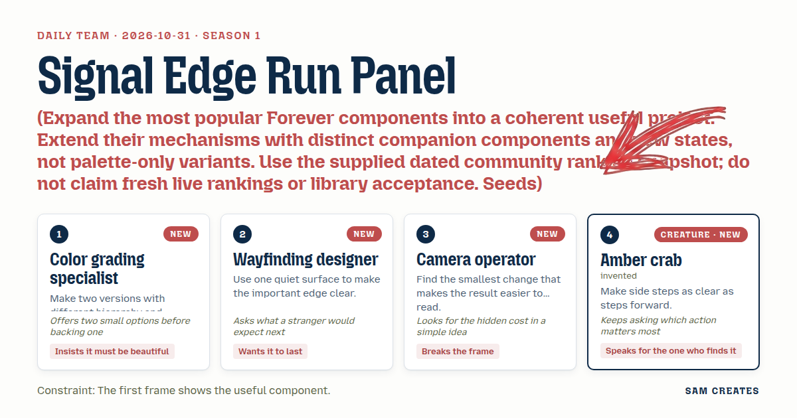
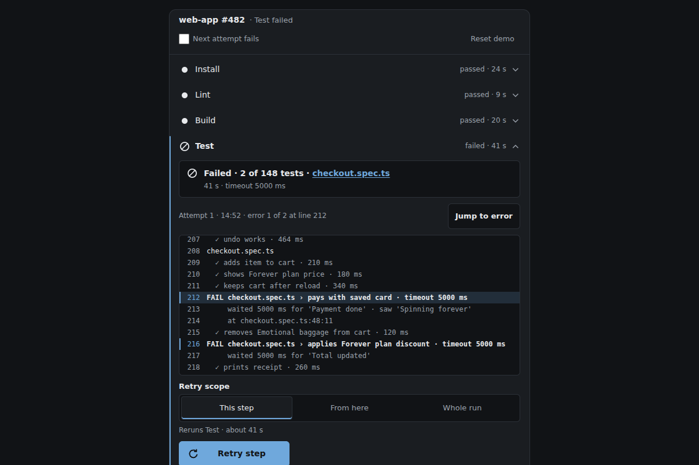
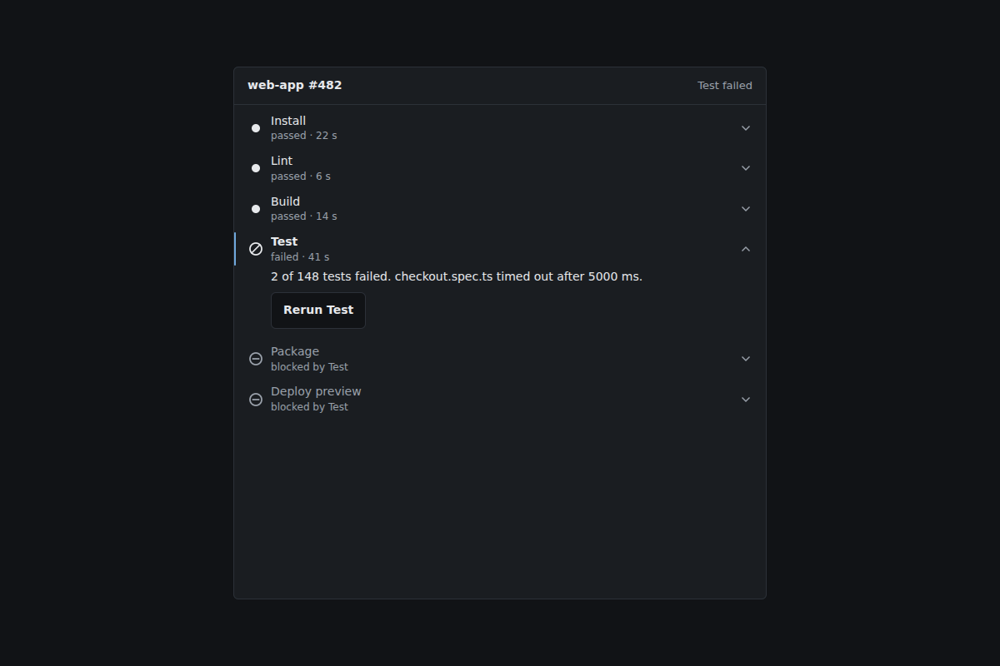
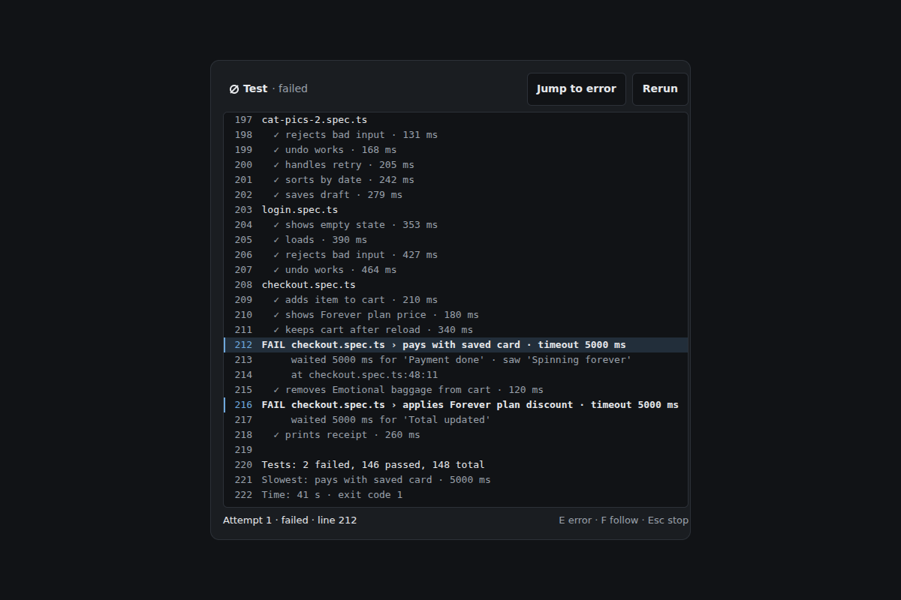
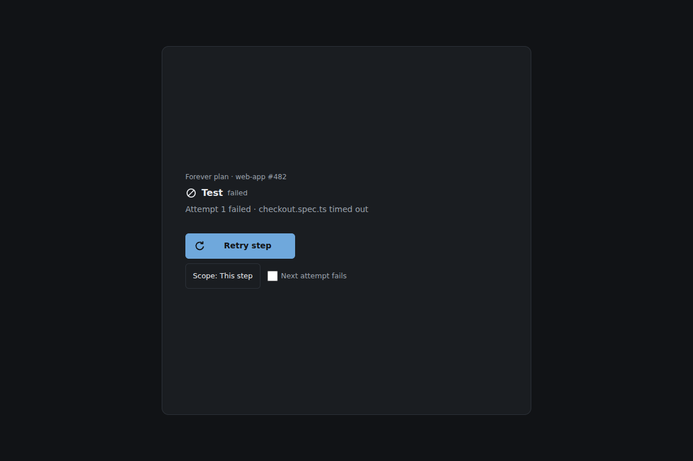
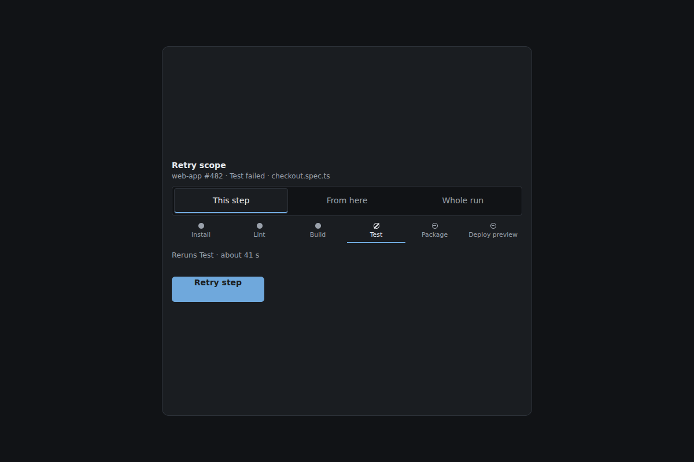
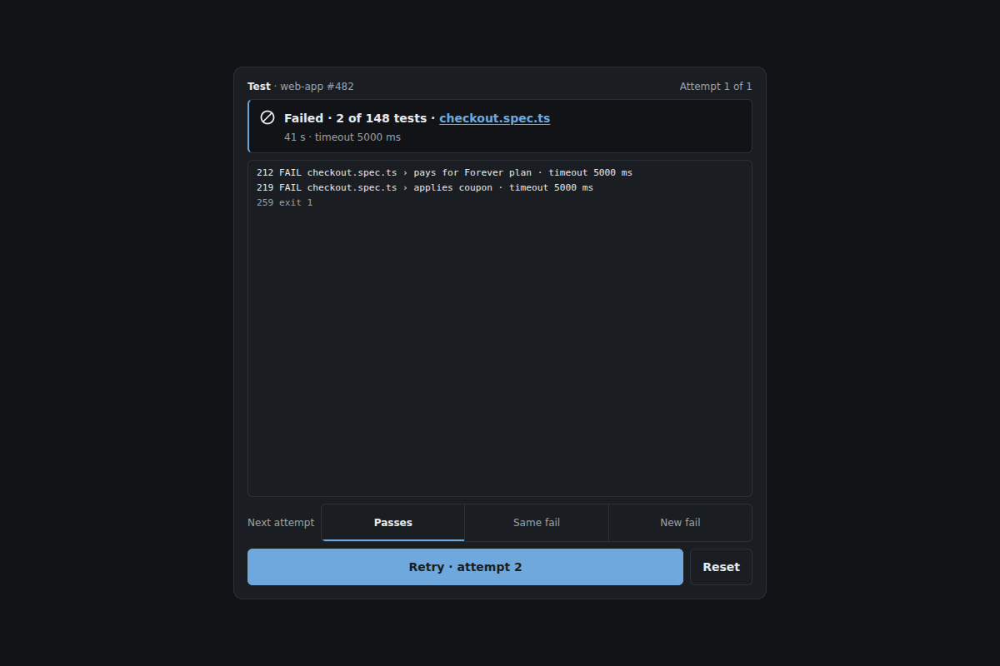
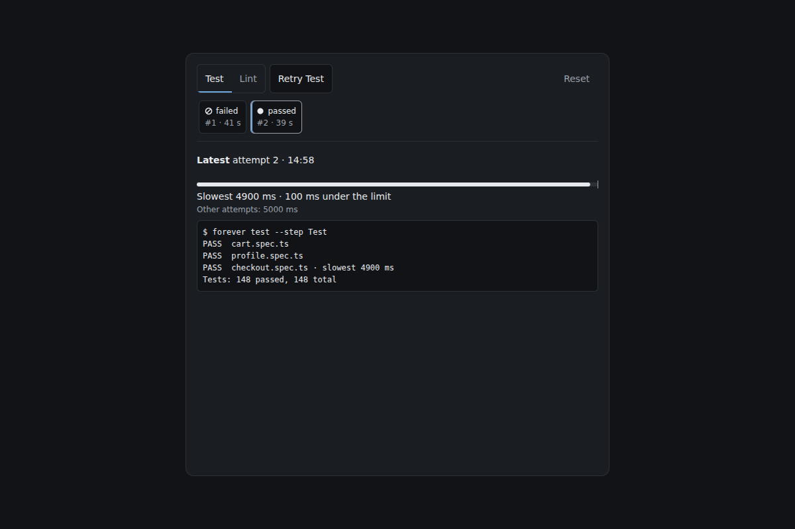

# 2026-10-31: Signal Edge Run Panel

[Today](../../README.md) · [Archive](../../ARCHIVE.md)



**Task:** Expand the most popular Forever components into a coherent useful project. Extend their mechanisms with distinct companion components and new states, not palette-only variants. Use the supplied dated community ranking snapshot; do not claim fresh live rankings or library acceptance. Seeds: Morphing Action FAB (rank 1, displayed score 9); Success Check (rank 2, displayed score 7); Typewriter Loop (rank 3, displayed score 6). Source: https://forevercomponents.com/?collection=popular.

**Constraint:** The first frame shows the useful component.

**Season:** 2026-10-26

**Decision:** The team builds a pipeline status panel for a local build demo where a developer sees the failed Test step expanded on first paint, reads its log at the error line, chooses a retry scope, retries, and learns whether the fix held across a...


[Cover art direction](cover.json) · [Cover source](cover.html)

## Feed evidence

- all: popular-brief
- No feed article recorded as used; fetched items may have been considered without selection.
- Chosen opportunity: daily-task. It is the only candidate and the explicit brief. The pipeline panel gives the three seeds practical jobs with real state transitions, without restyling the 2026-10-30 share pack. The snapshot is cited as dated and is not presented as a live ranking.

[Saved planning input](planning-input.json)

## Asset

[Pack manifest](pack.json) · [Shared tokens](tokens.json) · [Planning input](planning-input.json)

Generated candidates require human review. Library acceptance: unreviewed.

<a href="piece.html"></a>

[Use it](https://isas1.github.io/daily-team/editions/popular/2026-10-31/) · [piece.html](piece.html), led by Color grading specialist. Model: claude-opus-5-5.

<a href="artifact-1.html"></a>

[Use it](https://isas1.github.io/daily-team/editions/popular/2026-10-31/) · [artifact-1.html](artifact-1.html), led by Color grading specialist. Model: claude-opus-5-5.

<a href="artifact-2.html"></a>

[Use it](https://isas1.github.io/daily-team/editions/popular/2026-10-31/) · [artifact-2.html](artifact-2.html), led by Wayfinding designer. Model: claude-opus-5-5.

<a href="artifact-3.html"></a>

[Use it](https://isas1.github.io/daily-team/editions/popular/2026-10-31/) · [artifact-3.html](artifact-3.html), led by Camera operator. Model: claude-opus-5-5.

<a href="artifact-4.html"></a>

[Use it](https://isas1.github.io/daily-team/editions/popular/2026-10-31/) · [artifact-4.html](artifact-4.html), led by Amber crab. Model: claude-opus-5-5.

<a href="artifact-5.html"></a>

[Use it](https://isas1.github.io/daily-team/editions/popular/2026-10-31/) · [artifact-5.html](artifact-5.html), led by Color grading specialist. Model: claude-opus-5-5.

<a href="artifact-6.html"></a>

[Use it](https://isas1.github.io/daily-team/editions/popular/2026-10-31/) · [artifact-6.html](artifact-6.html), led by Wayfinding designer. Model: claude-opus-5-5.

## The session

### Pitch

### Clash

**3 · Camera operator:** Two versions costs us twice the states for one panel. Pick the hierarchy now. Step rail first, log under it. The failed row already gives the log its frame.

**1 · Color grading specialist:** Fine. I ran both in my head and B buries which step failed. A wins. But the glyphs carry the state, never hue alone, and the accent stays one restrained blue.

**2 · Wayfinding designer:** Agreed on one accent. The legend can go. If the shapes need a legend, the shapes are wrong. Each glyph gets its word next to it.

**4 · Amber crab:** Then my scope choice. Is it a menu? A menu hides the side step. Three radio segments: This step, From here, Whole run.

**3 · Camera operator:** Hidden cost: three segments beside Retry crowd 360px. Put them on their own line above the button, default This step. One line, no wrap.

**2 · Wayfinding designer:** And attempt history earns a row only if it answers "did the retry fix it or did it just pass by luck". Same test failing twice is the thing a stranger can't see otherwise.

**1 · Color grading specialist:** Then the result line says it outright: "Failed again · same test" or "Passed on attempt 2". The check draws once, 200ms. No glow.

**4 · Amber crab:** Which action matters most when it fails again? Retry, still. Focus returns to it. History is the side door, one tab away.

### Decision

The team builds a pipeline status panel for a local build demo where a developer sees the failed Test step expanded on first paint, reads its log at the error line, chooses a retry scope, retries, and learns whether the fix held across attempts.

Concept: Signal Edge Run Panel

Wayfinding designer set the spine: one quiet surface, one 2px accent edge for selection, and the step, log, retry, result order. Color grading specialist tested two hierarchies and chose rail-over-log. She also fixed the single accent and the glyph-plus-word rule. Camera operator held the first frame to 360px with the failure pre-expanded. He limited motion to two moments, streamed log lines and one check stroke, and flagged the auto-scroll cost. That cost became a pause-on-scroll rule. Amber crab made retry scope a visible three-way choice and kept attempt history one Tab stop from Retry.

Rejected direction: the Camera operator's keyboard hint strip. Each component carries its own keyboard behaviour and focus ring. A permanent strip would cost 32px of the first frame for text most visitors read once.

No component_source was supplied. The inspiration paths for the CI oscilloscope, splitflap label button and rolling log band served as idea bank entries only. No code was taken. The three seeds from the 2026-10-30 popular snapshot are extended with new jobs. Morphing Action FAB becomes a retry-to-stop morph tied to a job. Success Check becomes an attempt verdict that also reports a repeated failure. Typewriter Loop becomes a log tail that streams real lines once and stops.

Six components earn their place, one per question. Where did it fail (rail). Why (log). How far to rerun (scope). Rerun (retry). Did it hold (result). Was it luck (history). Removing any one leaves a question unanswered. A seventh, the legend, was cut in the Clash.

```json
{
  "schemaVersion": 1,
  "categoryVersion": 1,
  "id": "signal-edge-run-panel",
  "name": "Signal Edge Run Panel",
  "description": "Status panel for a local build demo that opens on the failed step, shows its log at the error line, retries with a chosen scope and reports whether the fix held across attempts.",
  "project": "Pipeline panel for build web-app #482 with six steps: Install, Lint, Build, Test, Package, Deploy preview. Test fails with 2 of 148 tests failing (checkout.spec.ts timed out after 5000 ms). Package and Deploy preview are blocked. All data is local sample state.",
  "sizeRationale": "Six components answer six separate questions: where it failed, why, how far to rerun, rerun, whether it held, and whether the pass was luck. A glyph legend and a keyboard hint strip were cut because each component labels its own state and keys.",
  "opportunities": [
    {
      "id": "daily-task",
      "need": "Extend the three popular seeds (Morphing Action FAB rank 1, Success Check rank 2, Typewriter Loop rank 3, snapshot observed 2026-10-30) into a coherent useful project, here the team's pipeline panel task.",
      "use": "A developer sees a failed Test step, reads why, retries it and learns whether the retry fixed the problem or passed by chance.",
      "interaction": "Expand a step, read and jump in a streaming log, pick a retry scope, press a morphing Retry/Stop button, read a drawn verdict, and select past attempts to compare.",
      "similarity": "2026-10-30 used the same seeds for a share sheet (open/close morph, copy check, URL retype). This pack gives each seed a different job: job-state morph, verdict with repeat-failure detection, and a one-pass log stream. 2026-10-27 named the pipeline task but recorded no components, so the rows here are new. Tradeoff: reusing the snapshot risks echoing 10-30, so each row names its 10-30 analogue and the difference."
    }
  ],
  "selection": {
    "id": "daily-task",
    "rationale": "It is the only candidate and the explicit brief. The pipeline panel gives the three seeds practical jobs with real state transitions, without restyling the 2026-10-30 share pack. The snapshot is cited as dated and is not presented as a live ranking."
  },
  "tokens": {
    "colors": {
      "dark": { "bg": "#111316", "surface": "#1a1d21", "text": "#e7e9ec", "muted": "#9aa1ab", "accent": "#6fa8dc", "border": "#2c3138" },
      "light": { "bg": "#f6f7f9", "surface": "#ffffff", "text": "#16191d", "muted": "#5b636e", "accent": "#2f6db3", "border": "#d6dae0" }
    },
    "typography": { "family": "system-ui, -apple-system, \"Segoe UI\", Roboto, \"Helvetica Neue\", Arial, sans-serif", "size": "14px" },
    "spacing": { "gap": "8px", "padding": "16px" },
    "radii": { "control": "6px" },
    "motion": { "duration": "180ms", "easing": "ease-out" }
  },
  "components": [
    {
      "row": 1,
      "id": "step-rail",
      "file": "artifact-1.html",
      "name": "Step rail",
      "description": "Vertical list of build steps with shape glyphs, durations and the failed step expanded on first paint.",
      "category": "Navigation",
      "tags": ["pipeline", "steps", "disclosure", "status-glyph", "first-frame", "roving-focus"],
      "purpose": "Show which step failed and open its detail without searching.",
      "use": "A developer opens the panel and sees 'Test · failed · 41 s' already expanded with a 2px accent left edge.",
      "input": "Click or tap a step row to expand or collapse it. Keyboard: Tab into the rail, Up and Down move between steps, Home and End jump, Enter or Space toggles.",
      "outcome": "One step is expanded at a time. Expanding a step points rows 2 and 6 at that step.",
      "recovery": "Collapsing the expanded step leaves the rail with nothing open and the log shows 'Select a step'. Expanding Test again restores its last log scroll position.",
      "mechanism": "A list of native buttons with aria-expanded and aria-controls, using roving tabindex. On load the first failed step is expanded and focus stays on the document, so nothing jumps. Glyphs sit in a fixed 20px slot: filled dot (passed), slashed ring (failed), hollow ring with a dash (blocked), arc (running). Each glyph has its word beside it.",
      "nearestAnalogue": "2026-10-30 source tabs put request glyphs in a fixed slot on a horizontal tablist. This rail is ordered, vertical, auto-opens the failure and drives the log and history.",
      "usefulness": "The first question after a red build is which step, and this row answers it in the first frame.",
      "creativeDifference": "The only accent on screen is the failed row's left edge, so the eye lands there with no colour coding of status.",
      "states": [
        "initial: Test expanded with accent edge, reached on load",
        "expanded: a selected step open with its summary line, reached by click or Enter",
        "collapsed: no step open, reached by toggling the open step",
        "blocked: Package and Deploy preview show hollow-dash glyph and 'blocked by Test'",
        "running: arc glyph on the retried step, reached when row 3 starts a run",
        "focus: 2px accent ring at 2px offset, reached by Tab or arrows",
        "reduced-motion: arc glyph static with the word 'running'"
      ],
      "sources": [
        { "title": "ARIA Authoring Practices: Disclosure", "url": "https://www.w3.org/WAI/ARIA/apg/patterns/" }
      ]
    },
    {
      "row": 2,
      "id": "log-tail",
      "file": "artifact-2.html",
      "name": "Log tail",
      "description": "Monospace log for the selected step that opens at the first error line and streams new lines once during a run.",
      "category": "Content",
      "tags": ["log", "streaming", "line-numbers", "jump-to-error", "auto-scroll", "typewriter"],
      "purpose": "Show why the step failed and what the retry is printing.",
      "use": "A developer reads line 212 'checkout.spec.ts › pays with saved card · timeout 5000 ms' highlighted on open.",
      "input": "Scroll with wheel or touch. Click or tap Jump to error or Follow. Keyboard: Tab focuses the log region, arrows and Page Up/Down scroll, E jumps to the next error line, F toggles Follow.",
      "outcome": "On open the view centres the first error line. During a run, new lines append at their sample arrival times and the view follows the tail.",
      "recovery": "Scrolling up during a run pauses Follow and shows 'Paused · 14 new lines' with a Follow button. Pressing it returns to the tail.",
      "mechanism": "A pre element in a focusable region with role log and tabindex 0. Line numbers come from a CSS counter, and long lines scroll horizontally without wrapping. Only the newest line draws its characters at 8 ms each, once. Earlier lines arrive whole and the caret disappears when the run ends. Follow is on while the scroll offset is within 24px of the bottom.",
      "nearestAnalogue": "2026-10-30 link retype line typed one changed URL suffix. 2026-10-26 log viewer filtered past events. This row streams a live run once, pauses for a reader and finds error lines.",
      "usefulness": "The cause sits in the log. Opening at the error line saves scrolling past 200 lines of install output.",
      "creativeDifference": "Extends Typewriter Loop: typing appears only on the line being written now, so motion marks live output and stops with the run.",
      "states": [
        "opened-at-error: line 212 highlighted and centred, reached on load",
        "streaming: newest line types once with caret, reached by a row 3 run",
        "paused: 'Paused · n new lines' with Follow, reached by scrolling up during a run",
        "settled: caret removed, reached when the run ends",
        "empty: 'Select a step', reached when no step is expanded",
        "focus: 2px ring on the region",
        "reduced-motion: new lines appear whole"
      ],
      "sources": [
        { "title": "Forever Components popular collection (snapshot 2026-10-30)", "url": "https://forevercomponents.com/?collection=popular" },
        { "title": "ARIA Authoring Practices patterns", "url": "https://www.w3.org/WAI/ARIA/apg/patterns/" }
      ]
    },
    {
      "row": 3,
      "id": "retry-stop-morph",
      "file": "artifact-3.html",
      "name": "Retry stop morph",
      "description": "Retry button whose glyph and label morph into Stop while the run is active and back when it ends.",
      "category": "Actions",
      "tags": ["retry", "stop", "morph", "button", "abort", "dedupe"],
      "purpose": "Start one rerun of the chosen scope and offer a way to stop it from the same spot.",
      "use": "A developer presses Retry step, watches the log, then presses Stop when the same timeout appears early.",
      "input": "Click or tap the 44px button. Keyboard: Tab to it, Enter or Space. R retries when the panel has focus. Escape stops a running job.",
      "outcome": "Retry starts attempt n+1 with the scope from row 4. The circular-arrow glyph rotates into a square and the label changes from 'Retry step' to 'Stop' in a reserved width.",
      "recovery": "Stop aborts the run, marks the attempt 'stopped' and morphs back to Retry. A press during the 180 ms morph sets the final state directly. Focus returns to the button when a run ends.",
      "mechanism": "One native button bound to a job object with an AbortController and attempt id. Replies tagged with an older attempt id are dropped. The label width is reserved from its longest string, 'Retry from here'. The glyph strokes move in one transform transition.",
      "nearestAnalogue": "2026-10-30 share morph trigger toggled a dialog open and closed. 2026-10-30 retry guard deduped a content request. This button morphs on job state and owns both start and abort.",
      "usefulness": "Keeping Stop in the same place as Retry means the developer never hunts for a cancel control mid-run.",
      "creativeDifference": "Extends Morphing Action FAB: the morph tracks whether a job is running, so the shape always tells the developer what a press will do.",
      "states": [
        "ready: 'Retry step', reached on load and after any run ends",
        "pressed: 1px sink, reached on pointer or key down",
        "running: square glyph with 'Stop', reached on press",
        "stopping: disabled 'Stopping', reached by Stop or Escape",
        "scope-label: label reads 'Retry step', 'Retry from here' or 'Retry run' per row 4",
        "focus: 2px ring",
        "reduced-motion: glyph swaps without rotation"
      ],
      "sources": [
        { "title": "Forever Components popular collection (snapshot 2026-10-30)", "url": "https://forevercomponents.com/?collection=popular" },
        { "title": "ARIA Authoring Practices: Button", "url": "https://www.w3.org/WAI/ARIA/apg/patterns/" }
      ]
    },
    {
      "row": 4,
      "id": "retry-scope",
      "file": "artifact-4.html",
      "name": "Retry scope",
      "description": "Three-way segmented choice for rerunning this step, this step and those after it, or the whole run.",
      "category": "Inputs",
      "tags": ["radio-group", "segmented", "scope", "side-step", "pipeline"],
      "purpose": "Choose how much of the pipeline a retry reruns.",
      "use": "A developer suspects a stale build cache and picks 'Whole run' instead of 'This step'.",
      "input": "Click or tap a segment. Keyboard: Tab into the group, Left and Right move and select, Home and End jump.",
      "outcome": "The choice sets the rerun list. A note shows its cost from sample durations: 'Reruns Test · about 41 s', 'Reruns Test, Package, Deploy preview · about 70 s' or 'Reruns all 6 · about 2 min 3 s'.",
      "recovery": "The group is locked during a run, with a note 'Scope locked while running'. The last choice persists for the next retry.",
      "mechanism": "Native radio inputs styled as segments on one line with fixed label widths. Estimates are sums of the last recorded durations, labelled 'about'. When no step has failed, 'This step' and 'From here' are disabled.",
      "nearestAnalogue": "2026-10-28 range selector is also a segmented radio group. That control changed a data window. This one sets the extent of a destructive rerun and shows its time cost.",
      "usefulness": "Rerunning only the failed step is fast but can hide cache problems. Seeing the cost helps the developer choose.",
      "creativeDifference": "Side steps get the same weight as the forward retry: all three options sit visible at one tap, none behind a menu.",
      "states": [
        "default: 'This step' checked, reached on load",
        "changed: new segment checked with updated estimate, reached by click or arrows",
        "locked: disabled during a run",
        "no-failure: only 'Whole run' enabled, reached after a full pass",
        "focus: 2px ring on the checked segment"
      ],
      "sources": [
        { "title": "ARIA Authoring Practices: Radio Group", "url": "https://www.w3.org/WAI/ARIA/apg/patterns/" }
      ]
    },
    {
      "row": 5,
      "id": "attempt-verdict",
      "file": "artifact-5.html",
      "name": "Attempt verdict",
      "description": "Result line that draws a check only on a confirmed pass and states whether a repeat failure matches the previous one.",
      "category": "Feedback",
      "tags": ["success-check", "result", "verdict", "live-region", "flaky"],
      "purpose": "Say how the latest attempt ended and whether the failure changed.",
      "use": "A developer reads 'Failed again · same test · checkout.spec.ts' and stops retrying.",
      "input": "Display only. Click or tap the failing test name to jump the row 2 log to it. Keyboard: Tab to the test name link, Enter.",
      "outcome": "On exit 0 the check stroke draws in 200 ms and the line reads 'Passed on attempt 2 · 39 s'. On failure it compares the failing test names with the previous attempt and reports 'same test', 'different error' or 'stopped'.",
      "recovery": "Stopped attempts read 'Stopped at 12 s · no verdict' and do not draw. A later pass replaces the line.",
      "mechanism": "Rendered from the final attempt record. Failing test names are compared as sets against the previous attempt. The line sits in a polite live region and announces once per attempt. The check is an SVG path with stroke-dashoffset animated once.",
      "nearestAnalogue": "2026-10-30 copy check button drew a check on a confirmed clipboard write. This verdict also classifies failures against history.",
      "usefulness": "Knowing a failure repeated in the same test separates a real bug from a flaky run.",
      "creativeDifference": "Extends Success Check: the check is withheld until a confirmed pass, and the failure path carries comparison data.",
      "states": [
        "initial: 'Failed · 2 of 148 tests · checkout.spec.ts', reached on load",
        "pending: 'Attempt 2 running', reached by row 3",
        "passed: check drawn with 'Passed on attempt n', reached on exit 0",
        "failed-same: 'Failed again · same test', reached by the demo toggle 'Next attempt fails'",
        "failed-different: 'Failed · different error', reached by the second demo failure",
        "stopped: 'Stopped at n s · no verdict', reached by row 3 Stop",
        "reduced-motion: check shown without stroke draw"
      ],
      "sources": [
        { "title": "Forever Components popular collection (snapshot 2026-10-30)", "url": "https://forevercomponents.com/?collection=popular" },
        { "title": "ARIA Authoring Practices patterns", "url": "https://www.w3.org/WAI/ARIA/apg/patterns/" }
      ]
    },
    {
      "row": 6,
      "id": "attempt-history",
      "file": "artifact-6.html",
      "name": "Attempt history",
      "description": "Row of attempt chips with outcome glyph and duration that loads any past attempt's log for comparison.",
      "category": "Data",
      "tags": ["history", "attempts", "chips", "compare", "listbox", "duration"],
      "purpose": "Compare attempts of the selected step to see whether a pass was luck.",
      "use": "A developer selects attempt 1 after attempt 2 passes and sees the same test took 4900 ms in the pass.",
      "input": "Click or tap a chip. Keyboard: Tab into the row, Left and Right move, Home and End jump, Enter selects.",
      "outcome": "The row 2 log shows the chosen attempt read-only with a 'Viewing attempt 1 · 14:52' bar. The latest attempt is selected after each run.",
      "recovery": "'Back to latest' in the bar, or Escape, returns to the newest attempt. History is kept per step and cleared only when the demo is reset.",
      "mechanism": "A horizontal listbox with roving tabindex. Chips have a fixed 72px width and show glyph, attempt number and duration. Over 5 attempts the row scrolls horizontally with the selected chip kept in view. Each attempt record stores its lines, failing tests and slowest test timing.",
      "nearestAnalogue": "2026-10-28 pin pair compared two chart points. This row compares whole runs of one step over time.",
      "usefulness": "A single pass after a timeout proves little. Seeing the slowest test time across attempts shows how close it came.",
      "creativeDifference": "History works as a side door into the log, so comparing never leaves the panel or replaces the live view.",
      "states": [
        "single: one chip 'Attempt 1 · failed', reached on load",
        "latest-selected: newest chip with accent edge, reached after each run",
        "viewing-past: older chip selected with read-only bar in row 2",
        "overflow: horizontal scroll over 5 attempts",
        "focus: 2px ring on chip",
        "empty: 'No attempts for Lint yet', reached on a step with no recorded attempts"
      ],
      "sources": [
        { "title": "ARIA Authoring Practices: Listbox", "url": "https://www.w3.org/WAI/ARIA/apg/patterns/" }
      ]
    }
  ],
  "demo": {
    "file": "piece.html",
    "rows": [1, 2, 3, 4, 5, 6],
    "sharedState": "One run record for web-app #482 holds six steps, each with a status, duration and attempts array. Each attempt holds log lines, failing test names and slowest test ms. Row 1 sets the selected step. Rows 2 and 6 read that step's attempts. Row 4 sets the scope list that row 3 runs. Row 3 appends an attempt, row 2 streams it, and row 1 shows the running glyph. When the attempt ends, row 5 compares it with the previous attempt and row 6 adds a chip. A demo toggle 'Next attempt fails' switches the seeded outcome between pass (attempt 2, 39 s, slowest 4900 ms) and the same checkout.spec.ts timeout."
  }
}
```

### Build notes

1. First frame at 360px wide: rail with Test expanded (about 280px), scope line (40px), Retry (44px) and the log opened at line 212. The verdict line must sit above the fold. Test this with the log's minimum height set to 160px.
2. Log Follow logic: compare `scrollHeight - scrollTop - clientHeight` with 24px on every scroll event. Never call `scrollIntoView` while paused. Count appended lines into the 'Paused · n new lines' label.
3. One job object owns the AbortController, attempt id and scope list. Rows 3, 4 and 5 subscribe to it. Only the per-character draw of the newest log line and the single check stroke animate. Both are skipped under `prefers-reduced-motion: reduce`.

**Guest:** Amber crab (creature; invented). The method is drawn from public-domain history, myth, or literature, or invented. The guest speaks in character in original words, never quoting the source, and nothing here is endorsed by anyone.

## Team

```text
Team for 2026-10-31
Season: 2026-10-26

1. Color grading specialist [new]
   Method: Make two versions with different hierarchy and compare them. [new]
   Stance: Insists it must be beautiful.
   Temperament: Offers two small options before backing one.
2. Wayfinding designer [new]
   Method: Use one quiet surface to make the important edge clear. [new]
   Stance: Wants it to last.
   Temperament: Asks what a stranger would expect next.
3. Camera operator [new]
   Method: Find the smallest change that makes the result easier to read. [new]
   Stance: Breaks the frame.
   Temperament: Looks for the hidden cost in a simple idea.
4. Amber crab (creature; invented) [guest] [new]
   Method: Make side steps as clear as steps forward.
   Stance: Speaks for the one who finds it.
   Temperament: Keeps asking which action matters most.

Constraint: The first frame shows the useful component.
Task: Pipeline panel: a status panel for a build tool that expands a failed step, shows its log and retries it in a local demo.
```

Provider: claude. Model: claude-opus-5-5.
